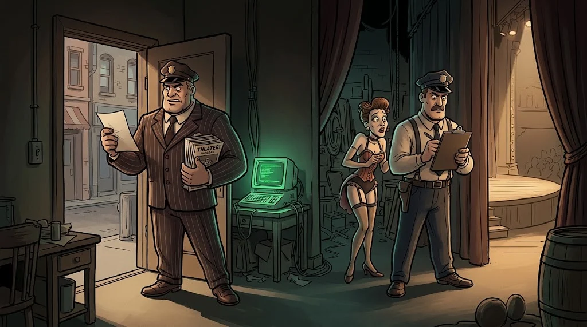

# Tarayıcı tarafı: XSS, CSRF, CORS ve CSP

> Bazen saldırı sunucuda değil, **kurbanın tarayıcısında** çalışır — onun oturumuyla, onun adına.
> 🗂️ **Çekmece 6:** Portalın duyuru panosuna biri tuhaf bir not bırakmış.

::cizgi[a-06-sahne]

## XSS: sayfaya sızan script

Kullanıcı girdisi sayfaya **kaçışlanmadan** basılırsa tarayıcı onu kod olarak çalıştırır.

| Tür | Girdi nerede duruyor? |
|---|---|
| **Yansıyan** | Bağlantının içinde; kurban tıklayınca çalışır |
| **Kalıcı** | Veritabanında (yorum, duyuru); sayfayı açan herkeste çalışır |
| **DOM tabanlı** | Tarayıcıdaki JavaScript girdiyi sayfaya kendisi yazar |

::animasyon[xss]

## CSRF: senin adına istek

Başka bir site, tarayıcının **otomatik eklediği çerezlerle** senin adına istek tetikler
("şifreni değiştir", "parayı gönder"). Savunma: `SameSite` çerezler ve istek başına **CSRF token**.

## CORS ve CSP: iki ayrı soru

| | Sorduğu soru | Tipik hata |
|---|---|---|
| **CORS** | Başka bir site bu yanıtı **okuyabilir mi?** | Her kaynağa izin + çerezlere izin |
| **CSP** | Bu sayfada **hangi script'ler** çalışabilir? | `unsafe-inline` ile XSS koruması boşa gider |

CORS bir saldırıyı engellemez; yanlış ayarlanırsa **kapıyı açar**. CSP ise XSS'e karşı ikinci kilit.

## Savunma özeti

Çıktıda bağlama göre kaçışlama (framework'ün varsayılanı), `HttpOnly` çerez, katı CSP,
SameSite + CSRF token, CORS'ta yalnızca bilinen kaynaklar.

## 🧪 Dene (5 dk)

Yerel Juice Shop'ta arama kutusuna `<b>deneme</b>` yaz. Sonuç başlığı kalın mı göründü,
yoksa etiketler olduğu gibi mi yazıldı? Kalın göründüyse bu ne anlama gelir?

## ✅ Akılda kalsın

- XSS: girdi kaçışlanmadan sayfaya basılıyor.
- CSRF: tarayıcı çerezleri otomatik ekler; token ve SameSite bunu keser.
- CORS "kim okuyabilir?", CSP "ne çalışabilir?" sorusudur.
