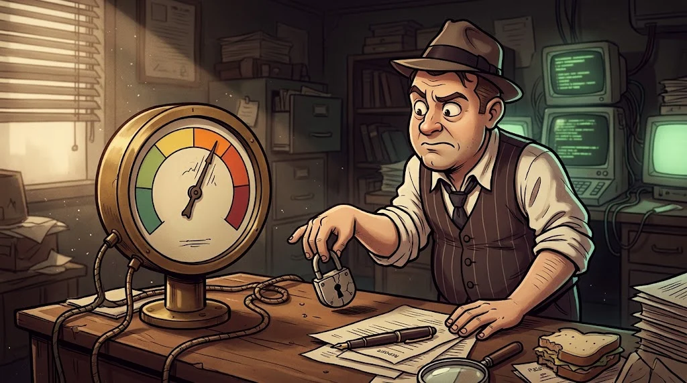

# Final: from scope to a professional report

> Finding a vulnerability is half the job. The other half is writing it so that **the person who will fix it** understands it.
> 🗂️ **The last drawer:** The lab copy of the Campus Portal is yours. Finish before Jasmine.

::cizgi[a-12-sahne]

## Mission

On the target your instructor gives you (the Ördek Lab portal copy or a local Juice Shop), **following the scope document**:

1. **Reconnaissance** → asset inventory table (A02)
2. **Testing** → at least **4 different types** of finding (A03–A10)
3. **Rating** → a CVSS score for each finding
4. **Report** → with the structure below, at most 8 pages

## Report structure

| Section | Content |
|---|---|
| **Executive summary** | Half a page for a non-technical reader: the 3 biggest risks and what should be done |
| **Scope and method** | Target, dates, permission, tools used, what was left out of scope |
| **Findings** | Each one: title, CVSS, affected location, reproduction steps, evidence, impact, recommendation |
| **Appendix** | Sample raw requests/responses (with secret values masked) |

## CVSS in brief

It scores a flaw's severity from 0 to 10. The basic questions:
**From where** can it be attacked (network/local)? **How hard** is it? Does it need **privileges**? Does **a user** have to do something?
How much are **confidentiality, integrity and availability** affected? Get the score with a calculator, and write the vector into the report too.

## Assessment

| Criterion | Score |
|---|---:|
| Scope respected, no requests outside the lab | 2 |
| Findings are reproducible and evidenced | 3 |
| CVSS and impact are justified | 2 |
| Recommendations are actionable (at code level) | 2 |
| The executive summary is clear to a non-technical reader | 1 |

## ✅ Remember

- The report should be clear enough for the reader to fix the problem.
- Every finding: evidence + impact + recommendation.
- A single step outside scope invalidates the whole report.

> 🔒 **FILE CLOSED: Single-Quote Jasmine** · *when you hand in your report*
>
> ::cizgi[jasmine-kapanis]
>
> ➡️ *Season 2 is still running: other files of the Shadow Network are waiting for you on the other specialisation paths.*
