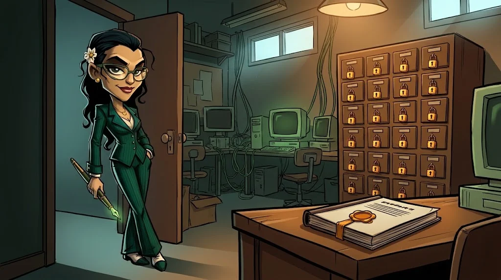
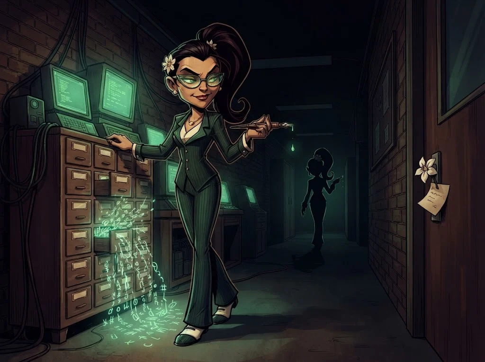

# Final: kapsamdan profesyonel rapora

> Bulgu bulmak işin yarısı. Diğer yarısı, onu **düzeltecek kişinin anlayacağı** biçimde yazmak.
> 🗂️ **Son çekmece:** Kampüs Portalı'nın laboratuvar kopyası senin. Jasmine'den önce bitir.

## Görev

Eğitmenin verdiği hedefte (Ördek Lab portal kopyası ya da yerel Juice Shop) **kapsam belgesine uyarak**:

1. **Keşif** → varlık envanteri tablosu (A02)
2. **Test** → en az **4 farklı türde** bulgu (A03–A10)
3. **Derecelendirme** → her bulgu için CVSS puanı
4. **Rapor** → aşağıdaki yapıyla, en fazla 8 sayfa

## Rapor yapısı

| Bölüm | İçerik |
|---|---|
| **Yönetici özeti** | Teknik olmayan biri için yarım sayfa: en büyük 3 risk ve ne yapılmalı |
| **Kapsam ve yöntem** | Hedef, tarih, izin, kullanılan araçlar, kapsam dışı bırakılanlar |
| **Bulgular** | Her biri: başlık, CVSS, etkilenen yer, tekrar etme adımları, kanıt, etki, öneri |
| **Ek** | Ham istek/yanıt örnekleri (gizli değerler maskeli) |

## CVSS'i kısaca

Bir açığın ciddiyetini 0–10 arası puanlar. Temel sorular:
**Nereden** saldırılır (ağ/yerel)? **Ne kadar zor**? **Yetki** gerekir mi? **Kullanıcı** bir şey yapmalı mı?
**Gizlilik, bütünlük, erişilebilirlik** ne kadar etkilenir? Puanı hesaplayıcıyla bul, vektörü de rapora yaz.

## Değerlendirme

| Ölçüt | Puan |
|---|---:|
| Kapsama uyuldu, laboratuvar dışına istek yok | 2 |
| Bulgular tekrarlanabilir, kanıtlı | 3 |
| CVSS ve etki gerekçeli | 2 |
| Öneriler uygulanabilir (kod düzeyinde) | 2 |
| Yönetici özeti teknik olmayan biri için anlaşılır | 1 |

## ✅ Akılda kalsın

- Rapor, okuyanın düzeltebileceği kadar açık olmalı.
- Her bulgu: kanıt + etki + öneri.
- Kapsam dışına tek adım atmak bütün raporu geçersiz kılar.

> 🔒 **DOSYA KAPANDI: Tek Tırnak Jasmine** · *raporunu teslim edince*
>
> 
>
> Son çekmece kilitlendi; raporun okulun güvenlik ekibinin masasında. Laboratuvarın kapı kolunda bir yasemin çiçeği ve
> katlanmış bir not var: "Kapüşonlular hep üç kişi miydi sanıyorsun, Tilki? Selim'e dördüncüyü sor."
>
> ➡️ *Sezon 2 sürüyor: diğer uzmanlık yollarında Gölge Ağ'ın başka dosyaları seni bekliyor.*
