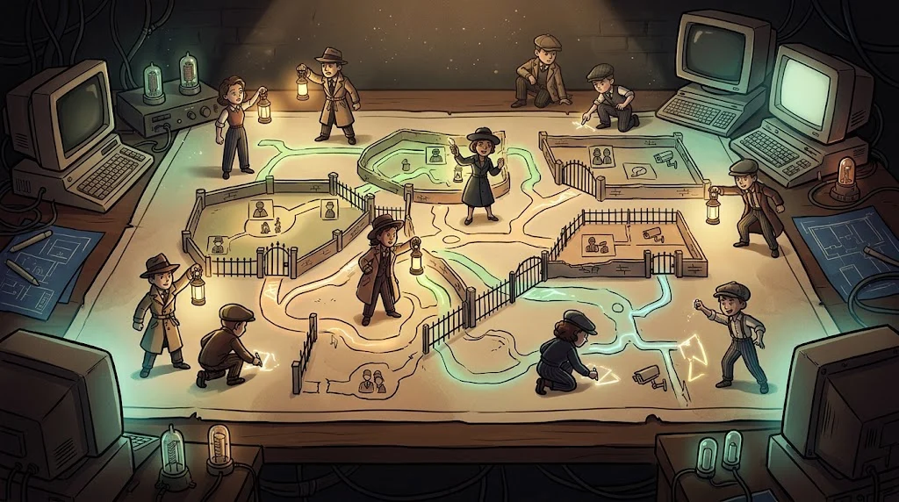

# Path B — Network and System Security

> Understand a campus network end to end: traffic, scanning, Wi-Fi, firewall, Windows and Linux servers.

::cizgi[b-00-sahne]

> 🕴️ **FILE: Tunneller Tarık** · *Ghost of the Network*
>
> 
>
> **Who is he?** He served time in the same wing as Rıza and Kadir. He works for the Baron but owes him nothing — he holds a grudge.
> [Shadow Network story →](../../00-program/09-golge-ag.md)

::cizgi[tarik-acilis]

**Prerequisite:** Network fundamentals (M05), Linux (M04), Windows (M03)

## 12 lessons

| # | Lesson | In one sentence |
|---|---|---|
| B01 | [Advanced network fundamentals](01-ileri-ag-temelleri.md) | VLAN, routing, segmentation |
| B02 | [Traffic analysis](02-trafik-inceleme.md) | Read packets with Wireshark and tcpdump |
| B03 | [Discovery with Nmap](03-nmap-kesif.md) | Host, port and service discovery |
| B04 | [Advanced scanning concepts](04-ileri-tarama.md) | Scan types, speed, false positives |
| B05 | [Local network threats](05-yerel-ag-tehditleri.md) | ARP/DNS/DHCP spoofing and their defences |
| B06 | [Wireless networks](06-kablosuz-aglar.md) | WPA2/WPA3, Evil Twin, a safe guest network |
| B07 | [Firewall and network defence](07-firewall-ids-vpn.md) | Rules, IDS/IPS, VPN |
| B08 | [Windows Server and AD](08-active-directory.md) | Domain, Kerberos, Group Policy |
| B09 | [Linux server security](09-linux-sunucu.md) | SSH, sudo, SUID, hardening |
| B10 | [Windows system security](10-windows-sistem.md) | Services, registry, UAC, hardening |
| B11 | [Controlled penetration testing tools](11-metasploit-mimarisi.md) | Metasploit architecture — isolated lab only |
| B12 | [Final](12-final-ag-degerlendirmesi.md) | Inventory → misconfiguration → segmentation proposal |

## Capstone output

A **security assessment of a fictional campus network**.

## Important

Scanning and testing are done **only** against targets in the club lab. Scanning the campus network, the dorm Wi-Fi
or any other network is outside the scope of this path.
