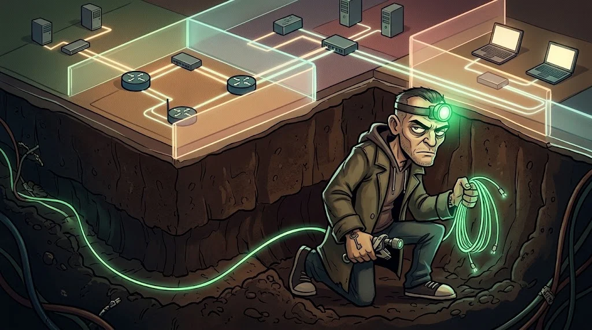

# Yol B — Ağ ve Sistem Güvenliği

> Bir kampüs ağını uçtan uca anla: trafik, tarama, Wi-Fi, güvenlik duvarı, Windows ve Linux sunucular.

> 🕴️ **DOSYA: Tünelci Tarık** · *Ağın Hayaleti*
>
> 
>
> 📼 **Bölüm — Sezon 2: Tüneller.** Selim Hoca sonunda anlatıyor: "Dördüncü Kapüşonlu Tarık'tı. Ağı o kurardı.
> O gece Eren'in açtığı kapının suçu ona kaldı; on yıl yattı." Şimdi kampüs ağında bir hayalet dolaşıyor: bölgeler
> arasında tünel kazıyor, güvenlik duvarının arkasında beliriyor. Kampüs ağının laboratuvar kopyası senin;
> Tarık'tan önce her tüneli bul ve kapat.
>
> **Kim o?** Rıza ve Kadir'le aynı koğuşta yattı. Baron'a çalışıyor ama ona borçlu değil — kin besliyor.
> [Gölge Ağ hikâyesi →](../../00-program/09-golge-ag.md)

**Ön koşul:** Ağ temelleri (M05), Linux (M04), Windows (M03)

## 12 ders

| # | Ders | Tek cümleyle |
|---|---|---|
| B01 | [İleri ağ temelleri](01-ileri-ag-temelleri.md) | VLAN, routing, segmentasyon |
| B02 | [Trafik inceleme](02-trafik-inceleme.md) | Wireshark ve tcpdump ile paketleri oku |
| B03 | [Nmap ile keşif](03-nmap-kesif.md) | Host, port ve servis keşfi |
| B04 | [İleri tarama kavramları](04-ileri-tarama.md) | Tarama türleri, hız, yanlış pozitifler |
| B05 | [Yerel ağ tehditleri](05-yerel-ag-tehditleri.md) | ARP/DNS/DHCP spoofing ve savunmaları |
| B06 | [Kablosuz ağlar](06-kablosuz-aglar.md) | WPA2/WPA3, Evil Twin, güvenli misafir ağı |
| B07 | [Firewall ve ağ savunması](07-firewall-ids-vpn.md) | Kurallar, IDS/IPS, VPN |
| B08 | [Windows Server ve AD](08-active-directory.md) | Domain, Kerberos, Group Policy |
| B09 | [Linux sunucu güvenliği](09-linux-sunucu.md) | SSH, sudo, SUID, sertleştirme |
| B10 | [Windows sistem güvenliği](10-windows-sistem.md) | Servisler, registry, UAC, sertleştirme |
| B11 | [Kontrollü sızma testi araçları](11-metasploit-mimarisi.md) | Metasploit mimarisi — yalnız izole laboratuvarda |
| B12 | [Final](12-final-ag-degerlendirmesi.md) | Envanter → yanlış yapılandırma → segmentasyon önerisi |

## Bitirme çıktısı

Kurgusal bir **kampüs ağının güvenlik değerlendirmesi**.

## Önemli

Tarama ve test **yalnızca** kulüp laboratuvarındaki hedeflere yapılır. Kampüs ağını, yurt Wi-Fi'sini
veya başka herhangi bir ağı taramak bu yolun kapsamı dışındadır.
