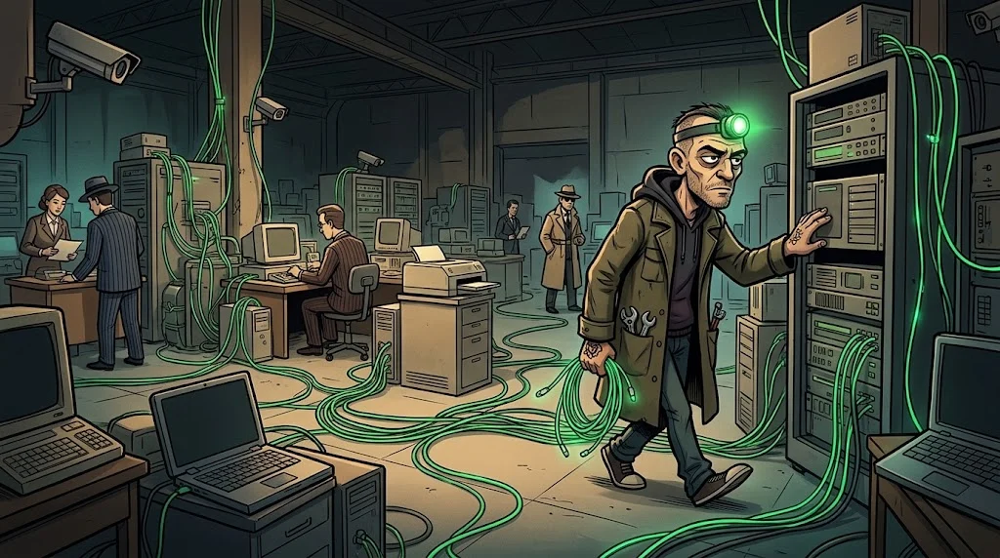

# İleri ağ temelleri: VLAN, yönlendirme, segmentasyon

> Düz bir ağ, kapısız bir evdir: ön kapıdan giren her odaya girer.
> 🕳️ **Tünel 1:** Laboratuvardaki kampüs ağı kopyasında öğrenci Wi-Fi'si, kameralar ve not sunucusu aynı ağda. Tarık'ın en sevdiği manzara.



## VLAN: tek kabloda ayrı ağlar

Bir switch'i mantıksal olarak bölersin: VLAN 10 öğrenciler, VLAN 20 personel, VLAN 30 sunucular.
Aynı fiziksel cihazdalar ama birbirlerini **doğrudan** göremezler.

- **Access port:** tek VLAN'a ait (bir bilgisayar).
- **Trunk port:** birden çok VLAN'ı etiketli (802.1Q) taşır (switch–switch, switch–router).

## Yönlendirme: bölgeler arası kapı

VLAN'lar arası trafik bir **router ya da L3 switch** üzerinden geçer. İşte burada kural koyabilirsin:
"Öğrenciler not sunucusunun yalnızca web portuna erişebilir, veritabanına asla."

::animasyon[network-topology]

## Segmentasyon tasarımı

| Bölge | İçinde | Kime açık? |
|---|---|---|
| **Misafir / öğrenci** | Telefonlar, laptoplar | Yalnızca internet ve portal |
| **Personel** | Ofis bilgisayarları | İç uygulamalar |
| **Sunucu** | Portal, veritabanı | Yalnızca gereken portlar |
| **Yönetim** | Switch/firewall arayüzleri | Yalnızca yöneticiler |
| **IoT** | Kamera, yazıcı, akıllı kilit | Hiçbir yere (yalnızca kendi sunucusu) |

## Tipik hatalar

Her şeyin tek VLAN'da olması, yönetim arayüzlerinin öğrenci ağından erişilebilmesi,
"geçici" açılıp unutulan **any-any** kuralı, kullanılmayan switch portlarının açık bırakılması.

## 🧪 Dene (5 dk)

Kendi bilgisayarında ağ bilgini incele:

```bash
ip route        # Linux / macOS: netstat -rn
ipconfig        # Windows
```

Varsayılan ağ geçidin hangisi? Ağ maskene göre aynı ağda kaç cihaz olabilir? Bu bir okul ağı olsaydı nasıl bölerdin?

## ✅ Akılda kalsın

- VLAN ağı mantıksal olarak böler; bölgeler arası trafik bir kapıdan geçer.
- Segmentasyonun amacı: bir cihaz düşerse yangın tek odada kalsın.
- Yönetim ve IoT cihazları kendi bölgelerinde, dışarıya kapalı durur.
