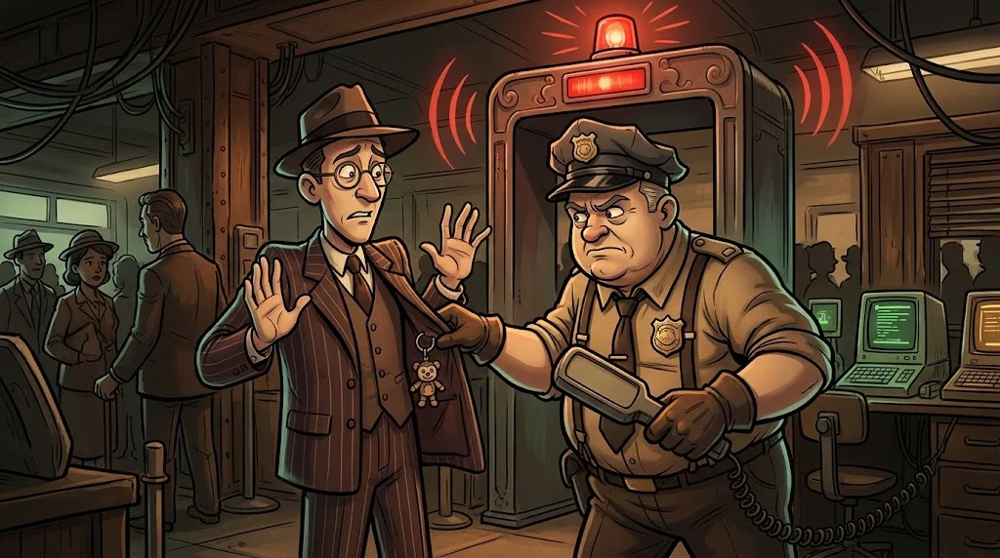

# Advanced scanning: types, speed and false positives

> A fast scan is noisy; a slow scan needs patience. And not everything the scanner says is **true**.
> 🕳️ **Tunnel 4:** The lab IDS caught a brief scan last night. But is Tarık really that much of an amateur?

::cizgi[b-04-sahne]

## Scan types

| Type | Command | How does it work? | Note |
|---|---|---|---|
| **SYN** | `-sS` | Sends SYN; if SYN/ACK comes back, it doesn't complete the connection | Default (with root) |
| **Connect** | `-sT` | Establishes a full TCP connection | For unprivileged users; more visible in logs |
| **UDP** | `-sU` | Sends a UDP packet and interprets the reply | Slow, but finds services such as DNS and SNMP |
| **All ports** | `-p-` | All 65535 ports | Finds what's hidden on non-standard ports |

## Speed and trail

- `-T4` is fast, `-T2` is slow and quiet. A fast scan strains the network and trips the IDS.
- In the lab, watching **which scans the IDS sees** is the best way to understand defence.

## False positives

A scanner makes a **guess**; it isn't a finding.

- The version is the advertisement the service makes about itself; a patched system may still show an old version number.
- `filtered` doesn't always mean "closed".
- If a vulnerability scanner says "possible", verify it by hand: look at the configuration, the package version, the patch notes.

**Unverified** findings don't go into the report.

## 🧪 Try it (6 min)

In the lab, scan the same server with `-sS` and `-sT`. In the server's logs (`/var/log/auth.log`, the web log) or in the IDS,
what difference do you see between the two scans? Then try `-sU --top-ports 20`: which UDP services showed up?

## ✅ Remember

- A SYN scan is a half handshake; a connect scan is a full connection.
- Speed leaves a trail; watch what the IDS sees in the lab.
- The scanner guesses, the analyst verifies.
