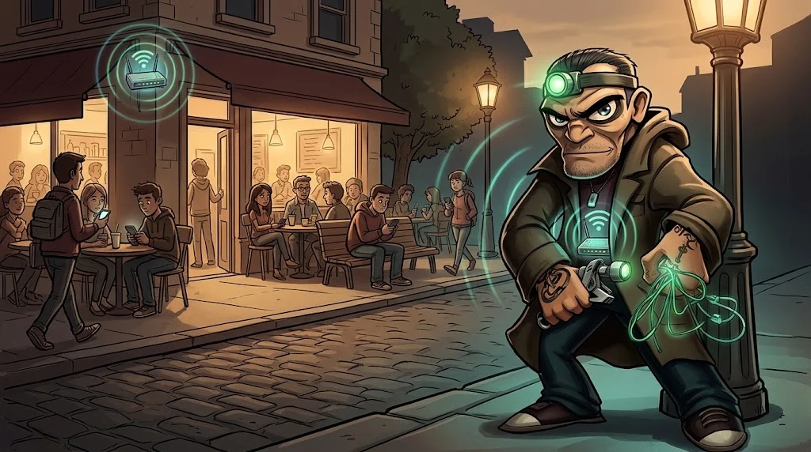

# Kablosuz ağlar: WPA2, WPA3 ve sahte erişim noktası

> Telefonun, adı tanıdık gelen her Wi-Fi'a **kendiliğinden** bağlanmaya hazırdır. Aynı adı yayınlayan sahtesine de.
> 🕳️ **Tünel 6:** Laboratuvarda "Kampus-Misafir" adında iki ağ görünüyor. Biri senin, biri Tarık'ın.

## Güvenlik seviyeleri

| Mod | Kimlik doğrulama | Zayıf nokta |
|---|---|---|
| **Açık ağ** | Yok | Trafik havada şifresiz (OWE/Enhanced Open yoksa) |
| **WPA2-Personal** | Herkes aynı parola | Yakalanan el sıkışmaya karşı çevrimdışı parola tahmini |
| **WPA3-Personal** | Aynı parola, SAE ile | Çevrimdışı tahmine dayanıklı |
| **WPA2/3-Enterprise** | Her kullanıcı kendi hesabıyla (802.1X) | Sunucu sertifikası doğrulanmazsa kimlik bilgisi çalınabilir |

## Sahte erişim noktası (Evil Twin)

Saldırgan aynı ağ adını (SSID) daha güçlü sinyalle yayınlar. Cihaz ona bağlanır;
ardından sahte bir "giriş sayfası" parola ister ya da trafik saldırgandan geçer.

## Savunma

- Kurumsal ağda **WPA2/3-Enterprise** ve cihazlarda **sunucu sertifikası doğrulaması** zorunlu.
- Kişisel ağlarda **WPA3**, uzun ve tahmin edilemez parola; WPS kapalı.
- Misafir ağı ayrı VLAN'da, **istemci izolasyonuyla**, iç ağa yolu yok.
- Kablosuz IDS sahte erişim noktalarını ve kopya SSID'leri raporlar.
- Kullanıcı: tanımadığın ağda hassas işlem yok; telefonunda **otomatik bağlanmayı** kapat.

## Kural

Kablosuz testler yalnızca laboratuvardaki **kendi** erişim noktana yapılır.
Başkasının ağına bağlanmak, paketlerini yakalamak ya da parolasını denemek suçtur.

## 🧪 Dene (4 dk)

Telefonunun kayıtlı Wi-Fi listesine bak. Kaç ağ var? Hangilerine **otomatik** bağlanıyor?
Bir saldırgan bu adlardan birini kopyalasa telefonun ne yapardı? Gereksizleri sil.

## ✅ Akılda kalsın

- WPA3 ve Enterprise modu paylaşılan parolanın zayıflığını kapatır.
- Evil Twin, adı tanıdık gelen ağa otomatik bağlanma alışkanlığını kullanır.
- Misafir ağı ayrı ve izole olmalı.
