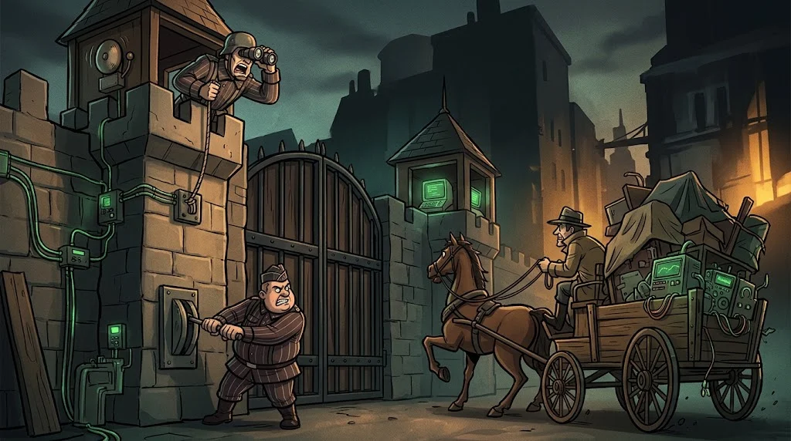

# Network defence: firewall rules, IDS/IPS and VPN

> However high the wall, what matters is **who writes the rules** and **who watches**.
> 🕳️ **Tunnel 7:** In the lab firewall, a rule opened "temporarily" a year ago is still there. Tarık found it.

::cizgi[b-07-sahne]

## How do you read a firewall rule?

Rules are processed **top to bottom**; the first match wins. At the end: **default deny**.

| # | Source | Destination | Port | Action |
|---|---|---|---|---|
| 1 | Student VLAN | Portal server | 443 | ✅ Allow |
| 2 | Management VLAN | All servers | 22 | ✅ Allow |
| 3 | Any | Any | Any | ⛔ **Deny + log** |

Dangerous rules: `any → any`, rules opened "temporarily" with no expiry date, rules with no description,
unlimited outbound traffic from a server (stolen data and the command channel leave that way).

::animasyon[firewall-decision]

## IDS and IPS

| | IDS | IPS |
|---|---|---|
| What does it do? | Sees and **raises an alert** | Sees and **blocks** |
| Risk | Alert fatigue | A false positive cuts off legitimate traffic |
| Example | Suricata, Zeek (monitoring) | Suricata (inline mode) |

## VPN

An **encrypted tunnel** over an untrusted network: it connects a remote user safely to the internal network.
But where inside the internal network can a user who enters the VPN go? The VPN is subject to **segmentation** too. A VPN without MFA is an attacker's favourite door.

::animasyon[vpn-tunnel]

## 🧪 Try it (5 min)

You've been asked to add two rules to the table above: "the camera VLAN may reach the internet" and
"students may connect to the database (3306)". Which would you narrow and how, and which would you deny? Write a short justification.

## ✅ Remember

- Rules are read top to bottom; at the end, default deny.
- Egress rules matter just as much as ingress rules.
- A VPN opens a tunnel, but the far end of the tunnel must be limited by segmentation too.
