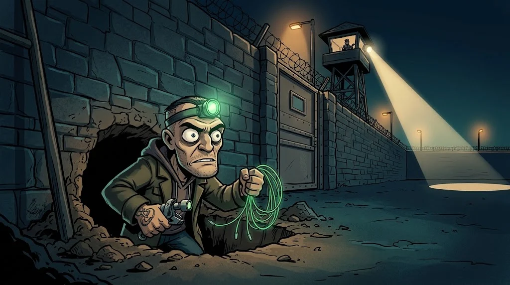

# Ağ savunması: firewall kuralları, IDS/IPS ve VPN

> Duvar ne kadar yüksek olursa olsun, **kuralları kimin yazdığı** ve **kimin izlediği** belirler.
> 🕳️ **Tünel 7:** Laboratuvar firewall'unda bir yıl önce "geçici" açılmış bir kural duruyor. Tarık onu buldu.

## Firewall kuralı nasıl okunur?

Kurallar **yukarıdan aşağı** işlenir; ilk eşleşen kazanır. En sonda: **varsayılan reddet**.

| # | Kaynak | Hedef | Port | Eylem |
|---|---|---|---|---|
| 1 | Öğrenci VLAN | Portal sunucusu | 443 | ✅ İzin |
| 2 | Yönetim VLAN | Tüm sunucular | 22 | ✅ İzin |
| 3 | Herhangi | Herhangi | Herhangi | ⛔ **Reddet + logla** |

Tehlikeli kurallar: `any → any`, "geçici" açılıp tarihi olmayan kurallar, açıklaması olmayan kurallar,
sunucudan **dışarıya** sınırsız çıkış (çalınan veri ve komut kanalı buradan çıkar).

::animasyon[firewall-decision]

## IDS ve IPS

| | IDS | IPS |
|---|---|---|
| Ne yapar? | Görür ve **alarm** üretir | Görür ve **engeller** |
| Risk | Alarm yorgunluğu | Yanlış pozitif meşru trafiği keser |
| Örnek | Suricata, Zeek (izleme) | Suricata (satır içi mod) |

## VPN

Güvensiz bir ağ üzerinden **şifreli tünel**: uzaktaki kullanıcıyı iç ağa güvenle bağlar.
Ama VPN'e giren kullanıcı iç ağın neresine gidebilir? VPN de **segmentasyona** tabidir. MFA'sız VPN, saldırganın en sevdiği kapıdır.

::animasyon[vpn-tunnel]

## 🧪 Dene (5 dk)

Yukarıdaki tabloya iki kural eklemen istendi: "kamera VLAN'ı internete çıkabilsin" ve
"öğrenciler veritabanına bağlanabilsin (3306)". Hangisini nasıl daraltırsın, hangisini reddedersin? Kısa gerekçe yaz.

## ✅ Akılda kalsın

- Kurallar yukarıdan aşağı okunur; en sonda varsayılan reddet.
- Çıkış (egress) kuralları da en az giriş kuralları kadar önemlidir.
- VPN tünel açar, ama tünelin ucu da segmentasyonla sınırlanmalıdır.
