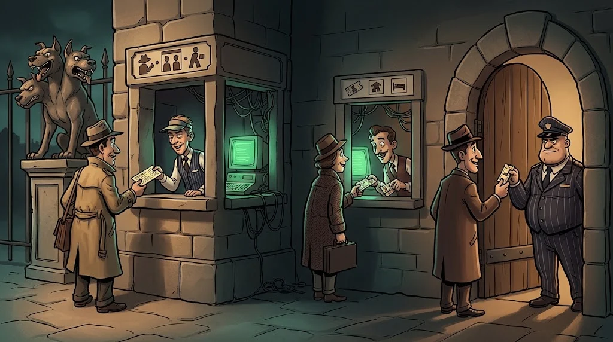

# Windows Server and Active Directory: the keys to the kingdom

> Who is who in an organisation, and who can access what — it's all written in **Active Directory**. Whoever takes it over takes over everything.
> 🕳️ **Tunnel 8:** In the lab domain, 14 accounts are in the "Domain Admins" group. One of them is a service account.

::cizgi[b-08-sahne]

## Core concepts

| Concept | What does it mean? |
|---|---|
| **Domain** | A centrally managed community of users and computers (`kampus.test`) |
| **Domain Controller (DC)** | The server that verifies identities; the heart of the kingdom |
| **OU** | Folders that organise users and computers |
| **Group Policy (GPO)** | Sends settings to thousands of computers from one place |
| **Kerberos** | Authentication with a **ticket** instead of sending the password over the network |

## Kerberos in brief



When a user signs in, they get a **ticket-granting ticket** (TGT) from the DC. When they want to reach a service,
they present the TGT and receive a ticket specific to that service. The password never travels the network — but tickets and service accounts are **valuable targets**.

## Typical misconfigurations

- **Too many administrators:** more people and service accounts than necessary in the Domain Admins group.
- **Weak service account passwords:** service tickets are open to offline cracking.
- **Legacy authentication:** NTLMv1, SMB signing turned off.
- **The same local administrator password everywhere:** if one machine falls, they all fall.
- **Plaintext passwords** in shares and scripts.

## Defence

Tiered administration (administrators don't use an admin account for everyday work), managed service accounts (gMSA),
a different local administrator password per machine with LAPS, restricting NTLM, SMB signing, monitoring DC event logs.

## 🧪 Try it (5 min)

On a machine joined to the lab domain (in the lab only):

```powershell
net group "Domain Admins" /domain
gpresult /r
```

How many administrators are there? Which GPOs are applied? Why shouldn't an administrator account be used for everyday work?

## ✅ Remember

- AD is the organisation's identity map; the DC is the heart of the kingdom.
- Kerberos moves tickets, not passwords; service accounts need strong passwords.
- Few administrators, different local passwords, monitored DC logs.
