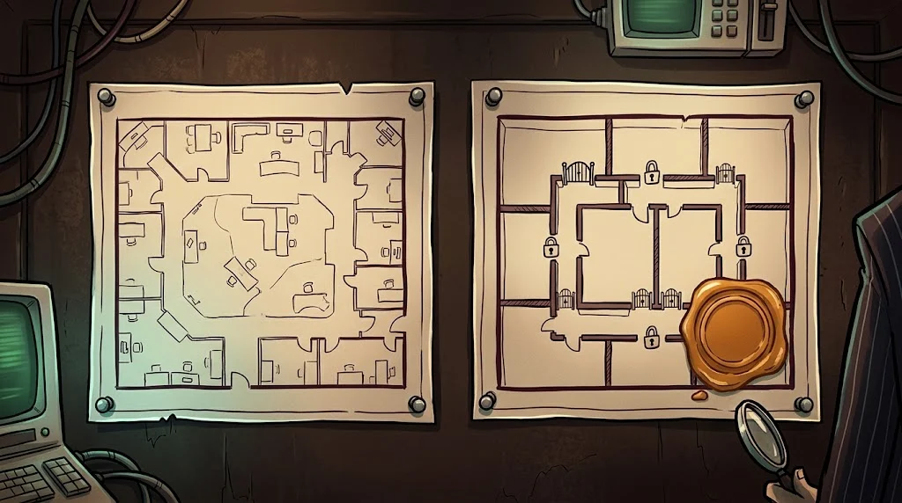

# Final: campus network security assessment

> Assessing a network isn't about finding a single flaw; it's about **drawing the map, showing the weak points and redesigning it**.
> 🕳️ **The last tunnel:** The copy of the campus network in the lab is yours. Close every tunnel Tarık dug.

::cizgi[b-12-sahne]

## Mission

In the isolated lab network provided by your instructor (`10.66.0.0/16`), **with written scope**:

1. **Inventory** — hosts, services, roles (B02–B04)
2. **Misconfigurations** — at least 6 findings; at least four of them from the network, Wi-Fi, firewall, Linux, and Windows/AD areas (B05–B10)
3. **Verification** — every finding evidenced; not a scanner guess
4. **Redesign** — a segmentation diagram and a proposed firewall rule table
5. **Report** — executive summary + technical findings + a 30/60/90-day improvement plan

## Report skeleton

| Section | Content |
|---|---|
| **Executive summary** | The 3 biggest risks, business impact, what to do first |
| **Network map** | Current state ↔ proposed zones (diagram) |
| **Findings** | Title, risk, affected hosts, evidence, recommendation |
| **Rule proposal** | Source → destination → port → action table, default deny at the end |
| **Improvement plan** | 30 days: quick wins · 60 days: configuration · 90 days: architecture |

## Assessment

| Criterion | Points |
|---|---:|
| Scope respected, no traffic outside the lab | 2 |
| Inventory complete and legible | 2 |
| Findings verified and prioritised | 3 |
| Segmentation and rule proposal workable | 2 |
| Improvement plan realistic | 1 |

## ✅ Remember

- An assessment starts with a map and ends with a redesign.
- Every finding is evidenced and prioritised.
- The best recommendation is the design that keeps the fire in one room when a device falls.

> 🔒 **CASE CLOSED: Tunneller Tarık** · *when you submit your report*
>
> ::cizgi[tarik-kapanis]
>
> ➡️ *Season 2 is under way: other case files from the Shadow Network are waiting for you on the other specialisation paths.*
