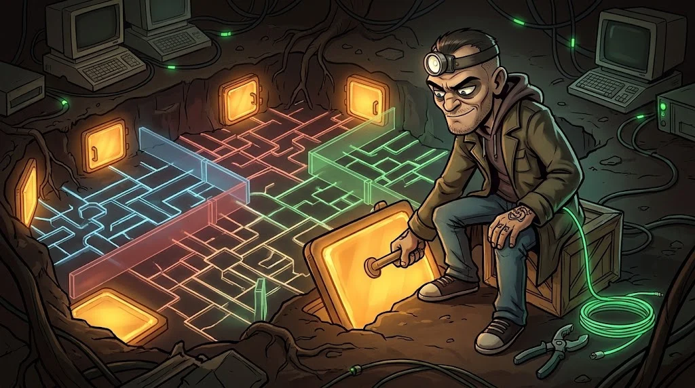
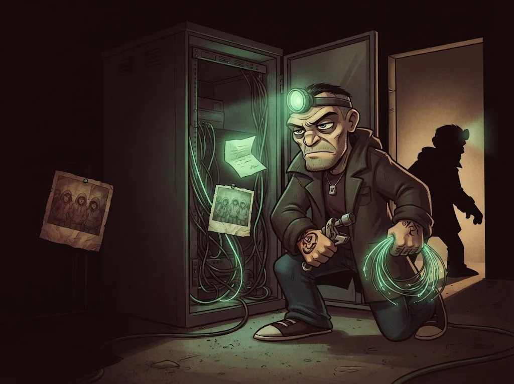

# Final: kampüs ağı güvenlik değerlendirmesi

> Bir ağı değerlendirmek tek bir açığı bulmak değil; **haritayı çizmek, zayıf noktaları göstermek ve yeniden tasarlamaktır**.
> 🕳️ **Son tünel:** Laboratuvardaki kampüs ağı kopyası senin. Tarık'ın kazdığı her tüneli kapat.

## Görev

Eğitmenin verdiği izole laboratuvar ağında (`10.66.0.0/16`), **yazılı kapsamla**:

1. **Envanter** — hostlar, servisler, işlevler (B02–B04)
2. **Yanlış yapılandırmalar** — en az 6 bulgu; ağ, Wi-Fi, firewall, Linux, Windows/AD alanlarından en az dördü (B05–B10)
3. **Doğrulama** — her bulgu kanıtlı; tarayıcı tahmini değil
4. **Yeniden tasarım** — segmentasyon şeması ve firewall kural tablosu önerisi
5. **Rapor** — yönetici özeti + teknik bulgular + 30/60/90 günlük iyileştirme planı

## Rapor iskeleti

| Bölüm | İçerik |
|---|---|
| **Yönetici özeti** | En büyük 3 risk, iş etkisi, ilk yapılacaklar |
| **Ağ haritası** | Şimdiki durum ↔ önerilen bölgeler (çizim) |
| **Bulgular** | Başlık, risk, etkilenen hostlar, kanıt, öneri |
| **Kural önerisi** | Kaynak → hedef → port → eylem tablosu, en sonda varsayılan reddet |
| **İyileştirme planı** | 30 gün: hızlı kazançlar · 60 gün: yapılandırma · 90 gün: mimari |

## Değerlendirme

| Ölçüt | Puan |
|---|---:|
| Kapsama uyuldu, laboratuvar dışına trafik yok | 2 |
| Envanter eksiksiz ve okunaklı | 2 |
| Bulgular doğrulanmış ve önceliklendirilmiş | 3 |
| Segmentasyon ve kural önerisi uygulanabilir | 2 |
| İyileştirme planı gerçekçi | 1 |

## ✅ Akılda kalsın

- Değerlendirme haritayla başlar, yeniden tasarımla biter.
- Her bulgu kanıtlı ve önceliklidir.
- En iyi öneri, bir cihaz düştüğünde yangını tek odada tutan tasarımdır.

> 🔒 **DOSYA KAPANDI: Tünelci Tarık** · *raporunu teslim edince*
>
> 
>
> Son tünel kapandı; ağ bölgelerine ayrıldı, sunucular sertleştirildi. Sunucu dolabının içinde fenerinin yeşil ışığıyla
> yazılmış bir not buluyorsun: "Eren beni o gece yaktı. Ona çalışıyorum, ama onun adamı değilim. Bir gün aynı tarafta olacağız, Tilki."
>
> ➡️ *Sezon 2 sürüyor: diğer uzmanlık yollarında Gölge Ağ'ın başka dosyaları seni bekliyor.*
