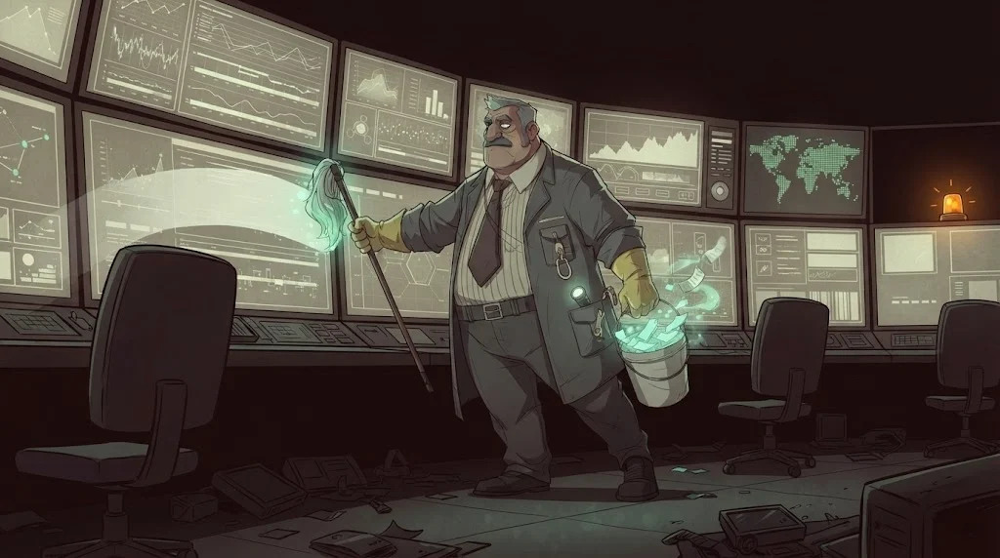

# Yol C — SOC, Olay Müdahalesi ve Dijital Adli Bilişim

> Alarm çaldı. Gerçek mi? Ne oldu, ne zaman, nasıl durdururuz? **Blue Team** ve **DFIR**.

> 🕴️ **DOSYA: Temizlikçi Tamer** · *İz Silici*
>
> 
>
> 📼 **Bölüm — Sezon 2: Temizlik.** Tarık'ın notundan bir hafta sonra kampüsün olay kayıtlarında altı saatlik bir boşluk var.
> Saatler kaydırılmış, loglar silinmiş, alarmlar susturulmuş. Bu, ailenin temizlikçisinin işi: Temizlikçi Tamer.
> Görevin SOC masasında; silinen her izi geri getir, olayın zaman çizelgesini kur.
>
> **Kim o?** Ailenin temizlikçisi; her operasyondan sonra izleri o siler. Don'un en eski adamlarından, ama raporunu doğrudan Baron'a verir.
> [Gölge Ağ hikâyesi →](../../00-program/09-golge-ag.md)

**Ön koşul:** İşletim sistemleri (M03), ağ (M05), log okuma (M07)

## 12 ders

| # | Ders | Tek cümleyle |
|---|---|---|
| C01 | [SOC ve savunma operasyonları](01-soc-temelleri.md) | Tier 1–3, alert/event/incident |
| C02 | [SIEM temelleri](02-siem-temelleri.md) | Log toplama, normalizasyon, korelasyon |
| C03 | [Wazuh laboratuvarı](03-wazuh-laboratuvari.md) | Ajan, kural, uyarı analizi |
| C04 | [IDS/IPS](04-ids-ips.md) | Snort, Suricata, basit kural yazımı |
| C05 | [Endpoint güvenliği](05-endpoint-guvenligi.md) | EDR, IOC/IOA, uç nokta triyajı |
| C06 | [Windows adli bilişim](06-windows-adli-bilisim.md) | Event log, Sysmon, registry, prefetch |
| C07 | [Linux adli bilişim](07-linux-adli-bilisim.md) | auth.log, journald, auditd, kalıcılık |
| C08 | [Ağ adli bilişimi](08-ag-adli-bilisimi.md) | PCAP'te DNS anomalisi ve şüpheli bağlantı |
| C09 | [Zararlı yazılım triyajı](09-zararli-yazilim-triyaji.md) | Hash, strings, YARA, sandbox raporu |
| C10 | [Disk ve bellek analizi](10-disk-bellek-analizi.md) | Autopsy, MFT, Volatility 3, kanıt bütünlüğü |
| C11 | [Olay müdahalesi](11-olay-mudahalesi.md) | Hazırlıktan olay sonrası değerlendirmeye, delil zinciri |
| C12 | [Final simülasyonu](12-final-simulasyonu.md) | Alarm → analiz → zaman çizelgesi → olay raporu |

## Bitirme çıktısı

Tamamlanmış bir **olay inceleme dosyası** ve **müdahale raporu**.

Tüm loglar, disk imajları ve PCAP'ler **sentetiktir**; gerçek kişilere ait veri kullanılmaz.
