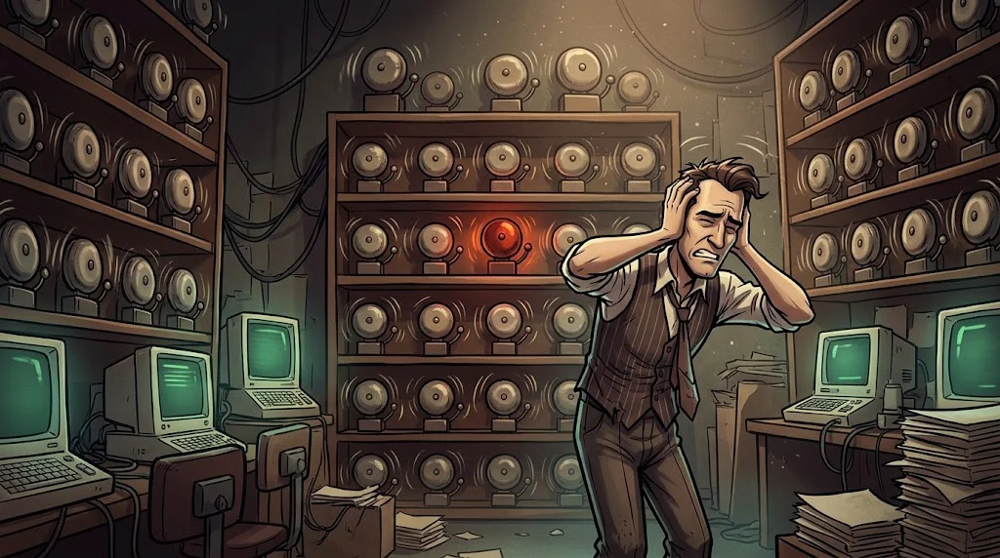

# What is a SOC? The difference between an event, an alert and an incident

> A campus network produces millions of **traces** every day. Which ones matter? The SOC is where that gets decided.
> 🧹 **Trace 1:** At 02:00 in the morning, 23 alerts landed on the SOC screen. Tamer hid the most important one in the crowd.

::cizgi[c-01-sahne]

## Who is the SOC, and what does it do?

The **SOC (Security Operations Center)** is the team that watches an organisation's security 24/7. The Shield team is the campus's SOC.

| Tier | Duty | Example question |
|---|---|---|
| **Tier 1** — triage | Reviews alerts first and sorts them | "Is this real, or a false positive?" |
| **Tier 2** — investigation | Deeper analysis, scope | "Which other devices were affected?" |
| **Tier 3** — hunting and expertise | Threat hunting, digital forensics | "What is there that nobody got an alert for?" |

## Event → alert → incident


- **Event:** everything that gets recorded. "deniz.kaya signed in."
- **Alert:** an event that a rule found suspicious. "12 failed sign-ins in 10 minutes."
- **Incident:** a confirmed situation that requires a response. "The account was taken over."

Not every event is an alert, and not every alert is an incident. Tier 1's job is that sieve.

::animasyon[soc-alert]

## Alert fatigue



Hundreds of low-severity alerts tire the analyst out and make them miss the critical one. This is called **alert fatigue**.
Sometimes the attacker deliberately makes noise: they start a scanning downpour and hide their real move among it.

**Defence:** prioritise (severity + asset value), group similar alerts, tune the noisy rule.

## 🧪 Try it (5 min)

Open the alert queue in the lab VM and count by severity:

```bash
cut -d, -f3 /opt/akademi/c-alarmlar.csv | sort | uniq -c
grep -E "kritik|yüksek" /opt/akademi/c-alarmlar.csv
```

How many alerts are "IDS: Port scan"? Which single device are the critical and high alerts gathered on? Which one would you look at first, and why?

## ✅ Remember

- In a SOC, Tier 1 sorts, Tier 2 investigates, Tier 3 hunts.
- An event is a record, an alert is a suspicion, an incident is a confirmed problem.
- Noise can be an attack technique: prioritise first, then investigate.
