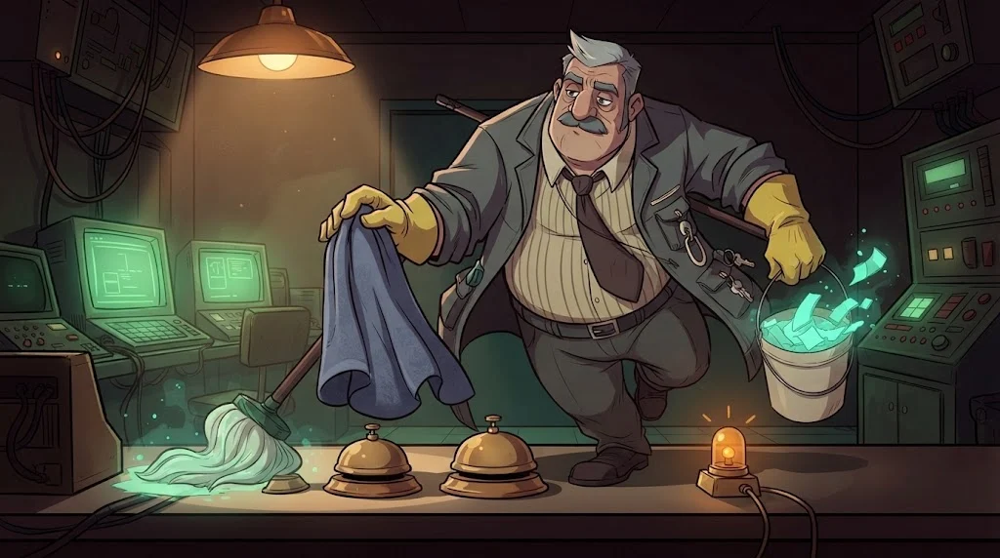

# SOC nedir? Olay, alarm ve vaka arasındaki fark

> Bir kampüs ağı her gün milyonlarca **iz** üretir. Hangisi önemli? Bunu ayıran yer SOC'tur.
> 🧹 **İz 1:** Gece 02:00'de SOC ekranına 23 alarm düştü. Tamer, en önemlisini kalabalığın içine sakladı.



## SOC kimdir, ne yapar?

**SOC (Security Operations Center)**, kurumun güvenliğini 7/24 izleyen ekiptir. Kalkan ekibi kampüsün SOC'udur.

| Kademe | Görev | Örnek soru |
|---|---|---|
| **Tier 1** — triyaj | Alarmları ilk inceler, ayıklar | "Bu gerçek mi, yanlış pozitif mi?" |
| **Tier 2** — inceleme | Derinlemesine analiz, kapsam | "Başka hangi cihazlar etkilendi?" |
| **Tier 3** — av ve uzmanlık | Tehdit avı (threat hunting), adli bilişim | "Kimsenin alarm almadığı ne var?" |

## Olay → alarm → vaka

- **Olay (event):** Kaydedilen her şey. "deniz.kaya oturum açtı."
- **Alarm (alert):** Bir kuralın şüpheli bulduğu olay. "10 dakikada 12 başarısız giriş."
- **Vaka (incident):** Doğrulanmış, müdahale gerektiren durum. "Hesap ele geçirildi."

Her olay alarm değildir, her alarm vaka değildir. Tier 1'in işi bu süzgeçtir.

::animasyon[soc-alert]

## Alarm yorgunluğu

Yüzlerce düşük önemli alarm, analisti yorar ve kritik olanı gözden kaçırtır. Buna **alarm yorgunluğu (alert fatigue)** denir.
Saldırgan bazen bilerek gürültü üretir: tarama yağmuru başlatır, asıl hamlesini arasına gizler.

**Savunma:** önceliklendir (önem + varlık değeri), benzer alarmları grupla, gürültülü kuralı ayarla (tuning).

## 🧪 Dene (5 dk)

Laboratuvar VM'inde alarm kuyruğunu aç ve önem derecesine göre say:

```bash
cut -d, -f3 /opt/akademi/c-alarmlar.csv | sort | uniq -c
grep -E "kritik|yüksek" /opt/akademi/c-alarmlar.csv
```

Kaç alarm "IDS: Port taraması"? Kritik ve yüksek alarmlar hangi tek cihazda toplanıyor? İlk hangisine bakarsın, neden?

## ✅ Akılda kalsın

- SOC'ta Tier 1 ayıklar, Tier 2 inceler, Tier 3 avlanır.
- Olay kayıttır, alarm şüphedir, vaka doğrulanmış sorundur.
- Gürültü bir saldırı tekniği olabilir: önce önceliklendir, sonra incele.
