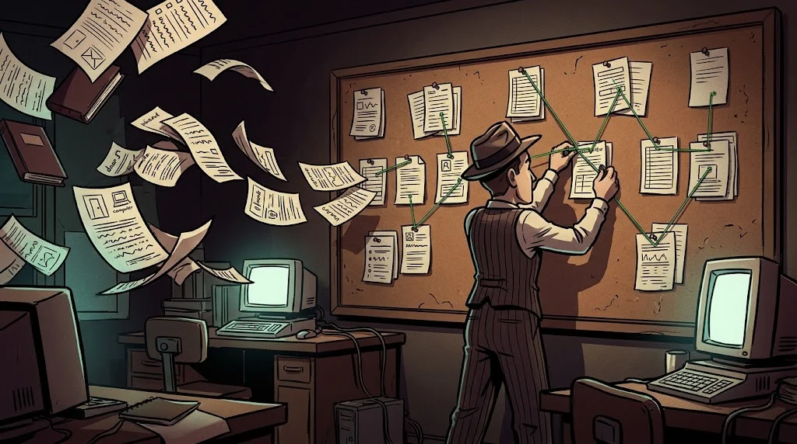

# SIEM: how do we bring scattered logs together on one screen?

> A single log can lie. Logs from ten sources **corroborate** each other.
> 🧹 **Trace 2:** KLP-WS07's own logs were deleted; but copies had already reached the SIEM before the deletion.

::cizgi[c-02-sahne]

## What does a SIEM do?



A **SIEM (Security Information and Event Management)** is a system that collects logs centrally and correlates them.

| Step | What happens? |
|---|---|
| **Collection** | Logs flow to the centre via agents and syslog |
| **Normalisation** | Different formats are converted into shared fields: `kaynak_ip`, `kullanici`, `zaman` |
| **Enrichment** | Location is added to an IP, a department to a user, criticality to an asset |
| **Correlation** | Rules combine events and produce alerts |
| **Retention** | Logs are kept for months in a form that cannot be altered |

## Log sources

Endpoints (Windows Event Log, Sysmon, Linux auth.log), network (firewall, IDS, DNS, proxy), identity (Active Directory, VPN),
applications (web server, database). **No source means no visibility.**

## A correlation example

```text
IF     ≥ 5 failed sign-ins (4625) from the same source IP within 10 min
AND    then a successful sign-in (4624) from the same IP
THEN   alert: "Brute force may have succeeded" — severity: high
```

Two events that look harmless on their own tell a story when placed side by side. Rules are usually written in the **Sigma** format:
a YAML-based rule language independent of any SIEM; the same rule can be translated into a Wazuh, Splunk or Elastic query.

## Two clocks: event time and ingestion time

Every record can carry two times: the **event time** written by the device and the **ingestion time** at which the SIEM received the record.
Normally the difference is seconds. If the gap grows to hours, the device's clock may have been shifted. An attacker can move a device's clock;
they cannot touch the SIEM's clock.

## 🧪 Try it (5 min)

Compare the two times in Windows events:

```bash
jq -r '[.zaman, .siem_alinma, .olay_id] | @tsv' /opt/akademi/c-windows-olaylar.jsonl
```

From which line does the gap between the two times open up? How many hours is it? Which event ID (`olay_id`) gives the reason for it?

## ✅ Remember

- A SIEM collects, normalises, enriches, correlates and retains.
- A log stored centrally survives even if the log on the device is deleted.
- The gap between event time and ingestion time is the trace of a moved clock.
