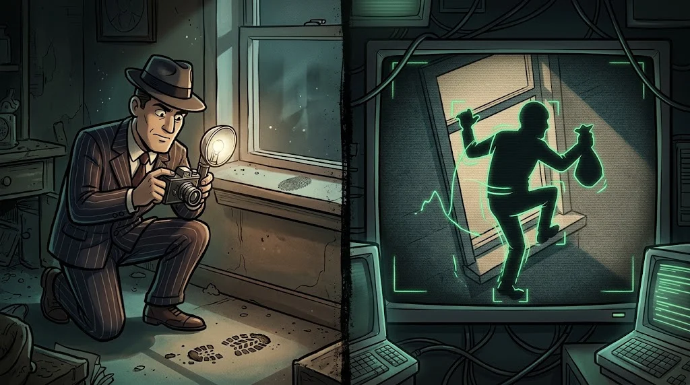

# Endpoint security: EDR, IOC and IOA

> The attacker gets in through the network but does the work **on the endpoint**: laptop, desktop, server.
> 🧹 **Trace 5:** Tamer deleted his script. But every process the script launched left a line in Sysmon.

::cizgi[c-05-sahne]

## The difference between antivirus and EDR

| | Classic antivirus | EDR (Endpoint Detection and Response) |
|---|---|---|
| What does it look at? | File signatures | Behaviour: process, network, registry, files |
| When? | When a file is written to disk | Continuously, recording event by event |
| What does it do? | Deletes, quarantines | Alerts, **isolates** the device from the network, shows history |

In the lab, the free equivalent of EDR: **Sysmon** (Windows) + the Wazuh agent.

## IOC and IOA



- **IOC (Indicator of Compromise):** the residue of a compromise. IP, domain, file hash, file path.
  Easy to share, easy to change.
- **IOA (Indicator of Attack):** the behaviour of the attack. "A Word document launched PowerShell",
  "a process cleared the security log". Even if the attacker changes their tool, the behaviour stays the same.

Use an IOC to search for what happened **yesterday**, and an IOA to catch what happens **tomorrow**.

## Endpoint triage: four questions

1. **What ran?** The process and its parent. Is `explorer.exe → powershell.exe` normal?
2. **What did it connect to?** External IPs, unusual ports.
3. **What did it leave behind?** A new file, service, scheduled task, registry key.
4. **What did it delete?** A deleted script, a cleared log: the attempt to hide is a finding in itself.

If in doubt, **don't shut the device down**: isolate it from the network. Evidence in memory disappears when you power it off.

## 🧪 Try it (5 min)

Extract an IOC list from the Sysmon records:

```bash
grep -oE "[0-9]+\.[0-9]+\.[0-9]+\.[0-9]+:443" /opt/akademi/c-sysmon.csv | sort | uniq -c
grep -E ",(1|11|13|23)," /opt/akademi/c-sysmon.csv | cut -d, -f4,5,8
```

Write the external IP, domain, file path and SHA256 value into a table. Then build two IOA sentences: "the … process performed …".

## ✅ Remember

- EDR looks at behaviour, not signatures, and can isolate a device.
- An IOC is residue (IP, hash); an IOA is behaviour (what was done).
- A suspicious device is not shut down, it is isolated from the network.
