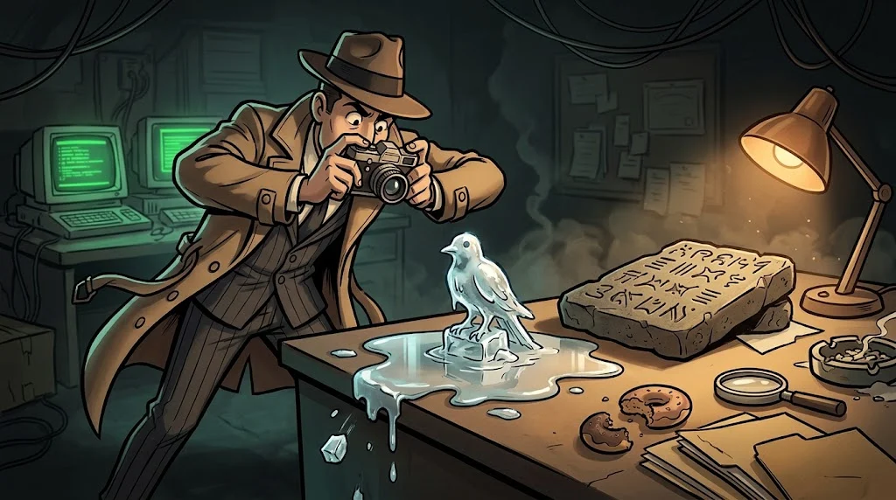

# Disk ve bellek analizi: Autopsy, MFT ve Volatility 3

> Log silinebilir, dosya silinebilir. Ama disk ve bellek, silinenin **gölgesini** taşır.
> 🧹 **İz 10:** `bakim.exe` kendini bir yıl önce oluşturulmuş gibi gösteriyor. MFT'nin ikinci saati başka bir tarih söylüyor.

::cizgi[c-10-sahne]

## Önce bütünlük

Asla orijinal diskte çalışılmaz. **Kopya imaj** alınır, hash'i hesaplanır, analiz kopyanın kopyasında yapılır.

```bash
sha256sum ws07-disk.E01 > ws07-disk.E01.sha256
sha256sum -c ws07-disk.E01.sha256
```

İki hash aynıysa imaj değişmemiştir. Bu değer delil zinciri formuna yazılır (C11).

## Uçucu olandan başla



Kanıt toplama sırası (order of volatility): **bellek → ağ bağlantıları → disk → yedekler.** Cihazı kapatırsan bellek gider.
Disk imajı alınırken **yazma engelleyici (write blocker)** kullanılır; böylece inceleme orijinal diske tek bir bayt bile yazmaz.

## Disk: Autopsy ve MFT

**Autopsy**, disk imajını açan açık kaynaklı adli bilişim arayüzüdür: dosya sistemi, silinmiş dosyalar, zaman çizelgesi, anahtar kelime arama.

NTFS'te her dosyanın kaydı **MFT (Master File Table)** içindedir ve iki zaman takımı taşır:

| Öznitelik | Kim değiştirebilir? |
|---|---|
| `$STANDARD_INFORMATION` | Kullanıcı düzeyindeki araçlar kolayca değiştirir |
| `$FILE_NAME` | Çekirdek yönetir; değiştirmek çok daha zordur |

İkisi arasında büyük fark varsa: **zaman damgası oynanmış (timestomping)** olabilir.


## Bellek: Volatility 3

Bellek imajında çalışan işlemler, ağ bağlantıları ve diske hiç yazılmamış kod görünür.

```bash
vol -f ws07-bellek.raw windows.pslist
vol -f ws07-bellek.raw windows.pstree
vol -f ws07-bellek.raw windows.netscan
vol -f ws07-bellek.raw windows.cmdline
```

`pstree`'de tuhaf ebeveyn-çocuk ilişkisi, `netscan`'de dış IP'ye açık bağlantı ararsın.

## 🧪 Dene (5 dk)

Eğitmenin verdiği sentetik ders imajlarıyla: önce `sha256sum -c` ile bütünlüğü doğrula. Sonra `windows.netscan` çıktısında
`198.51.100.200` adresine bağlı işlemin adını ve PID'sini bul. Bu işlemin ebeveyni `pstree`'de kim?

## ✅ Akılda kalsın

- Orijinale dokunma: imaj al, hash'le, kopyada çalış.
- MFT'de iki saat vardır; aralarındaki fark zaman oynamasını ele verir.
- Bellek, diske yazılmayanı gösterir: pslist, pstree, netscan, cmdline.
