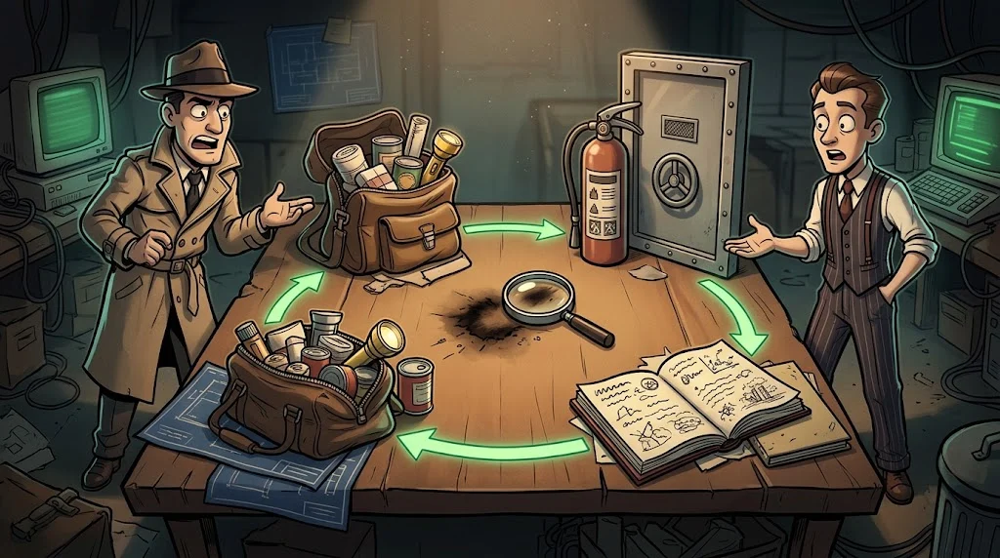

# Incident response: the NIST cycle, playbooks and chain of custody

> Panic is the attacker's best friend. A **plan** is the defender's.
> 🧹 **Trace 11:** Tamer's last move is to make the evidence "go missing". If the chain of custody has been kept, even lost evidence is documented.

::cizgi[c-11-sahne]

## The NIST cycle

NIST SP 800-61 describes incident response in four phases:

| Phase | Example for KLP-WS07 |
|---|---|
| **1. Preparation** | Central logging, Sysmon, playbook and contact list ready |
| **2. Detection and analysis** | Alerts confirmed, scope determined |
| **3. Containment, eradication, recovery** | Device isolated; account, service and Run key removed; rebuilt from a clean image |
| **4. Post-incident** (lessons learned) | "Why was RDP exposed to the internet?" — a permanent fix |

It is a cycle: the fourth phase feeds the first.

## Playbook

A **playbook** is a step-by-step recipe for a specific type of incident. Example: *"Successful RDP logon from outside"*

1. Confirm the source IP and the account (4624 type 10).
2. Isolate the device from the network with EDR, **do not power it off**.
3. Take memory and disk images, hash them.
4. Reset the account's password, close its sessions.
5. Search for the same IP on other devices.
6. Update the case record, notify the person responsible.

## Chain of custody

The **chain of custody** shows without interruption who held the evidence, when, and why. If the chain breaks, the evidence becomes disputable.

| Evidence | Hash (SHA256) | Handed over → received by | Time | Purpose |
|---|---|---|---|---|
| `ws07-bellek.raw` | `…` | Fox → Professor Selim | 2026-03-14 09:40 | Analysis |

The rule: a row is added at every handover, the hash is verified again, and the evidence is stored in a locked place.

## 🧪 Try it (5 min)

On your own lab VM, take the hash of a file (for example `/opt/akademi/c-sysmon.csv`) and fill in a two-row chain of custody table:
Fox → Professor Selim, then Professor Selim → the evidence locker. Then map the playbook above onto the NIST phases.

## ✅ Remember

- The NIST cycle: preparation → detection/analysis → containment/eradication/recovery → post-incident.
- A playbook turns panic into steps; the first step is to isolate, not to power off.
- In the chain of custody, every handover is written down and verified with a hash.
