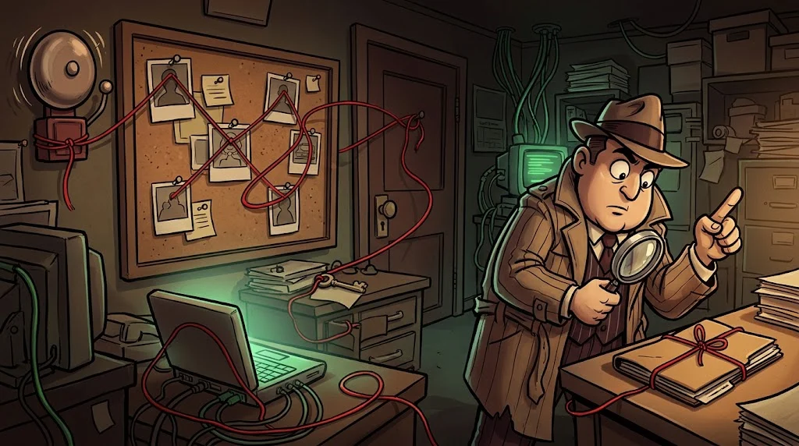

# Final simulation: from alert to incident report

> Solving an incident isn't about finding a single log line; it's about **combining all the traces into one story**.
> 🧹 **The last trace:** A six-hour gap is on your desk. Bring back everything Tamer deleted.

::cizgi[c-12-sahne]

## Mission

On the lab VM, using the **synthetic** files under `/opt/akademi/`, investigate what happened on KLP-WS07 on the night of 14 March 2026:

| File | What does it tell you? |
|---|---|
| `c-alarmlar.csv` | SIEM alert queue (C01–C02) |
| `c-windows-olaylar.jsonl` | Windows Security/System events (C06) |
| `c-sysmon.csv` | Sysmon process, network, file and registry events (C05–C06) |
| `c-dns.log` | The network sensor's DNS records; its clock is correct (C08) |
| `c-bakim-strings.txt` | The `strings` output of the suspicious file (C09) |

1. **Triage** — Which alerts are real, which are noise? Who might have produced the noise, and why?
2. **Time correction** — Find when the clock was shifted, by how much, and when it was corrected; convert every event to **real time**.
3. **Timeline** — At least 15 rows, from first contact to the last heartbeat; write the source of each row.
4. **Traces of concealment** — Log clearing, clock shifting, timestomping, script deletion, disabling auditing: evidence for each one.
5. **IOC and detection** — An IOC table + at least one detection rule (Wazuh, Suricata, Sigma or YARA).
6. **Response** — What should be done according to the NIST phases; a chain of custody table.

## Deliverable: the report skeleton

| Section | Content |
|---|---|
| **Executive summary** | What happened, what the impact was, what should be done now (at most 5 sentences) |
| **Timeline** | Real time · device time · source · event · comment |
| **Findings** | Initial access, persistence, command-and-control, concealment; each with evidence |
| **IOCs and rules** | IP, domain, file path, hash, account; the rule texts |
| **Response and recommendations** | Containment, eradication, recovery; 3 permanent improvements |
| **Chain of custody** | The SHA256 value and handover record of every file used |

## Assessment

| Criterion | Points |
|---|---:|
| Real alerts correctly sorted out, noise explained | 2 |
| Clock skew found, timeline built on real time | 3 |
| Every trace of concealment shown with evidence | 2 |
| IOC table and detection rule in working order | 1 |
| Response plan and chain of custody complete | 2 |

## ✅ Remember

- The timeline is built on an independent clock (SIEM, network sensor).
- Even a deleted trace leaves a trace: clearing, shifting and silencing are events too.
- A good report speaks with evidence and gives assurance through the chain of custody.

> 🔒 **CASE CLOSED: Cleaner Tamer** · *when you hand in your report*
>
> ::cizgi[tamer-kapanis]
>
> ➡️ *Season 2 is under way: other case files of the Shadow Network await you on the other specialisation paths.*
