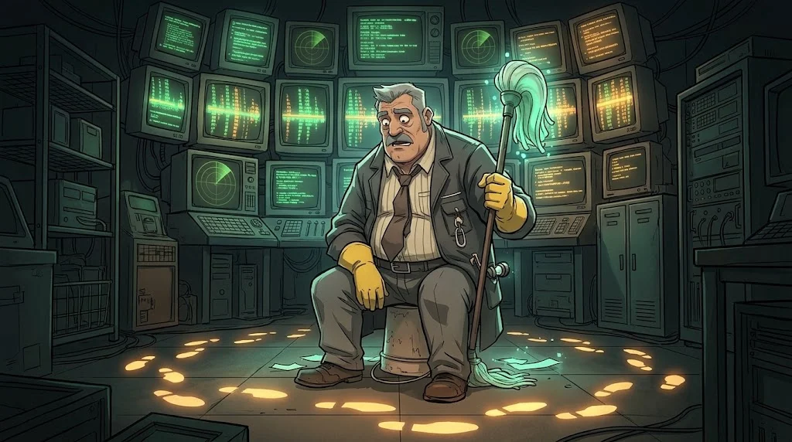
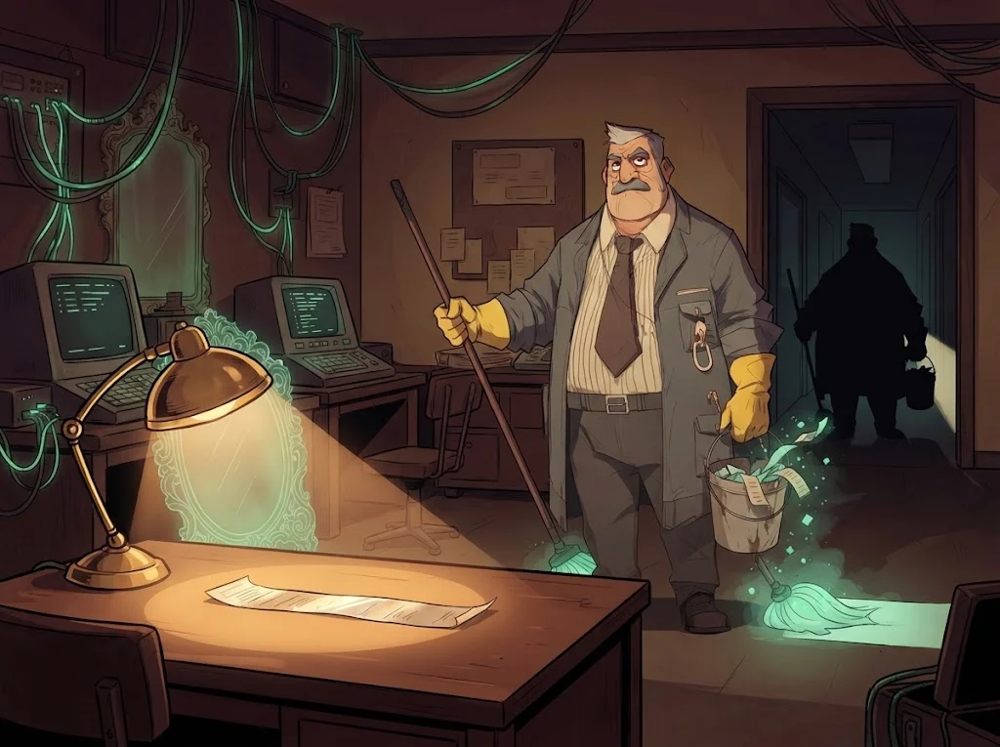

# Final simülasyonu: alarmdan olay raporuna

> Bir olayı çözmek tek bir log satırı bulmak değil; **bütün izleri tek bir hikâyede birleştirmektir**.
> 🧹 **Son iz:** Altı saatlik boşluk senin masanda. Tamer'in sildiği her şeyi geri getir.

## Görev

Laboratuvar VM'inde `/opt/akademi/` altındaki **sentetik** dosyalarla, 14 Mart 2026 gecesi KLP-WS07'de olanları incele:

| Dosya | Ne anlatır? |
|---|---|
| `c-alarmlar.csv` | SIEM alarm kuyruğu (C01–C02) |
| `c-windows-olaylar.jsonl` | Windows Security/System olayları (C06) |
| `c-sysmon.csv` | Sysmon işlem, ağ, dosya, kayıt defteri olayları (C05–C06) |
| `c-dns.log` | Ağ sensörünün DNS kaydı; saati doğru (C08) |
| `c-bakim-strings.txt` | Şüpheli dosyanın `strings` çıktısı (C09) |

1. **Triyaj** — Hangi alarmlar gerçek, hangileri gürültü? Gürültüyü kim, neden üretmiş olabilir?
2. **Zaman düzeltmesi** — Saatin ne zaman, ne kadar kaydırıldığını ve ne zaman düzeltildiğini bul; bütün olayları **gerçek zamana** çevir.
3. **Zaman çizelgesi** — İlk temastan son nabza kadar en az 15 satır; her satırın kaynağını yaz.
4. **Gizlenme izleri** — Log temizleme, saat kaydırma, zaman damgası oynama, betik silme, denetim kapatma: her biri için kanıt.
5. **IOC ve tespit** — IOC tablosu + en az bir tespit kuralı (Wazuh, Suricata, Sigma ya da YARA).
6. **Müdahale** — NIST aşamalarına göre ne yapılmalı; delil zinciri tablosu.

## Teslim: rapor iskeleti

| Bölüm | İçerik |
|---|---|
| **Yönetici özeti** | Ne oldu, etkisi ne, şimdi ne yapılmalı (en fazla 5 cümle) |
| **Zaman çizelgesi** | Gerçek zaman · cihaz zamanı · kaynak · olay · yorum |
| **Bulgular** | İlk erişim, kalıcılık, komuta-kontrol, gizlenme; her biri kanıtlı |
| **IOC ve kurallar** | IP, alan adı, dosya yolu, hash, hesap; kural metinleri |
| **Müdahale ve öneriler** | Sınırlama, temizleme, kurtarma; 3 kalıcı iyileştirme |
| **Delil zinciri** | Kullanılan her dosyanın SHA256 değeri ve el değiştirme kaydı |

## Değerlendirme

| Ölçüt | Puan |
|---|---:|
| Gerçek alarmlar doğru ayıklandı, gürültü açıklandı | 2 |
| Saat kayması bulundu, çizelge gerçek zamana göre kuruldu | 3 |
| Gizlenme izlerinin her biri kanıtla gösterildi | 2 |
| IOC tablosu ve tespit kuralı çalışır durumda | 1 |
| Müdahale planı ve delil zinciri eksiksiz | 2 |

## ✅ Akılda kalsın

- Zaman çizelgesi, bağımsız bir saate (SIEM, ağ sensörü) göre kurulur.
- Silinen iz bile iz bırakır: temizleme, kaydırma ve susturma da olaydır.
- İyi rapor kanıtla konuşur ve delil zinciriyle güvence verir.

> 🔒 **DOSYA KAPANDI: Temizlikçi Tamer** · *raporunu teslim edince*
>
> 
>
> Zaman çizelgesi tamamlandı; Tamer'in sildiği altı saat geri geldi. Kurtarılan son kayıtta tek bir kelime tekrar ediyor:
> AYNA. Selim Hoca kâğıdı katlayıp cebine koyuyor: "Bunu daha önce duymuştum."
>
> ➡️ *Sezon 2 sürüyor: diğer uzmanlık yollarında Gölge Ağ'ın başka dosyaları seni bekliyor.*
