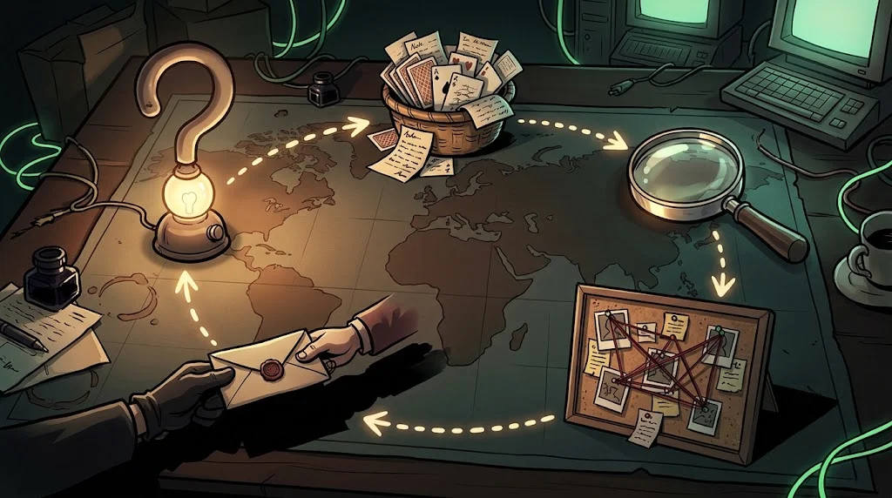

# OSINT methodology: question first, then search

> A researcher without a question chases every flag. That is exactly what Bedri wants.
> 🚩 **Flag 1:** The day after the attack on campus, everyone is saying the same name: MERCAN-7. Professor Selim only asks: "What's the problem, Fox?"

::cizgi[d-01-sahne]

## Research question

"Find everything about MERCAN-7" is not a question, it is a well. A good question is **narrow, answerable and tied to a purpose**:

| ❌ Vague | ✅ Researchable |
|---|---|
| Who carried out the attack? | Whose infrastructure are the domain names used in the attack attached to? |
| Is this group dangerous? | Have this group's known techniques been seen on our network? |

## Scope and ethics

Before you start, write it down and get it signed:

```text
Question : Does the campaign infrastructure overlap with infrastructure seen before?
Target   : Only the domain names and IPs in the case file (lab/d-*)
Forbidden: Investigating real people, attempting to log in to the target, interacting through a fake account
Data     : Enough for the question; no personal data is collected (KVKK/GDPR — M02)
Duration : 2 days, then an interim report to Professor Selim
```

## The OSINT cycle



1. **Plan** — question, scope, possible sources
2. **Collect** — passive methods first (search, archive, records)
3. **Process** — remove duplicates, align dates
4. **Verify** — at least two independent sources
5. **Report** — finding + evidence + confidence level

## Research log

For everything you find: **what, where, when, how**. Take a screenshot, and if the page has been archived, write down the link.
A week later, the answer to "where did I find this?" should be in the log; otherwise the finding is not evidence, it is rumour.

## 🧪 Try it (4 min)

Read only the headings of the `lab/d-tehdit-raporlari.md` file. For this case, write **one** researchable question and
a five-line scope following the template above. Add at least two items to the "Forbidden" line.

## ✅ Remember

- Question first: narrow, answerable, tied to a purpose.
- The scope is written down; real people and unauthorised targets are always outside it.
- A finding that isn't in the log isn't evidence, it's rumour.
