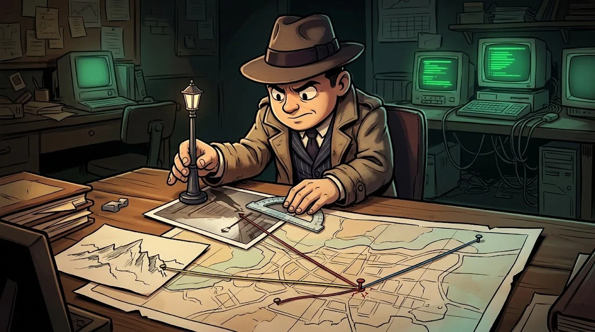

# Visual and geospatial OSINT: when and where was this photo taken?

> A photo is worth a thousand words; a fake photo is worth a thousand wrong reports.
> 🚩 **Flag 4:** The "Mercan Collective" claimed responsibility and even shared a photo: "Here is our office." Isn't that a bit too generous?

::cizgi[d-04-sahne]

## EXIF: the file's own statement

Photos carry the capture date, device, software and sometimes **GPS** location (EXIF, Exchangeable Image File Format).

```bash
exiftool foto.jpg
exiftool -DateTimeOriginal -Model -Software -GPSPosition foto.jpg
exiftool -all= foto.jpg        # strip the metadata from your own photo
```

Careful: social media strips most EXIF, and EXIF is **easy to edit**. An inconsistency is a strong clue; consistency is not proof.

## Reverse image search

Search the image in more than one search engine. If the same photo was published years ago in another context, the claim collapses.
For cropped or mirrored copies, also search with a part of the image.

## Verification questions



| Question | What do you look at? |
|---|---|
| **Who** took it? | The account that shared it first, the age of the account |
| **When?** | EXIF, first publication date, season, shadow length (chronolocation) |
| **Where?** | Signs, architecture, mountain and coastline shapes (geolocation) |
| **Why now?** | Which claim was the photo shared to support? |

## The ethical line

Geolocation is only done on **fictional cases and your own photos**.
Finding a real person's home or routine from their photo is not the subject of this path.

## 🧪 Try it (4 min)

1. `lab/d-tehdit-raporlari.md` → read the `exiftool` output in K4. Which three fields contradict the photo's claim?
2. Open a photo you took on your own phone with `exiftool`: does it contain location data? If so, strip it.

## ✅ Remember

- EXIF is easy to edit: an inconsistency is a clue, consistency is not proof.
- If the first publication date is earlier than the claimed date, the story collapses.
- Geolocation only on fictional cases and your own photos.
