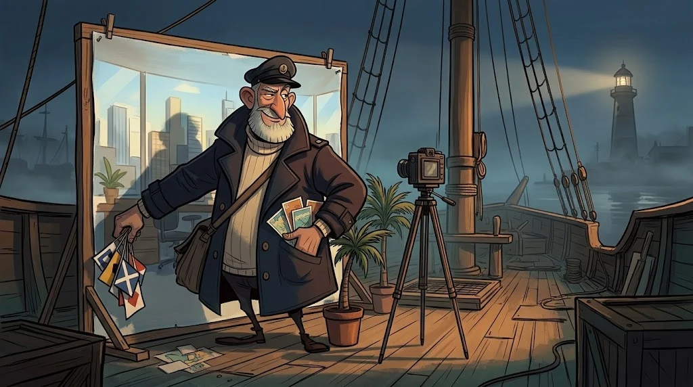

# Görsel ve coğrafi OSINT: bu fotoğraf ne zaman, nerede çekildi?

> Bir fotoğraf bin kelimeye bedel; sahte bir fotoğraf bin yanlış rapora.
> 🚩 **Bayrak 4:** "Mercan Kolektifi" sorumluluğu üstlenip bir de fotoğraf paylaşmış: "İşte ofisimiz." Fazla cömert değil mi?



## EXIF: dosyanın kendi ifadesi

Fotoğraflar çekim tarihi, cihaz, yazılım ve bazen **GPS** konumu taşır (EXIF, Exchangeable Image File Format).

```bash
exiftool foto.jpg
exiftool -DateTimeOriginal -Model -Software -GPSPosition foto.jpg
exiftool -all= foto.jpg        # kendi fotoğrafından meta veriyi temizle
```

Dikkat: sosyal medya çoğu EXIF'i siler ve EXIF **kolayca düzenlenir**. Tutarsızlık güçlü bir ipucudur; tutarlılık ise kanıt değildir.

## Tersine görsel arama (reverse image search)

Görseli birden çok arama motorunda ara. Aynı fotoğraf yıllar önce başka bir bağlamda yayınlanmışsa, iddia çöker.
Kırpılmış veya aynalanmış kopyalar için görselin bir parçasıyla da ara.

## Doğrulama soruları

| Soru | Neye bakılır? |
|---|---|
| **Kim** çekti? | İlk paylaşan hesap, hesabın yaşı |
| **Ne zaman?** | EXIF, ilk yayın tarihi, mevsim, gölge uzunluğu (chronolocation) |
| **Nerede?** | Tabelalar, mimari, dağ ve kıyı hatları (geolocation) |
| **Neden şimdi?** | Fotoğraf hangi iddiayı desteklemek için paylaşıldı? |

## Etik çizgi

Coğrafi doğrulama yalnızca **kurgusal vakalarda ve kendi fotoğraflarında** yapılır.
Gerçek bir kişinin fotoğrafından evini veya rutinini bulmak bu yolun konusu değildir.

## 🧪 Dene (4 dk)

1. `lab/d-tehdit-raporlari.md` → K4'teki `exiftool` çıktısını oku. Fotoğrafın iddiasıyla çelişen üç alan hangisi?
2. Kendi telefonunla çektiğin bir fotoğrafı `exiftool` ile aç: konum bilgisi var mı? Varsa temizle.

## ✅ Akılda kalsın

- EXIF kolay düzenlenir: tutarsızlık ipucudur, tutarlılık kanıt değildir.
- İlk yayın tarihi, iddia edilen tarihten eskiyse hikâye çöker.
- Coğrafi doğrulama yalnızca kurgusal vakalarda ve kendi fotoğraflarında.
