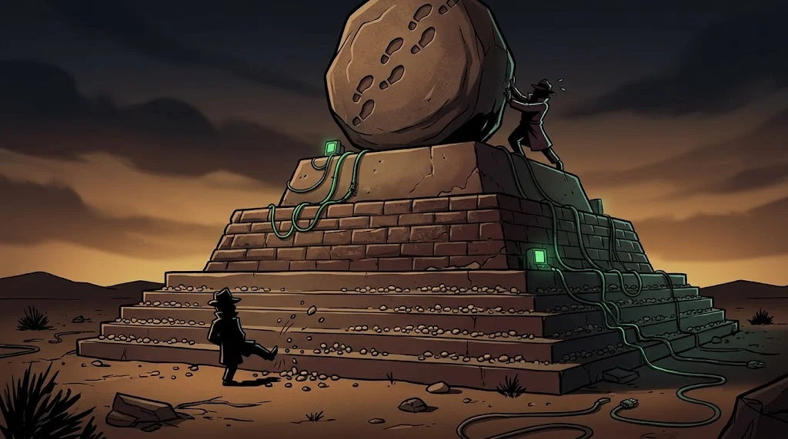

# Tehdit istihbaratı: veri ne zaman istihbarat olur?

> Bin IP adresi istihbarat değildir. Bir karar için kullanılabilen, bağlamı olan bilgi istihbarattır.
> 🚩 **Bayrak 6:** Blog "hemen engelleyin" diye bir IOC listesi yayınladı. Bedri bu listeyi değiştirmek için beş dakika harcar; sen engellemek için bir gün.

::cizgi[d-06-sahne]

## İstihbarat döngüsü


1. **Yönlendirme (direction)** — karar vericinin sorusu
2. **Toplama (collection)** — loglar, raporlar, açık kaynaklar
3. **İşleme (processing)** — ayıkla, normalize et
4. **Analiz (analysis)** — anlam ve güven düzeyi
5. **Yayma (dissemination)** — doğru kişiye, doğru biçimde
6. **Geri bildirim (feedback)** — işe yaradı mı?

## PIR: önce gereksinim

**Öncelikli istihbarat gereksinimi (Priority Intelligence Requirement)** = karar vericinin cevap beklediği soru.
Örnek: "Kampüs portalını hedefleyen bir grup var mı ve hangi teknikleri kullanıyor?" PIR yoksa toplanan her şey gürültüdür.

## Üç düzey

| Düzey | Okuyucu | Örnek çıktı |
|---|---|---|
| **Stratejik** | Yönetim | "Eğitim kurumları kimlik avıyla hedefleniyor" |
| **Operasyonel** | SOC lideri | "Kampanya burs temalı makrolu belge kullanıyor" |
| **Taktik** | Analist, araçlar | Alan adları, hash'ler, tespit kuralları |

## IOC ve TTP

- **IOC (Indicator of Compromise):** IP, alan adı, hash. Somut, hızlı, ama kısa ömürlü.
- **TTP (Tactics, Techniques and Procedures):** saldırganın **nasıl** çalıştığı. Değiştirmesi zor.

## Acı Piramidi (Pyramid of Pain)



```text
          ▲  TTP'ler            ← saldırgan için en acı verici
         ▲▲  Araçlar
        ▲▲▲  Ağ/host izleri
       ▲▲▲▲  Alan adları
      ▲▲▲▲▲  IP adresleri
     ▲▲▲▲▲▲  Hash değerleri     ← değiştirmesi en kolay
```

Savunma ne kadar yukarıda olursa, saldırganın "yeni bayrak" dikmesi o kadar pahalılaşır.

## 🧪 Dene (5 dk)

`lab/d-ioc-listesi.csv` dosyasındaki her satırı piramidin bir basamağına yerleştir.
Sonra K1'deki olay zincirinden **iki davranış** (TTP) yaz: hangisi bir sonraki kampanyada da işe yarar?

## ✅ Akılda kalsın

- İstihbarat bir soruyla (PIR) başlar ve bir kararla biter.
- IOC hızlıdır ama kısa ömürlüdür; TTP yavaş ama kalıcıdır.
- Piramitte yukarı çık: saldırganın değiştirmesi zor olanı yakala.
