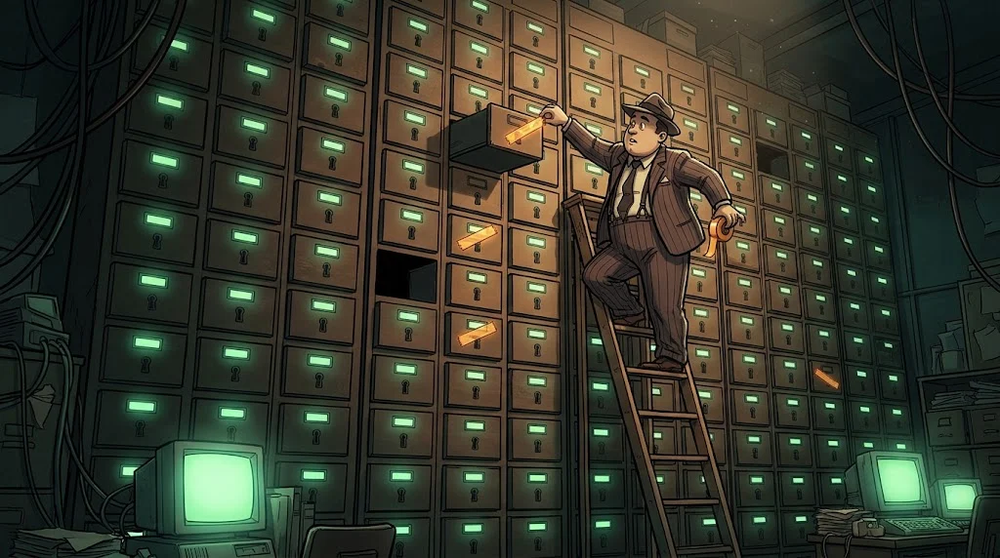

# MITRE ATT&CK: davranışı ortak dile çevir

> "Makrolu belge PowerShell açtı" demek yerine `T1059.001` dersin; dünyanın her yerindeki analist aynı şeyi anlar.
> 🚩 **Bayrak 7:** Blog, "MERCAN-7'nin teknikleriyle birebir aynı" diyor. Herkese açık raporları Bedri de okuyor.

::cizgi[d-07-sahne]

## Yapı

- **Taktik (tactic):** amaç — *neden?* (Initial Access, Persistence, Command and Control…)
- **Teknik (technique):** yol — *nasıl?* (`T1053` Scheduled Task/Job)
- **Alt teknik (sub-technique):** ayrıntı (`T1053.005` Scheduled Task)
- **Prosedür (procedure):** belirli bir aktörün somut uygulaması ("`MercanSync` adlı görev, oturum açılışında")

## Vakayı eşle

| Gözlem (K1) | Taktik | Teknik |
|---|---|---|
| Burs temalı makrolu e-posta eki | Initial Access | `T1566.001` Spearphishing Attachment |
| Kullanıcı belgeyi açıyor | Execution | `T1204.002` Malicious File |
| `powershell -enc` | Execution | `T1059.001` PowerShell |
| Kodlanmış komut | Defense Evasion | `T1027` Obfuscated Files or Information |
| `MercanSync` görevi | Persistence | `T1053.005` Scheduled Task |
| `rundll32` ile DLL çalıştırma | Defense Evasion | `T1218.011` Rundll32 |
| 15 dakikada bir HTTPS | Command and Control | `T1071.001` Web Protocols |

## Tespit boşluğu

ATT&CK Navigator'da bir katman (layer) aç: kampanyanın tekniklerini bir renge, **elindeki tespit kurallarını** başka renge boya.
Kesişmeyen hücreler, Tilki'nin yapılacaklar listesidir.

## Örtüşme ≠ atıf

Teknikler herkese açık belgelenir; bir grubu taklit etmek için onun raporunu okumak yeter.
Asıl ayırt edici olan **prosedür ayrıntısı** ve **birden çok bağımsız kanıt türü**dür (altyapı, zamanlama, araç, hedef seçimi).
K5'e göre MERCAN-7 kalıcılık için WMI, komuta-kontrol için DNS kullanır. Bu kampanya ise zamanlanmış görev ve HTTPS kullanıyor.

## 🧪 Dene (5 dk)

MERCAN-7'nin K5'te anlatılan iki tarihsel davranışını ATT&CK'te bul (ipucu: `T1546.003`, `T1071.004`).
Tablodaki kampanya teknikleriyle karşılaştır: kaç teknik ortak, kaç teknik farklı? Bu sonuç atıf için ne söylüyor?

## ✅ Akılda kalsın

- Taktik "neden", teknik "nasıl", prosedür "tam olarak nasıl".
- Navigator'da kampanya ile tespitlerini üst üste koy; boşluk görünür olur.
- Teknik örtüşmesi taklit edilebilir; atıf için tek başına yetmez.
