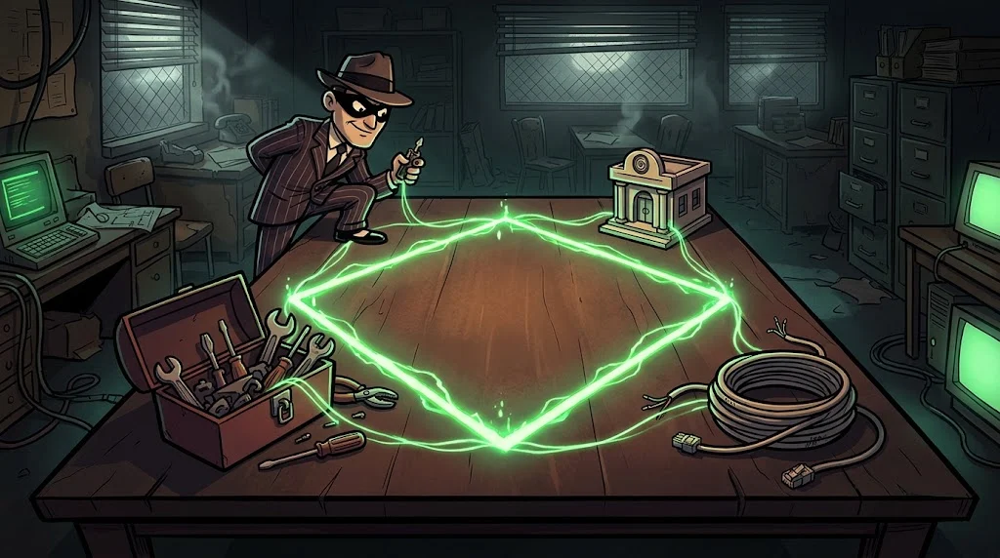
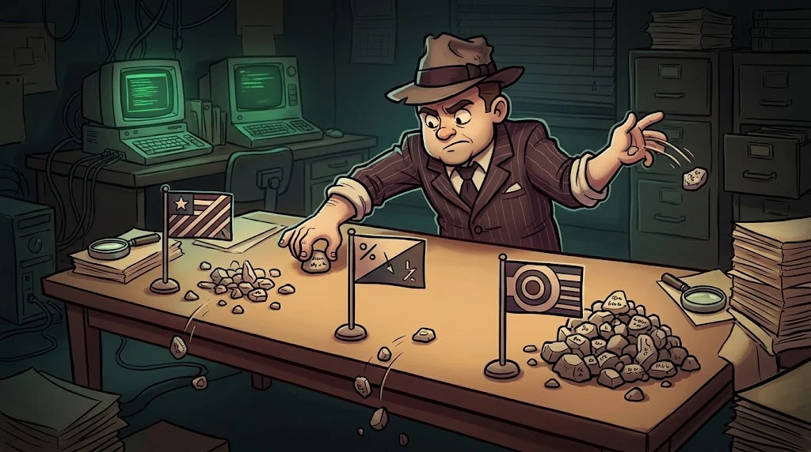

# Korelasyon ve atıf: sahte bayrağı nasıl ayırırsın?

> Kanıtı toplamak kolay; onu doğru hipoteze bağlamak zor. Bedri ipleri senin yerine bağlamaya çalışır.
> 🚩 **Bayrak 11:** Elinde rapor, altyapı kaydı, zararlı yazılım analizi ve av sonuçları var. Hepsi aynı yere mi çıkıyor?

::cizgi[d-11-sahne]

## Elmas Modeli (Diamond Model)

Her saldırı olayının dört köşesi vardır: **Saldırgan (adversary) · Yetenek (capability) · Altyapı (infrastructure) · Kurban (victim)**.
Boş bir köşe, toplanacak bilginin yeridir. Sahte bayrak genellikle yetenek köşesini boyar; altyapı köşesi daha zor taklit edilir.

Olayları zaman çizgisinde ise **Siber Öldürme Zinciri (Cyber Kill Chain)** ile sırala: keşif → silahlandırma → iletim → istismar → kurulum → komuta-kontrol → eylem.

## Zihnin tuzakları

| Yanlılık | Belirtisi |
|---|---|
| **Doğrulama yanlılığı (confirmation bias)** | Yalnızca ilk hipotezi destekleyen kanıtı aramak |
| **Çapalama (anchoring)** | İlk duyulan isme takılıp kalmak |
| **Ayna düşüncesi (mirror imaging)** | "Ben olsam böyle yapardım, o da öyle yapmıştır" |
| **Erişilebilirlik (availability)** | En çok konuşulan grubu en olası sanmak |

## Rakip hipotezler analizi (ACH)

Analysis of Competing Hypotheses: hipotezleri **yan yana** koy, her kanıtın her hipotezle uyumunu işaretle (✔ uyumlu · ✘ çelişkili · – nötr).
Kazanan, en çok ✔ alan değil, **en az ✘ alan** hipotezdir. Her hipotezle uyumlu kanıt ayırt edici değildir.

| Kanıt | H1: MERCAN-7 | H2: Başkası, sahte bayrakla | H3: Derleyiciyi kullanan bağımsız biri |
|---|---|---|---|
| DLL'de `MERCAN-7 was here` | ✔ | ✔ | ✔ |
| Teknikler MERCAN-7'nin geçmişinden farklı | ✘ | ✔ | ✔ |
| … | | | |

## Sahte bayrak göstergeleri

- Atıf kanıtları **fazla temiz ve fazla erken**: sorumluluk iddiası olaydan hemen sonra.
- Ucuz izler bir grubu, pahalı izler (altyapı, kayıt düzeni) başka birini gösteriyor.
- İddiayı yayan kaynaklar yeni, koordineli ve döngüsel.

## 🧪 Dene (6 dk)

Tabloyu tamamla: tüm `lab/d-*` dosyalarından en az **altı** kanıt ekle (altyapı, sertifika, EXIF, sosyal hesaplar, imphash, av sonuçları).
Hangi hipotez en az çelişki alıyor? Hangi kanıt hiçbir hipotezi ayırmıyor?

## ✅ Akılda kalsın

- Elmas Modeli boş köşeyi, ACH zayıf hipotezi gösterir.
- Kazanan, en az çelişkiyle karşılaşan hipotezdir; her şeyle uyumlu kanıt ayırt edici değildir.
- Ucuz izlerle pahalı izler farklı yeri gösteriyorsa, pahalı ize güven.
