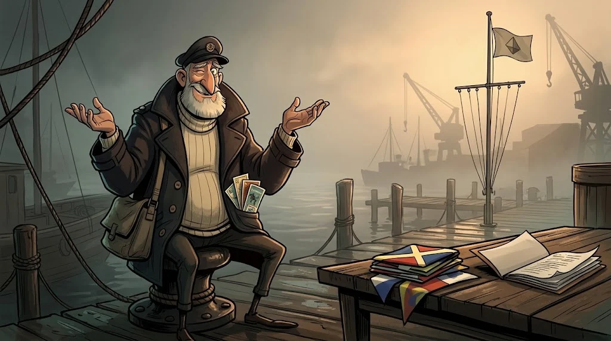
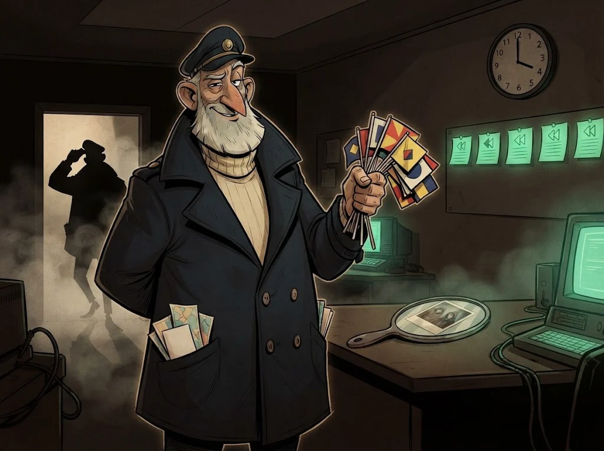

# Final: Sis Düdüğü istihbarat raporu

> İyi bir rapor kimin yaptığını bağırmaz; neyi bildiğini, neyi bilmediğini ve ne kadar emin olduğunu söyler.
> 🚩 **Son bayrak:** Bütün dosyalar masanda. Rektörlük yarın sabah soracak: "Saldırıyı MERCAN-7 mi yaptı, ne yapmalıyız?"

## Görev

Laboratuvardaki vaka dosyalarını (`lab/d-tehdit-raporlari.md`, `d-altyapi-kayitlari.txt`, `d-ioc-listesi.csv`,
`d-stix-paketi.json`, `d-av-olaylari.jsonl`) kullanarak:

1. **PIR** — rektörlüğün sorusunu bir ya da iki PIR'e çevir (D06)
2. **Kaynak değerlendirmesi** — her kaynağa Admiralty kodu (D02)
3. **Olay ve altyapı** — zaman çizelgesi, ATT&CK eşlemesi, altyapı ilişkileri (D03, D07, D10)
4. **Hipotezler** — en az üç hipotezli ACH tablosu (D11)
5. **Değerlendirme** — güven düzeyi ve olasılık diliyle sonuç
6. **Öneriler** — tespit kuralları (Sigma/YARA), engelleme listesi (temizlenmiş), farkındalık

Yalnızca laboratuvar dosyalarını kullan; gerçek bir grubu veya kişiyi araştırma, rapora gerçek isim yazma.

## Güven dili

| İfade | Olasılık |
|---|---|
| Neredeyse kesin | %95–99 |
| Büyük olasılıkla | %80–95 |
| Muhtemelen | %55–80 |
| Yarı yarıya | %45–55 |
| Muhtemelen değil | %20–45 |
| Çok düşük olasılıkla | %5–20 |

**Güven düzeyi** (düşük / orta / yüksek) ayrıdır: olasılığın değil, **kanıtın kalitesinin** ölçüsüdür.
Örnek: "Kampanyanın MERCAN-7 tarafından yürütülmüş olması *çok düşük olasılıkla* doğrudur (*orta güven*)."

## Rapor iskeleti

| Bölüm | İçerik |
|---|---|
| **Yönetici özeti** | Üç cümle: ne oldu, kim (güven düzeyiyle), ne yapılmalı |
| **Temel değerlendirmeler** | Her biri olasılık + güven düzeyi + dayandığı kanıt |
| **Kanıt tablosu** | Kanıt, kaynak, Admiralty kodu, hangi hipotezi destekliyor |
| **ACH tablosu** | Hipotezler × kanıtlar, çelişki sayıları |
| **ATT&CK eşlemesi** | Taktik, teknik, gözlem, mevcut tespit var mı? |
| **Öneriler** | Kısa vade (engelle, temizle), orta vade (kurallar), uzun vade (eğitim, PIR güncelleme) |
| **Ekler** | Temizlenmiş IOC listesi, Sigma/YARA kuralları, TLP etiketi |

## Değerlendirme

| Ölçüt | Puan |
|---|---:|
| PIR ve kapsam net; yalnızca laboratuvar verisi kullanıldı | 1 |
| Kaynaklar Admiralty koduyla gerekçeli değerlendirildi | 2 |
| Zaman çizelgesi ve ATT&CK eşlemesi doğru | 2 |
| ACH tablosu ve sahte bayrak analizi ikna edici | 3 |
| Güven dili tutarlı; bilinmeyenler açıkça yazıldı | 1 |
| Öneriler uygulanabilir; IOC listesi yanlış pozitiflerden temizlenmiş | 1 |

## ✅ Akılda kalsın

- Rapor bir karar içindir: yönetici özeti tek başına okunabilmeli.
- Olasılık ve güven ayrı söylenir; bilinmeyen de bir bulgudur.
- Ucuz izler bayrak diker; altyapı ve davranış sahibini gösterir.

> 🔒 **DOSYA KAPANDI: Bayrakçı Bedri** · *raporunu teslim edince*
>
> 
>
> Bayraklar söküldü; bütün altyapı tek bir şirkete çıkıyor: Ayna Teknoloji. Kâğıt üstünde kimse yok, ama bütün alan adları aynı gece, aynı saatte kaydedilmiş: Kapüşonlular'ın yirmi yıl önce buluştuğu saatte.
>
> ➡️ *Sezon 2 sürüyor: diğer uzmanlık yollarında Gölge Ağ'ın başka dosyaları seni bekliyor.*
