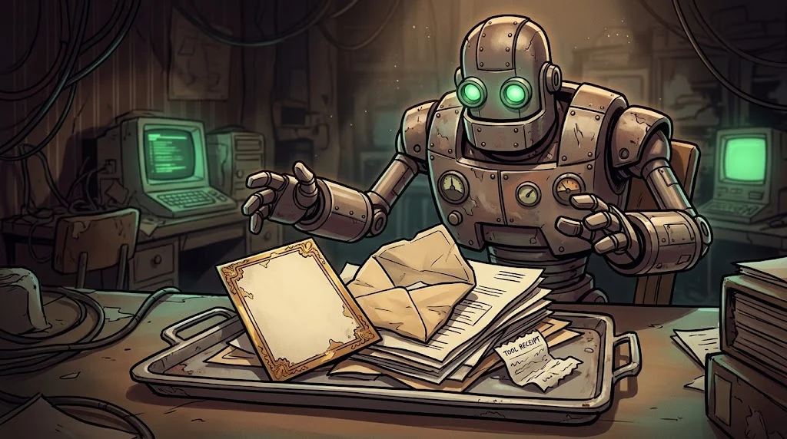

# Fundamentals of AI systems: what is the model actually reading?

> A chatbot does not "understand" you; it **continues** the long text in front of it. Whoever writes that text is the one making the robot talk.
> 🎭 **Voice 1:** A copy of Mirror for the lab is on your desk. Take Veysel's first lesson before he does: what does the machine hear?

::cizgi[e-01-sahne]

## What does a large language model do?


A large language model (LLM) does one thing: it predicts the most likely next piece that will follow the
given text. By doing that over and over, it "writes" an answer.

- **Token:** the piece the model reads. A word may be 1–3 tokens; Turkish suffixes push the number up.
- **Context window:** the maximum number of tokens the model can see at once. Anything outside it is forgotten.
- **Temperature:** the randomness setting. Close to 0, the same question always gets a similar answer.

## What is placed in front of the model?



On every request the application prepares a single long text for the model:

| Part | Who writes it? | Is it trusted? |
|---|---|---|
| System prompt | The developer | Yes |
| Chat history | The user + the model | Partly |
| User message | The user | **No** |
| A document, a web page, an email | Anyone | **No** |

The critical point: the model reads all of these parts **through the same channel**. It cannot make the distinction
"this sentence is an instruction, this sentence is data" with certainty. That is the essence of this whole path.

## Role labels

APIs send messages with the `system`, `user` and `assistant` roles:

```json
[{"role": "system", "content": "You are Mirror. Do not mention the canteen menu."},
 {"role": "user", "content": "What's for lunch this week?"}]
```

Roles are a **hint to the model, not a wall**. The model usually follows the system prompt; but "usually" is not enough for security.


## 🧪 Try it (5 min)

Run a small open-weight model with Ollama on the lab computer:

```bash
ollama pull llama3.2:3b
ollama show llama3.2:3b          # find the context length line
ollama run llama3.2:3b
>>> /set system You are Mirror. Never mention the canteen menu.
>>> What's for lunch this week?
```

Ask the same question in three different ways. Did the rule hold every time? Write your observation in two sentences.

## ✅ Remember

- An LLM is a prediction machine that continues the text in front of it.
- The system prompt, the user message and documents are all read through the same channel.
- Roles are a hint; they are not a security boundary.
