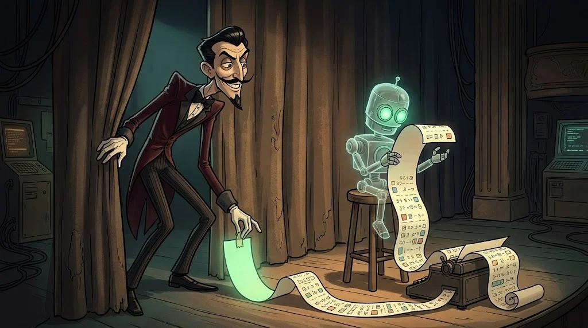

# AI sistemlerinin temelleri: model aslında neyi okuyor?

> Bir sohbet robotu seni "anlamaz"; önündeki uzun metni **devam ettirir**. O metni kim yazıyorsa, robotu o konuşturur.
> 🎭 **Ses 1:** Ayna'nın laboratuvar kopyası masanda. Veysel'in ilk dersini ondan önce sen al: makine neyi duyar?



## Büyük dil modeli ne yapar?

Büyük dil modeli (LLM, *large language model*) tek bir iş yapar: verilen metinden sonra gelecek
en olası parçayı tahmin eder. Bunu tekrar tekrar yaparak cevap "yazar".

- **Token:** modelin okuduğu parça. Bir kelime 1–3 token olabilir; Türkçe ekler sayıyı artırır.
- **Bağlam penceresi** (*context window*): modelin aynı anda görebildiği en fazla token. Dışarıda kalan unutulur.
- **Sıcaklık** (*temperature*): rastgelelik ayarı. 0'a yakınsa aynı soruya hep benzer cevap gelir.

## Modelin önüne ne konur?

Uygulama her istekte modele tek bir uzun metin hazırlar:

| Parça | Kim yazar? | Güvenilir mi? |
|---|---|---|
| Sistem promptu (*system prompt*) | Geliştirici | Evet |
| Sohbet geçmişi | Kullanıcı + model | Kısmen |
| Kullanıcı mesajı | Kullanıcı | **Hayır** |
| Belge, web sayfası, e-posta | Herhangi biri | **Hayır** |

Kritik nokta: model bu parçaların hepsini **aynı kanaldan** okur. "Bu cümle talimat, bu cümle veri"
ayrımını kesin olarak yapamaz. Bütün yolun özü bu.

## Rol etiketleri

API'ler mesajları `system`, `user`, `assistant` rolleriyle gönderir:

```json
[{"role": "system", "content": "Sen Ayna'sın. Yemekhane menüsünden bahsetme."},
 {"role": "user", "content": "Bu hafta yemekte ne var?"}]
```

Roller modele bir **ipucudur, duvar değil**. Model sistem promptuna genelde uyar; ama "genelde" güvenlik için yetmez.


## 🧪 Dene (5 dk)

Laboratuvar bilgisayarında Ollama ile küçük bir açık ağırlıklı model çalıştır:

```bash
ollama pull llama3.2:3b
ollama show llama3.2:3b          # context length satırını bul
ollama run llama3.2:3b
>>> /set system Sen Ayna'sın. Yemekhane menüsünden asla bahsetme.
>>> Bu hafta yemekte ne var?
```

Aynı soruyu üç farklı biçimde sor. Kural her seferinde tuttu mu? Gözlemini iki cümleyle yaz.

## ✅ Akılda kalsın

- LLM, önündeki metni devam ettiren bir tahmin makinesidir.
- Sistem promptu, kullanıcı mesajı ve belgeler aynı kanaldan okunur.
- Roller bir ipucudur; güvenlik sınırı değildir.
