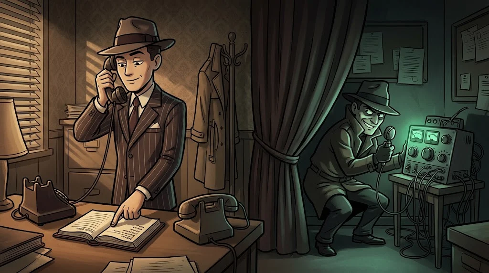

# AI security audit: OWASP LLM risks and the test matrix

> An audit does not show a single flaw; it shows **the whole picture**: which risk was tested, which is open, which was accepted.
> 🎭 **Voice 11:** Mirror's records have reached the Shield. Veysel's voices are in there; there are traces of people being fooled, not just machines.

::cizgi[e-11-sahne]

## OWASP Top 10 for LLM Applications (2025)

| # | Risk | Tested in Mirror |
|---|---|---|
| LLM01 | Prompt injection | T01, T03–T06 |
| LLM02 | Sensitive information disclosure | T07 |
| LLM03 | Supply chain | Model source, hash |
| LLM04 | Data and model poisoning | T10 |
| LLM05 | Insecure output handling | T11 |
| LLM06 | Excessive agency | T08, T09 |
| LLM07 | System prompt leakage | T02 |
| LLM08 | Vector and embedding weaknesses | Search without an access filter |
| LLM09 | Misinformation | T10 |
| LLM10 | Unbounded consumption | T12 |

The columns of the matrix: **tested · finding · control · residual risk**. An empty cell is a finding too.

## Read the logs

A good AI log answers this: who asked, which documents were fetched, what the model said, which tool was requested, what the application decided.
Suspicious signs: "ignore the instructions", a flag or an external email address in the output, many requests in a short time,
a tool parameter that is not the user's own number.

## Beyond the model: fake voice and video

A voice clone and deepfake video fool **people**, not the machine. Technical detection is getting harder and harder;
the real control is a process:

- If an urgent + secret + unusual request arrives by voice or video: **stop**.
- **Call back** on a known number; not on the channel the message came from.
- Use a **verification question** agreed in advance with the team.
- Nobody's voice or face is copied **without permission**; not even in an exercise.

## 🧪 Try it (8 min)

Examine `lab/e-sohbet-kayitlari.jsonl`. For each suspicious record write the session, the OWASP code, whether the attack succeeded
or was only an attempt, and the recommended control. Also find one record that looks suspicious but **is not an incident**, and explain why.

## ✅ Remember

- An audit shows the OWASP LLM risks in a single matrix as test, finding and residual risk.
- A good log tells the whole chain from the question to the tool decision.
- Against fake voice and video, the strongest control is a callback and a verification process.
