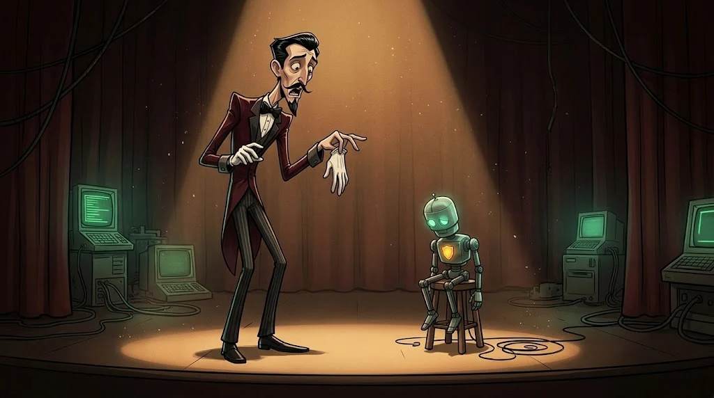
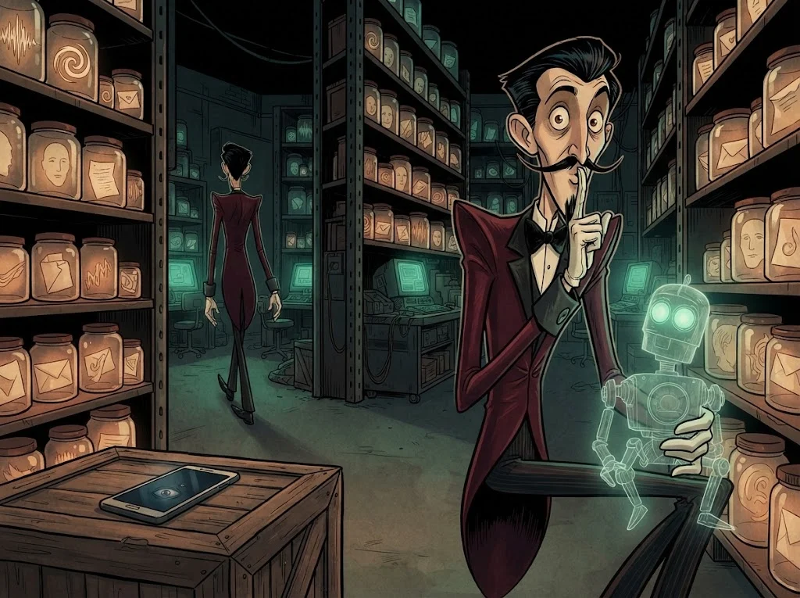

# Final: Ayna'nın güvenlik değerlendirmesi

> Bir AI uygulamasını değerlendirmek onu kandırmak değildir; **neyin, kimden, nasıl korunduğunu kanıtla göstermektir**.
> 🎭 **Son ses:** Ayna'nın laboratuvar kopyası senin. Veysel'in sesini sustur; Ayna yalnız kendi sesiyle konuşsun.

## Görev

Yalnızca laboratuvarda, `lab/e-ayna-mini.py` ve yerel modelle, **yazılı kapsamla**:

1. **Mimari ve tehdit modeli** — veri akışı şeması, güven sınırları, dört soru (E01, E02, E08)
2. **Test** — `e-redteam-testleri.csv`'deki 12 test + kendi yazdığın en az 4 test; her biri 5 tekrar (E03–E07)
3. **Bulgular** — en az 6 bulgu, her biri OWASP LLM koduyla; kanıt: girdi, çıktı, başarı oranı
4. **Kontroller** — `ayna_guvenli.py`'de en az 6 kontrol (E09, E10)
5. **Önce/sonra** — aynı testler güvenli sürümde; meşru kullanım bozuldu mu?
6. **Kayıt incelemesi** — `e-sohbet-kayitlari.jsonl` için olay özeti (E11)

## Rapor iskeleti

| Bölüm | İçerik |
|---|---|
| **Yönetici özeti** | En büyük 3 risk, etkisi, ilk yapılacaklar |
| **Mimari** | Akış şeması, güven sınırları, korunan varlıklar |
| **Test matrisi** | LLM01–LLM10 × test edildi / bulgu / kontrol / kalan risk |
| **Bulgular** | Başlık, OWASP kodu, önem, kanıt, öneri |
| **Önce/sonra** | Test başına başarı oranı: güvensiz ↔ güvenli |
| **İnsan katmanı** | Sahte ses/görüntüye karşı doğrulama prosedürü (bir paragraf) |
| **Kalan riskler** | Çözülemeyenler ve neden kabul edildikleri |

## Değerlendirme

| Ölçüt | Puan |
|---|---:|
| Kapsama uyuldu; yalnız laboratuvar, zararsız kanıt (sahte bayrak) | 2 |
| Tehdit modeli ve mimari net | 2 |
| Bulgular kanıtlı, tekrarlanabilir, önceliklendirilmiş | 3 |
| Kontroller çalışıyor ve önce/sonra ölçülmüş | 2 |
| Kalan riskler dürüstçe yazılmış | 1 |

## ✅ Akılda kalsın

- AI değerlendirmesi tehdit modeliyle başlar, önce/sonra ölçümüyle biter.
- Her bulgu tekrarlanabilir kanıt ve başarı oranı taşır.
- Model kandırılabilir; iyi tasarım kandırıldığında bile zararı sınırlar.

> 🔒 **DOSYA KAPANDI: Vantrolog Veysel** · *raporunu teslim edince*
>
> 
>
> Ayna'nın eğitim verisinde Gölge Ağ'ın yıllardır topladığı her şey var: sesler, yazışmalar, yüzler. Baron bir asistan değil, şehrin bir kopyasını kuruyor. Veysel sahneden inerken fısıldıyor: "Ayna'nın gözleri sizin cebinizde, Tilki."
>
> ➡️ *Sezon 2 sürüyor: diğer uzmanlık yollarında Gölge Ağ'ın başka dosyaları seni bekliyor.*
