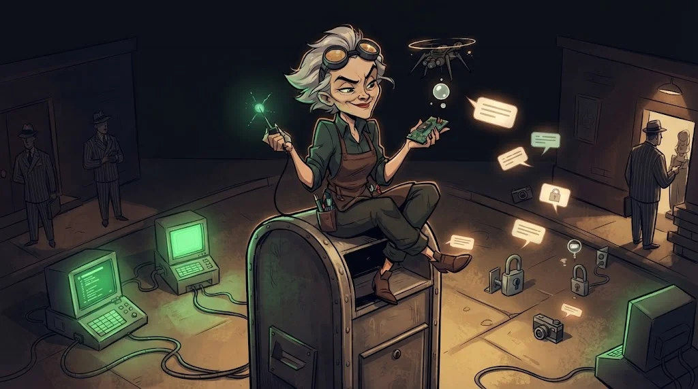

# IoT temelleri: ESP32, MQTT ve Bluetooth

> Nesnelerin İnterneti (Internet of Things, IoT): kilit, kamera, sensör… Hepsi küçük bir bilgisayar ve hepsi **konuşur**.
> 🔧 **Devre 7:** Laboratuvar broker'ında kilitlerin mesajları akıyor. Dinleyen tek kişi sen değilsin.



## Zincir

**Sensör → mikrodenetleyici (ESP32) → ağ geçidi / broker → bulut → mobil uygulama.**
Her halka bir saldırı yüzeyidir. ESP32, Wi-Fi ve Bluetooth'u aynı çipte taşıyan ucuz bir mikrodenetleyicidir; kulüp kitlerinde bunu kullanıyoruz.

## MQTT: yayınla / abone ol

Cihazlar birbirine değil, ortadaki **broker**'a konuşur. Mesajlar konu (topic) adlarıyla yayınlanır.

```bash
# yalnızca laboratuvar broker'ında
mosquitto_sub -h mqtt.lab-kampus.test -t 'kampus/#' -v
```

| Özellik | Risk |
|---|---|
| Port 1883, TLS yok | Mesajlar ağda düz metin |
| Anonim bağlantı | Herkes yayınlar, herkes dinler |
| Joker abonelik `#` | Tek istemci tüm konuları görür |
| `retain` bayrağı | Son mesaj saklanır, yeni bağlanan cihaza yeniden gider |

Savunma: 8883 + TLS, cihaz başına kimlik, konu bazlı erişim listesi (ACL).
**CoAP** ise UDP üzerinde (5683) çalışan hafif bir REST benzeri protokoldür; DTLS ile korunur.

## BLE: Bluetooth Low Energy

- Cihaz verisini GATT **servis** ve **karakteristik** (characteristic) olarak sunar.
- "Just Works" eşleşmesi kimlik doğrulamaz; araya girmeye açıktır.
- Kilidi açan karakteristik yazılabilir ve korumasızsa, yakındaki her telefon kilidi açabilir.
- Kendi cihazını telefondaki bir BLE tarayıcı uygulamasıyla incele; başkasının cihazına bağlanma.

## 🧪 Dene (5 dk)

`content/academy/lab/f-mqtt.log` dosyasını oku:

1. TLS kullanan istemci var mı?
2. Hangi mesajlarda parola veya token düz metin?
3. `x9` istemcisi ne yapıyor ve gece 02:04'te kapı neden yeniden açılıyor?

## ✅ Akılda kalsın

- IoT bir zincirdir; en zayıf halka tüm zinciri açar.
- MQTT'de TLS, cihaz başına kimlik ve konu ACL'si olmazsa broker herkese açık bir panodur.
- BLE'de korumasız yazılabilir karakteristik, uzaktan kumandadır.
