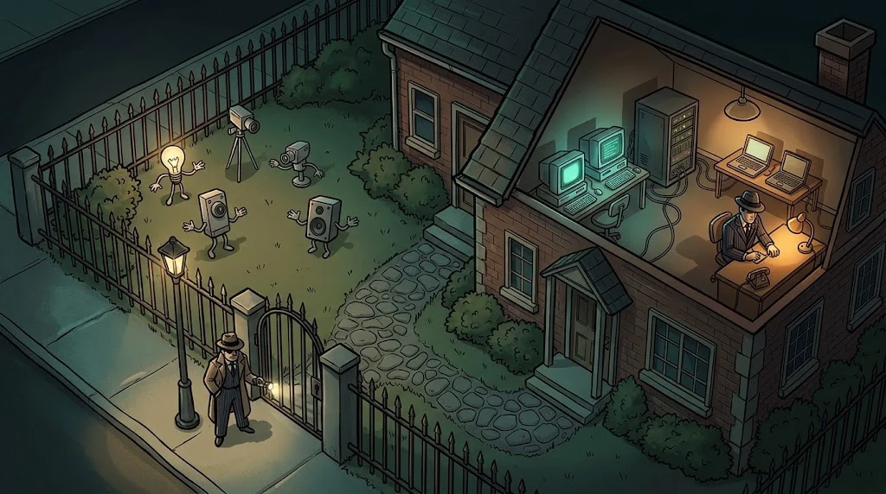

# IoT network security: isolation and encrypted communication

> Let the smart bulb's flaw stay in the bulb. Just make sure the bulb and your laptop aren't **in the same room**.
> 🔧 **Circuit 9:** In the lab, cameras, locks and student computers are on the same network. Leman's bridge is ready.

::cizgi[f-09-sahne]

## Why isolation?

IoT devices often can't be updated or hardened. If you can't fix them, **surround them**:
even if one device is taken over, the fire stays in one room.

::animasyon[network-topology]

## Design

| Measure | Implementation |
|---|---|
| Separate network | A separate VLAN / SSID for IoT |
| Client isolation | IoT devices can't see each other |
| Deny by default | IoT → user network forbidden; only management network → IoT |
| Egress restriction | A device only reaches its own broker / cloud address |
| UPnP off | A device can't open ports on the router by itself |
| No ports open to the internet | Remote access to the camera goes through a VPN |

## Encrypted communication

- **TLS (8883)** for MQTT, **HTTPS** instead of HTTP, **DTLS** for CoAP.
- **Each** device's **own** identity: a per-device password or client certificate. The same key on all devices = one key.
- Certificates and keys aren't baked into the firmware but generated per device at installation.

## Monitor

An IoT network's traffic profile is uniform: the same device, the same server, the same hour. A new destination, a scan in the middle of the night
or a subscription to every topic (`#`) is a reason for an **alert**.

## 🧪 Try it (4 min)

Open your own home router's admin interface (read-only). Count your smart devices in the list of connected devices:
are they on the same network as your laptop? Is UPnP on? Is there a guest network or a separate IoT network option? Note your findings.

## ✅ Remember

- Isolate a device you can't fix.
- Deny by default in the IoT network, and allow only the necessary addresses on egress.
- Each device gets its own identity; traffic is always encrypted.
