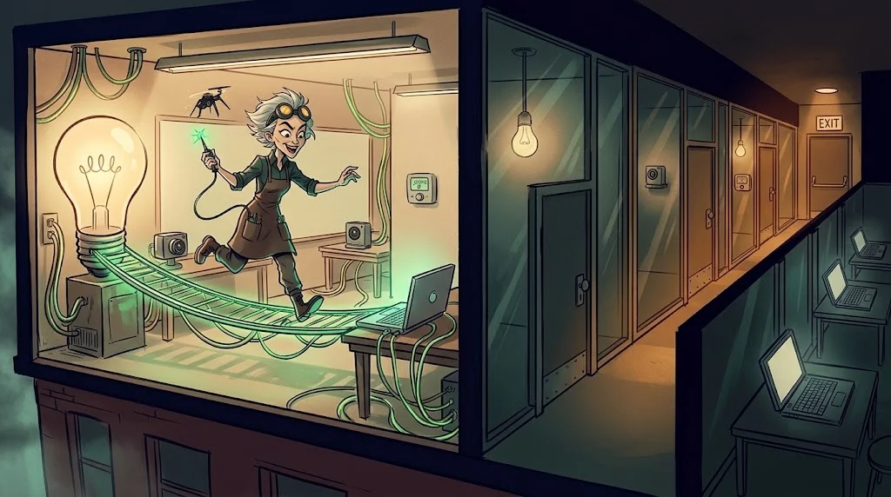

# IoT ağ güvenliği: izolasyon ve şifreli haberleşme

> Akıllı ampulün açığı ampulde kalsın. Yeter ki ampul ile dizüstün **aynı odada** olmasın.
> 🔧 **Devre 9:** Laboratuvarda kameralar, kilitler ve öğrenci bilgisayarları aynı ağda. Leman'ın köprüsü hazır.

## Neden izolasyon?

IoT cihazları çoğu zaman güncellenmez ve sertleştirilemez. Onları düzeltemiyorsan **etrafını çevir**:
bir cihaz ele geçirilse bile yangın tek odada kalsın.

::animasyon[network-topology]

## Tasarım

| Önlem | Uygulama |
|---|---|
| Ayrı ağ | IoT için ayrı VLAN / SSID |
| İstemci izolasyonu | IoT cihazları birbirini görmez |
| Varsayılan reddet | IoT → kullanıcı ağı yasak; yalnızca yönetim ağı → IoT |
| Çıkış kısıtlaması (egress) | Cihaz yalnızca kendi broker'ına / bulut adresine gider |
| UPnP kapalı | Cihaz yönlendiricide kendi kendine port açamaz |
| İnternete açık port yok | Kameraya uzaktan erişim VPN üzerinden |

## Şifreli haberleşme

- MQTT için **TLS (8883)**, HTTP yerine **HTTPS**, CoAP için **DTLS**.
- Her cihazın **kendi** kimliği: cihaz başına parola ya da istemci sertifikası. Tüm cihazlarda aynı anahtar = tek anahtar.
- Sertifika ve anahtarlar firmware'e gömülü değil, kurulumda cihaza özel üretilir.

## İzle

IoT ağının trafik profili tekdüzedir: aynı cihaz, aynı sunucu, aynı saat. Yeni bir hedef, gece yarısı tarama
ya da tüm konulara abonelik (`#`) **alarm** sebebidir.

## 🧪 Dene (4 dk)

Kendi ev modeminin yönetim arayüzüne gir (yalnızca okumak için). Bağlı cihaz listesinde akıllı cihazlarını say:
dizüstünle aynı ağdalar mı? UPnP açık mı? Misafir ağı ya da ayrı IoT ağı seçeneği var mı? Bulgularını not al.

## ✅ Akılda kalsın

- Düzeltemediğin cihazı izole et.
- IoT ağında varsayılan reddet, çıkışta yalnızca gerekli adresler.
- Her cihaza kendi kimliği; trafik her zaman şifreli.
