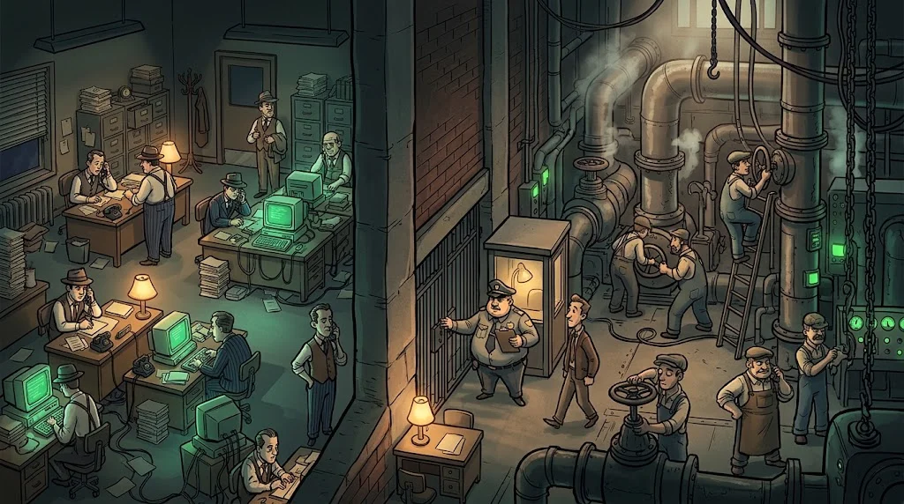
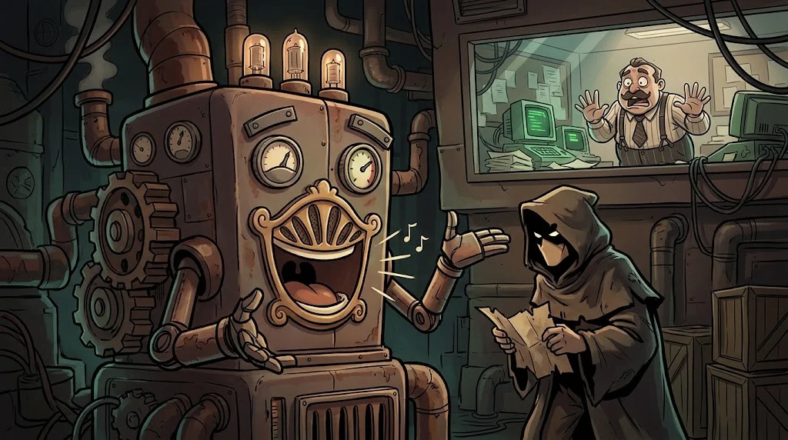

# Industrial systems: IT/OT, SCADA and Modbus

> If a server in the office goes down, email is delayed. If a valve in the factory opens by mistake, the **physical world** is affected.
> 🔧 **Circuit 10:** Leman's list includes a "heating panel" too. We'll look at that on the lab's scale model.

::cizgi[f-10-sahne]

## IT and OT



| | IT (information technology) | OT (operational technology) |
|---|---|---|
| Priority | Confidentiality | **Safety and continuity** |
| Lifespan | 3–5 years | 15–30 years |
| Patching | Regular | Rarely, during a planned outage |
| Scanning | Routine | Can **stop** a sensitive device |

## The parts

- **PLC** (Programmable Logic Controller): the small computer that drives a motor or valve on the floor.
- **HMI** (Human-Machine Interface): the operator's screen.
- **SCADA**: a system that monitors and manages many sites remotely.
- Layered network (the Purdue model): a separate intermediate zone (DMZ) between the office network and the field network.

## Modbus: it answers whoever asks



Modbus TCP (port 502) is a 1970s design: **no authentication and no encryption.**
Anyone with access to the network can read registers — and can send write commands too.

```bash
# to the Modbus simulator in the lab VM only; READ only
mbpoll -m tcp -a 1 -r 1 -c 5 -t 4 -1 192.0.2.50
```

Defence: keep the OT network separate from the internet and the office network, allow Modbus only from the HMI, monitor with an OT-aware IDS.

## ⚠️ Absolute rule

A real industrial system, the campus's heating/energy/water systems or building automation is **never** touched,
never scanned. This path works only with **simulators** and club scale models. Even a single packet on site can affect people.

## 🧪 Try it (4 min)

With Wireshark open in the lab VM, send the read request above to the simulator.
Is there a username, password or signature field in the packet? Write what an attacker on the same network could do.

## ✅ Remember

- In OT the priority is safety and continuity; even scanning can be a risk.
- Modbus doesn't ask for an ID; protection comes from network separation.
- Industrial testing is done only in simulation.
