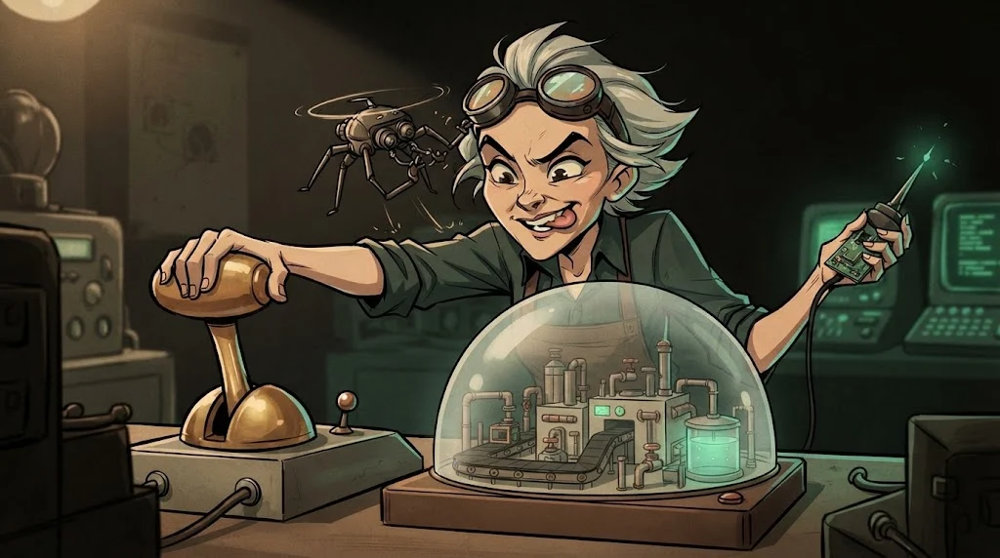

# Endüstriyel sistemler: IT/OT, SCADA ve Modbus

> Ofiste bir sunucu çökerse e-posta gecikir. Fabrikada bir vana yanlış açılırsa **fiziksel dünya** etkilenir.
> 🔧 **Devre 10:** Leman'ın listesinde bir de "ısıtma panosu" var. Biz ona laboratuvardaki maketinde bakacağız.



## IT ve OT

| | IT (bilgi teknolojisi) | OT (operasyonel teknoloji) |
|---|---|---|
| Öncelik | Gizlilik | **Emniyet ve süreklilik** |
| Ömür | 3–5 yıl | 15–30 yıl |
| Yama | Düzenli | Nadiren, planlı duruşta |
| Tarama | Rutin | Hassas cihazı **durdurabilir** |

## Parçalar

- **PLC** (Programmable Logic Controller): sahadaki motoru, vanayı süren küçük bilgisayar.
- **HMI** (Human-Machine Interface): operatörün ekranı.
- **SCADA**: birçok sahayı uzaktan izleyen ve yöneten sistem.
- Katmanlı ağ (Purdue modeli): ofis ağı ile saha ağı arasında ayrı bir ara bölge (DMZ).

## Modbus: soru sorana cevap verir

Modbus TCP (port 502) 1970'lerin tasarımıdır: **kimlik doğrulama ve şifreleme yok.**
Ağa erişen herkes register okuyabilir, yazma komutu da gönderebilir.

```bash
# yalnızca laboratuvar VM'indeki Modbus simülatörüne; yalnızca OKUMA
mbpoll -m tcp -a 1 -r 1 -c 5 -t 4 -1 192.0.2.50
```

Savunma: OT ağı internetten ve ofis ağından ayrı, Modbus'a yalnızca HMI'dan izin, OT'yi anlayan IDS ile izleme.

## ⚠️ Kesin kural

Gerçek bir endüstriyel sisteme, kampüsün ısıtma/enerji/su sistemlerine veya bina otomasyonuna **asla** dokunulmaz,
taranmaz. Bu yol yalnızca **simülatör** ve kulüp maketleriyle çalışır. Sahada tek bir paket bile insanları etkileyebilir.

## 🧪 Dene (4 dk)

Laboratuvar VM'inde Wireshark açıkken simülatöre yukarıdaki okuma isteğini gönder.
Pakette kullanıcı adı, parola ya da imza alanı var mı? Bir saldırganın aynı ağdan neler yapabileceğini yaz.

## ✅ Akılda kalsın

- OT'de öncelik emniyet ve sürekliliktir; tarama bile risk olabilir.
- Modbus kimlik sormaz; koruma ağ ayrımından gelir.
- Endüstriyel testler yalnızca simülasyonda yapılır.
