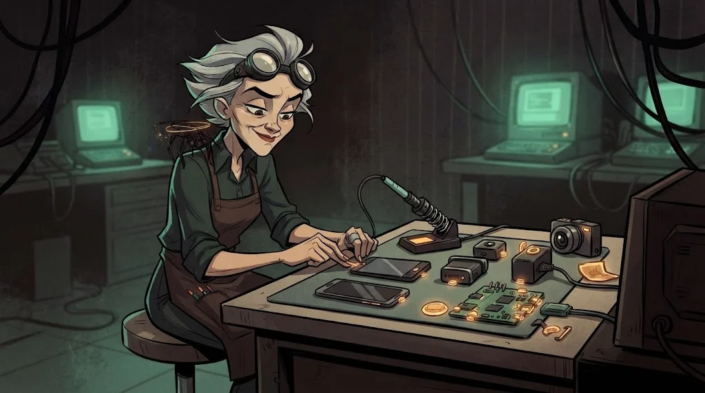
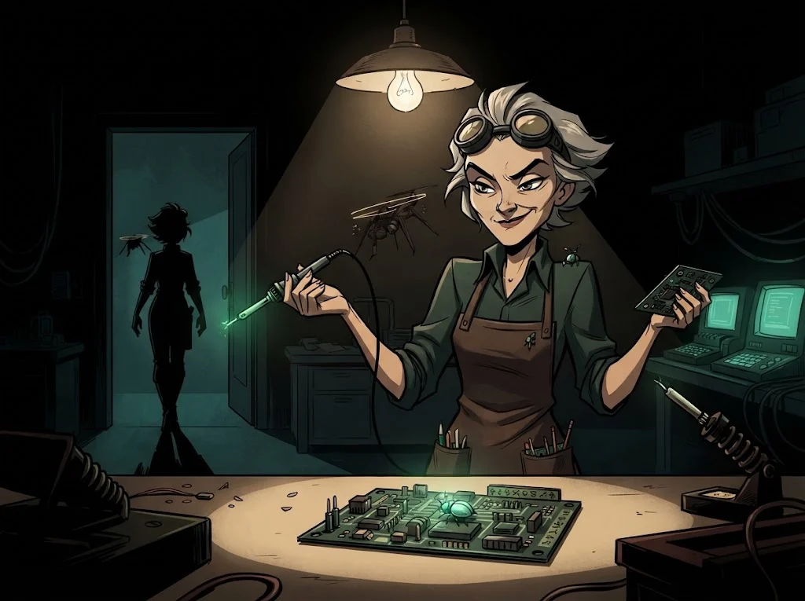

# Final: akıllı cihaz ve mobil uygulama güvenlik denetimi

> Denetim tek bir açığı bulmak değil; **cihazın bütün kapılarını haritalamak, kanıtlamak ve kapatmaktır**.
> 🔧 **Son devre:** Laboratuvar tezgâhı senin. Leman'ın kurduğu her gözü ve kulağı aç, incele, kapat.

## Görev

Eğitmenin onayladığı **bir** hedef seç ve **yazılı kapsamla** değerlendir:

- **A — Laboratuvar kiti:** ESP32 kapı kilidi prototipi + laboratuvar MQTT broker'ı + eşlik eden mobil uygulama
- **B — Eğitim uygulaması:** DIVA, InsecureBankv2 veya bir OWASP MASTG test uygulaması (emülatörde)
- **C — Kendi projen:** kendi yazdığın uygulama ya da kendi IoT prototipin

Adımlar:

1. **Tehdit modeli** — saldırı yüzeyi haritası, varlıklar, olası saldırganlar (F11)
2. **Envanter** — bileşenler ve sürümler, izinler, açık servisler (F02, F08)
3. **Test** — statik, dinamik, ağ ve (A için) firmware/donanım incelemesi (F03–F10)
4. **Bulgular** — en az 6; MASVS veya OWASP IoT Top 10 ile eşlenmiş, her biri kanıtlı
5. **Düzeltmeler** — her bulgu için somut öneri ve öncelik

Donanım çalışması yalnızca laboratuvar kartlarında ve elektrik güvenliği kurallarıyla; radyo testleri yalnızca kendi cihazına.

## Rapor iskeleti

| Bölüm | İçerik |
|---|---|
| **Yönetici özeti** | En büyük 3 risk, olası etki, ilk yapılacaklar |
| **Kapsam** | Hedef, sürüm, yöntem, tarih, izin |
| **Tehdit modeli** | Saldırı yüzeyi çizimi + tehdit tablosu |
| **Bulgular** | Başlık, risk (yüksek/orta/düşük), kanıt, eşleştirme, öneri |
| **Düzeltme planı** | Hemen · bu sürüm · sonraki tasarım |

## Değerlendirme

| Ölçüt | Puan |
|---|---:|
| Kapsama ve etik kurallara uyuldu | 2 |
| Tehdit modeli ve envanter eksiksiz | 2 |
| Bulgular doğrulanmış, kanıtlı ve eşlenmiş | 3 |
| Düzeltmeler uygulanabilir ve önceliklendirilmiş | 2 |
| Rapor okunaklı ve yönetici özeti net | 1 |

## ✅ Akılda kalsın

- Denetim haritayla başlar, kapatılmış kapılarla biter.
- Her bulgu kanıtlı, eşlenmiş ve önceliklidir.
- En iyi cihaz, varsayılanı zaten güvenli olan cihazdır.

> 🔒 **DOSYA KAPANDI: Lehimci Leman** · *raporunu teslim edince*
>
> 
>
> Kameralar kapandı, kilitler yeniden programlandı. Leman'ın tezgâhında yarım kalmış bir kart duruyor; içinde minik, mekanik bir böcek. Kartın arkasına kazınmış not: "Sabri Usta'ya teslim."
>
> ➡️ *Sezon 2 sürüyor: diğer uzmanlık yollarında Gölge Ağ'ın başka dosyaları seni bekliyor.*
