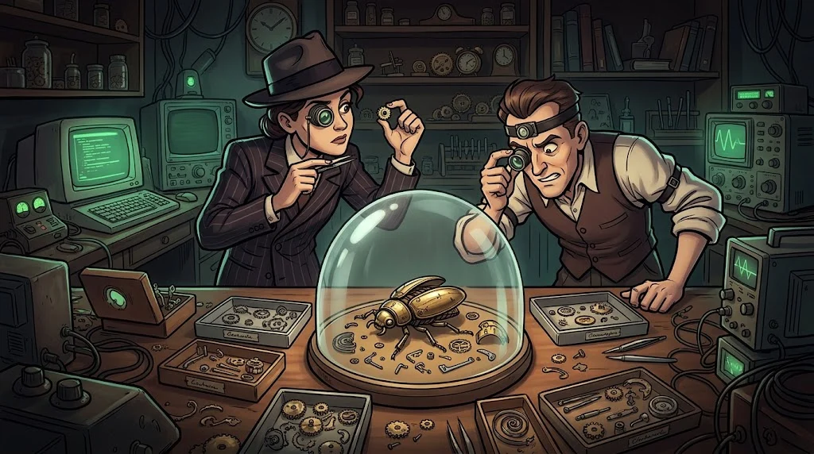

# Path G — Malware Analysis and Reverse Engineering

> What does a program **actually** do? The art of finding out without source code.

::cizgi[g-00-sahne]

> 🕴️ **FILE: Clockmaker Sabri** · *Master of Mechanical Bugs*
>
> 
>
> **Who is he?** The family's oldest master. He builds the mechanical bugs that feed the Mirror; twenty years ago he also made the golden key on young Eren's neck.
> [Shadow Network story →](../../00-program/09-golge-ag.md)

::cizgi[sabri-acilis]

**Prerequisite:** Linux (M04), Windows (M03), Python (M07)

## ⚠️ Lab safety rules (non-negotiable)

1. Samples are opened **only** in an isolated analysis virtual machine: a clean **snapshot** first, roll back when you're done.
2. Network **off** or host-only; shared folders, shared clipboard and drag-and-drop **off**.
3. Only the **harmless training samples** your instructor provides, the EICAR test file and publicly available crackmes.
4. Real malware is **never downloaded or shared**; samples are **never** run on a personal computer.
5. This path teaches you to **recognise and stop** malware; writing, packing or evading detection is out of scope.

## 12 lessons

| # | Lesson | In one sentence |
|---|---|---|
| G01 | [Fundamentals of reverse engineering](01-temeller-ve-guvenli-lab.md) | Static and dynamic analysis, a safe environment |
| G02 | [Windows internals](02-windows-ic-yapisi.md) | Process, DLL, the PE format |
| G03 | [Assembly fundamentals](03-assembly-temelleri.md) | Registers, stack, control flow |
| G04 | [Static analysis](04-statik-analiz.md) | Import tables and strings with Ghidra |
| G05 | [Dynamic analysis](05-dinamik-analiz.md) | Debugger, breakpoints, API monitoring |
| G06 | [.NET analysis](06-dotnet-analizi.md) | IL and decompiled code |
| G07 | [Malware types](07-zararli-turleri.md) | Trojans, ransomware, persistence indicators |
| G08 | [Behaviour analysis](08-davranis-analizi.md) | File, registry and network traces, and IOCs |
| G09 | [Memory safety](09-bellek-guvenligi.md) | How buffer overflow works, and safe memory |
| G10 | [Exploit development fundamentals](10-crash-analizi.md) | Crash analysis, ASLR/DEP — training programs only |
| G11 | [Detection](11-yara-tespit.md) | YARA and behavioural indicators |
| G12 | [Final](12-final-analiz-raporu.md) | An analysis report for the instructor's sample |

## Capstone output

A **malware analysis report** or a reverse engineering technical file.

## Safety

Every sample analysed is **prepared for training by the instructor** and examined in non-networked,
reversible virtual machines. Downloading or sharing real malware is not part of this path.
