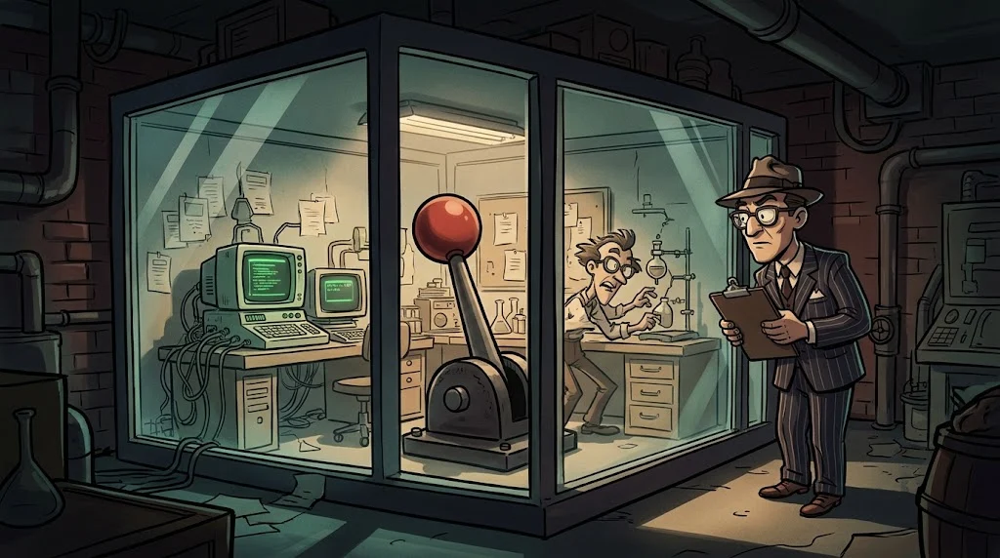

# What is reverse engineering? A safe analysis lab

> There's no source code, only a file in your hand. Reverse engineering reveals what that file **actually** does.
> ⚙️ **Cog 1:** Professor Selim leaves a sealed USB drive on your desk: "We caught one of Sabri's bugs on the campus network. Build its cage before you open it, Fox."

::cizgi[g-01-sahne]

## Two views

| Method | What does it do? | Example tool |
|---|---|---|
| **Static analysis** | Examines the file **without running it** | `file`, strings, a PE viewer, Ghidra |
| **Dynamic analysis** | Runs it in an isolated environment and watches its **behaviour** | Procmon, x64dbg, fake network services |

A good analyst uses both together: static analysis gives hints, dynamic analysis confirms them.

## The analysis lab



- **Windows analysis VM** — the FLARE-VM idea: a Windows loaded with analysis tools. The sample is opened here.
- **Linux helper VM** — the REMnux idea: strings, YARA, fake DNS/HTTP services.
- The two see each other only on a **host-only** network; there's no route to the internet or the campus network.

## Non-negotiable rules

1. Take a **clean snapshot** before opening the sample; roll back to it when you're done.
2. Network **off** or host-only; shared folders, shared clipboard and drag-and-drop **off**.
3. Only the instructor's **training samples**, the EICAR test file and publicly available crackmes. Live malware is **never downloaded**.
4. A sample is **never** opened on your personal computer; it's carried in a password-protected archive with a broken extension (`.exe_`).

## 🧪 Try it (5 min)

Open your analysis VM's settings and fill in this list:

```text
[ ] Network adapter   : host-only or not connected
[ ] Shared folder     : off
[ ] Clipboard / drag-and-drop: off
[ ] Snapshot name     : temiz-baslangic
```

Then, inside the VM, take the hash of the EICAR test file that comes ready in your instructor's lab image.
EICAR is harmless; it's a trial file that antivirus products recognise.

```powershell
Get-FileHash .\eicar.com.txt -Algorithm SHA256
```

## ✅ Remember

- Static analysis gives hints, dynamic analysis confirms.
- A sample is opened only in a VM with a snapshot, no network and sharing turned off.
- Live malware is never downloaded; only training samples are used.
