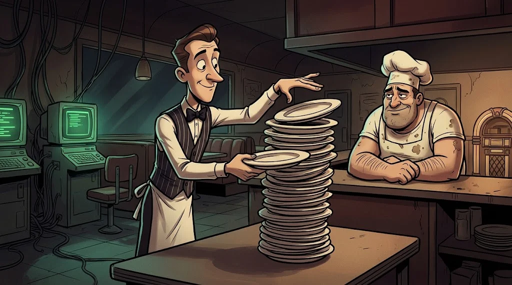
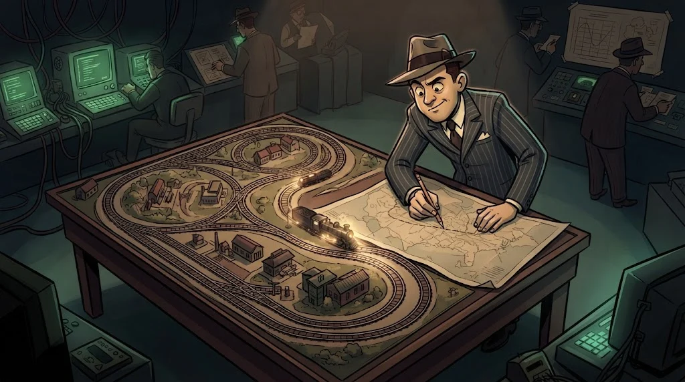

# Assembly temelleri: register, stack ve kontrol akışı

> Kaynak kod gitmiş olabilir ama işlemcinin okuduğu komutlar duruyor. Assembly, o komutların insan okuyabilen hâlidir.
> ⚙️ **Çark 3:** Böceğin dişlileri makine dilinde dönüyor. Selim Hoca gülümsüyor: "Sabri'nin sabrına sabırla cevap vereceksin."

::cizgi[g-03-sahne]

## Register'lar: işlemcinin cep defteri

| x64 | x86 | Tipik kullanım |
|---|---|---|
| `RAX` | `EAX` | Hesap, fonksiyonun **dönüş değeri** |
| `RCX` `RDX` `R8` `R9` | — | Windows x64'te ilk 4 fonksiyon argümanı |
| `RSP` | `ESP` | Stack'in tepesi |
| `RIP` | `EIP` | Sıradaki komutun adresi |

## Stack



Stack (yığın) üst üste dizilen tabaklar gibidir (LIFO): `push` koyar, `pop` alır.
`call` dönüş adresini stack'e iter ve fonksiyona atlar; `ret` o adresi alıp geri döner.

## Sık görülen komutlar

```asm
mov  eax, 5        ; eax = 5
add  eax, 3        ; eax = eax + 3
cmp  eax, 8        ; karşılaştır, bayrakları ayarla
jne  yanlis        ; eşit değilse "yanlis"a atla
call kontrol_et    ; fonksiyonu çağır
xor  eax, eax      ; eax = 0 (kısa yol)
```

## Kontrol akışını okumak



- `cmp` / `test` + koşullu atlama (`je`, `jne`, `jg`, `jl`) = bir **if**.
- Geriye doğru atlayan bir atlama çoğu zaman **döngüdür**.
- Crackme'lerde parola kontrolü genellikle tek bir karşılaştırma ve tek bir `jne`'dir.

## 🧪 Dene (5 dk)

Kâğıt kalemle çalıştır:

```asm
    mov  ecx, 0
    mov  eax, 1
dongu:
    add  eax, eax
    inc  ecx
    cmp  ecx, 4
    jl   dongu
```

Döngü kaç kez döner, sonunda `eax` kaçtır? Aynı işi yapan üç satırlık Python kodunu yaz.

<details><summary>Cevap</summary>4 kez döner; eax = 16. Python: <code>eax = 1</code> · <code>for _ in range(4):</code> · <code>eax += eax</code></details>

## ✅ Akılda kalsın

- Register'lar işlemcinin cep defteri; `RIP` sıradaki komutu gösterir.
- `call` stack'e dönüş adresini koyar, `ret` onu alıp geri döner.
- Karşılaştırma + koşullu atlama = if; geriye atlama = döngü.
