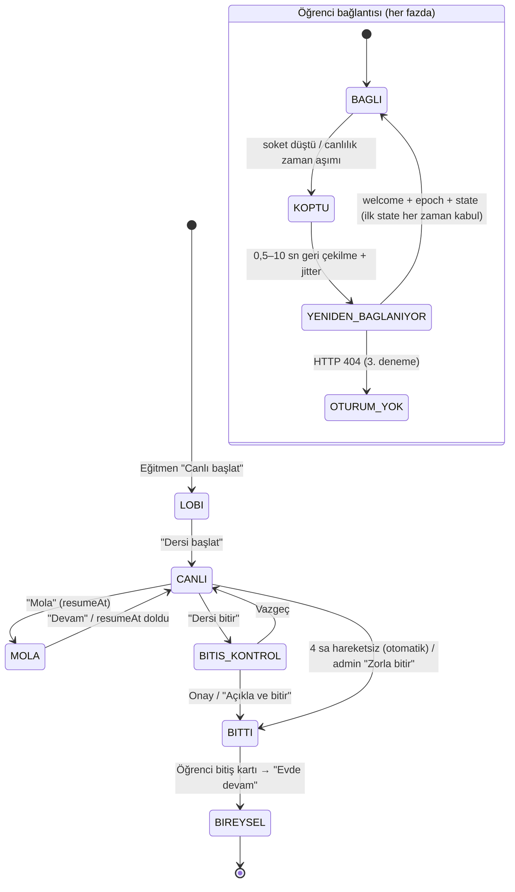

# 04 — Nihai UX/UI spesifikasyonu

> **Not:** Ajanlar bu oturumda Claude Code alt ajanı olarak, her biri kendi `.claude/agents/<ad>.md` tanımını sistem rolü olarak okuyarak AYRI ayrı çalıştırıldı (yeni eklenen ajan tipleri oturum yeniden başlamadan yerel tip olarak yüklenemediği için). Agent Teams kullanılmadı; tartışma, ana ajanın ayrı raporları birbirine iletmesiyle yürütüldü — "simüle edilmiş toplantı" değil, ayrı raporlardan sentez. Tur 1'de çalışan ajanlar: tryhackme-ux, htb-academy-ux, elite-ui-director, student-zero-knowledge, student-curious-beginner, student-bored-skeptic, underground-storyteller, learning-scientist, gamification-economy, interactive-mission, club-live-experience, motion-visual, accessibility-simplicity, student-ux-research, product-admin, technical-architect.

| Alan | Değer |
|---|---|
| Hazırlayan | Tasarım konseyi belge yazıcısı (ana ajanın ilettiği raporlardan sentez) |
| Tarih | 2026-10-23 |
| Girdiler | `00-current-state.md`, `MASTER_PROMPT.md`, `docs/TASARIM-SISTEMI.md`, Tur 1 raporları (elite-ui-director, tryhackme-ux, htb-academy-ux, accessibility-simplicity, club-live-experience, gamification-economy, product-admin, motion-visual), Tur 2 tartışma metinleri (tryhackme-ux, htb-academy-ux, elite-ui-director, learning-scientist, underground-storyteller), Tur 3 yargıç puanları (learning-scientist, accessibility-simplicity, student-ux-research) |
| Durum | Taslak spesifikasyon. **Hiçbir madde gerçek öğrenciyle sınanmadı.** Kabul eşikleri hedeftir, ölçüm sonucu değildir. |

### Kanıt etiketleri

| Etiket | Anlamı |
|---|---|
| **[Kod]** | Bir ajan repoda dosyayı okuyarak doğruladı (dosya/satır verildi). |
| **[Varsayım]** | Doğrulanmamış çıkarım; testle sınanmalı. |
| **[Simülasyon]** | Öğrenci persona ajanının tepkisi; gerçek kullanıcı verisi değil. |
| **[Sentez]** | Ajanlar arasında açık kalan bir çelişki için bu belgede önerilen çözüm; konsey onayı bekler. |
| *(aktaran: X)* | Raporu bu turun girdisinde olmayan bir ajanın görüşü, X ajanının raporundaki alıntıdan alındı. |

Öğrenci persona ajanlarının (student-zero-knowledge, student-curious-beginner, student-bored-skeptic) ve interactive-mission ile technical-architect'in kendi raporları bu belgenin girdisinde yoktu. Görüşleri yalnızca diğer ajanların alıntıları üzerinden aktarılıyor.

---

## 1. Seçilen konsept

### 1.1 Ağırlıklı matris sonucu

Ağırlıklar MASTER_PROMPT Tur 3'ten: anlaşılabilirlik %35, ilgi %25, öğrenme %20, erişilebilirlik %10, maliyet %10. Puanlar üç yargıcın (learning-scientist, accessibility-simplicity, student-ux-research) **uzman değerlendirme puanlarının ortalamasıdır, ölçüm değildir.**

| Konsept | Anlaşılabilirlik | İlgi | Öğrenme | Erişilebilirlik | Maliyet (yüksek = ucuz) | **Ağırlıklı** |
|---|---|---|---|---|---|---|
| A · Mission Control | 7,7 | 5,7 | 6,3 | 7,7 | 6,3 | **6,77** |
| B · Cyber Mystery | 4,3 | 8,7 | 7,7 | 4,3 | 3,3 | **5,98** |
| C · Friendly Academy | 9,0 | 5,0 | 6,7 | 9,0 | 8,0 | **7,43** |

Tek başına C önde, ama üç yargıç da C'nin ilgi (5) puanının tutundurma için zayıf olduğunu yazdı. B'nin vaka mimarisi öğrenme ve ilgi için en güçlüsü, gece kabuğu ise anlaşılabilirlik ve erişilebilirlik için en riskli seçenek. Bu yüzden üç yargıç ve elite-ui-director **gerekçeli melez** önerdi.

### 1.2 Melez: "Kabuk A, gövde C, motor B"

| Katman | Kaynak konsept | Neyi kapsar | Neyi kapsamaz |
|---|---|---|---|
| **Kabuk** | A · Mission Control | 5 sekmeli gezinme, "Bugün" ekranı, tek "Sıradaki adım" kartı, ilerleme rayı, eğitmen/admin özetleri | 3 adımlı kurulum (elendi), ilk gün halka ve haftalık hedef (ertelendi) |
| **Ders gövdesi ve dil** | C · Friendly Academy | Krem zemin, tek `LessonFrame`, kısa cümleler, jargon parantezi + "Nedir?", gerekçe veren saygılı geri bildirim | Okuma metniyle başlayan ders (elendi: learning-scientist "yeterince zorlamıyor") |
| **Etkileşim motoru** | B · Cyber Mystery | Kanıt topla → karar ver → gerekçeni seç → yeni vakaya aktar | Gece kabuğu, sinematik giriş, Vaka Masası ana ekranı (elendi) |
| **Atmosfer** | B · Cyber Mystery | Yalnız kanca bandı (tek cümle + saat damgası) ve kapanış kartı (DOSYA KAPANDI + kötü adam ifşası) | Navigasyon, düğmeler, ders gövdesi |

Kaynak: elite-ui-director (Tur 1 tavsiyesi ve Tur 2 güncellemesi), learning-scientist (yargıç: "B atmosfer olarak değil, etkileşim motoru olarak"), accessibility-simplicity (yargıç), student-ux-research (yargıç), underground-storyteller (Tur 2: "hikâye süs değil, görevin kendisi").

### 1.3 Bağlayıcı kurallar

1. **Bir ekranda tek görsel dil.** Kabuk ekranı A dilinde, ders adımı C dili + B etkileşimiyle, kapanış kartı B atmosferiyle çizilir. İki görsel dil yan yana durmaz (MASTER_PROMPT Tur 3; elite-ui-director).
2. **Yüzeyi ilerleme değil nesne türü belirler.** Krem/beyaz yüzey ürünün çoğunu kaplar. Koyu yüzey yalnız kanıt nesnesinde (log kartı, ağ akışı) ve terminalde kullanılır. İlk görevde hiç koyu öğe yoktur (elite-ui-director Tur 2; tryhackme-ux ve htb-academy-ux ile uzlaşı).
3. **Karar anı tavanı:** Derste en fazla 3 karar anı; ilk görevde ve M01–M02'de en fazla 2. **[Sentez]** tryhackme-ux ve htb-academy-ux 2, elite-ui-director ve learning-scientist 3 dedi; bu belge yeni başlayan bölümünde alt sınırı, sonrasında üst sınırı alır.
4. **Her karar anı bir `yapabilir` maddesine eşlenir.** Eşlenmeyen madde "Bitince yapabileceğin" kartından silinir (htb-academy-ux Tur 2, learning-scientist yargıç şartı 1).
5. **XP ipucundan ve deneme sayısından bağımsızdır; ölçme arka planda yapılır** (`firstTry`, ipucu kullanımı). 2 yanlıştan sonra çözümlü örnek açılır (learning-scientist yargıç şartı 2).
6. **Ustalık XP'si quiz reformundan sonra devreye girer** (learning-scientist yargıç şartı 3).

---

## 2. Konseptten bağımsız P0 kapıları

Üç yargıç da en kritik P0'ların konsept seçiminden bağımsız olduğunu yazdı. Bu kapılar kapanmadan hiçbir ekran "tamam" sayılmaz (MASTER_PROMPT: "Öğrenci ajanları P0 sürtünme bildirirse UI direktörü düzeltmeden o ekranı tamamlanmış sayma").

| # | P0 | Kanıt | Karar | Kaynak |
|---|---|---|---|---|
| P0-1 | "Başla" broşüre gidiyor | [Kod] `continueTarget()` (`service.ts:185-191`) PROGRAM yolunu sıraya katıyor; ilk uygulama doğrusal sırada 14. sayfa. STARTED dalı da `p-01`'i geri döndürebiliyor. | PROGRAM türü hem "sıradaki ders" hem STARTED sorgusunda atlanır. `akademi.yaml` içinde `ilk_gorev:` alanı varsa önce o döner. | tryhackme-ux B1, htb-academy-ux Tur 2 |
| P0-2 | İlk ekranda tek birincil eylem yok | [Kod] `dashboard/page.tsx` sırası: galaxy bandı, Şu an canlı, Görevler + Duyurular, Akademi, XP kartı, Üyelik. Yeni hesapta ilk iki kart boş. | `completed === 0` iken ilk ekranda yalnız tek kart ve tek yeşil düğme. Lig, sıra, seri, haftalık hedef, kurulum formu ve modal yok. | elite-ui-director K3, tryhackme-ux B2, Tur 2 uzlaşısı |
| P0-3 | XP okumayı/beklemeyi ödüllendiriyor | [Kod] `MIN_READ_MS = 15_000` (`service.ts:144`), PRACTICE türünde yalnız `CompleteButton`; cevaplar `<details>` içinde açık. | Karar verilmeden "Dersi bitir" açılmaz; kilit nedeni görünür ("1 karar kaldı"); yanlış cevap ilerlemeyi durdurmaz; ustalık XP'si `firstTry` ile. | tryhackme-ux B3, htb-academy-ux K1, gamification-economy B1 |
| P0-4 | Kontrol noktasında kaba kuvvet | [Kod] `gradeQuiz` açıklamayı her cevapta döndürüyor (`service.ts:23-28`). | Seçenek karıştırma, varyant havuzu, ilk yanlışta cevabın verilmemesi. Bu reform XP tablosundaki `lesson.proof` ve `track.complete` değişikliklerinden önce gelir. | learning-scientist (P0-1, P0-2, yargıç) |
| P0-5 | "Emin değilim" kuralı | — | Yalnız belirsiz kartta doğru sayılır ve doğrulama eylemi seçtirilir. Net kartta yanlış sayılır ama ceza metni yoktur (metin §11.3'te sabitlendi **[Sentez]**). | learning-scientist P0-3, underground-storyteller Tur 2; student-zero-knowledge *(aktaran: learning-scientist)* "her zaman geçerli olsun" diyor |
| P0-6 | Koyu zeminde odak halkası görünmez | [Kod] `--focus` `rgba(46,46,46,.6)`, koyu sahne `#2E2E2E` (globals.css:97,156,221); oran ≈1:1 [Hesap]. | Kapsam bazlı `--focus-ring` (§9.4). | accessibility-simplicity B1 |
| P0-7 | Quiz sonucu ekran okuyucuya gitmiyor | [Kod] `LessonActions.tsx:108` ikon `aria-hidden`, doğru/yanlış yalnız kenar rengiyle. | `sr-only` "Yanlış cevap." metni, sonuç başlığına odak (§12). | accessibility-simplicity B2 |
| P0-8 | Canlıda eski slaytta donma | [Kod] `if (m.v <= vRef.current) return` yeniden bağlanınca ilk durumu da eliyor; `stateVersion` 250 ms gecikmeli yazılıyor. | Sunucu `epoch`, ilk `state` her zaman kabul, canlılık denetimi, `hostOnline`. | club-live-experience B2 |
| P0-9 | Eksik görsel kesik çizgili kutu | [Kod] `academy.css:79-81` `.md-img-missing`; 229 görselin 15'i hazır (`GORSELLER.md`). | Görsel hazır değilse bileşen hiç çizilmez. | motion-visual B1 |
| P0-10 | Uygulama sayfası "alta yaz" diyor, alan yok | [Kod] `m01-05` "Teslim" bölümü; sayfa yalnız `CompleteButton` gösteriyor. | Görev düzeni (`MissionRunner`) ile kanıt seçimi + isteğe bağlı tek cümle; vaat ya karşılanır ya silinir. | htb-academy-ux K1, student-ux-research yargıç |
| P0-11 | Kişisel veri yaşam döngüsü yok | [Kod] yalnız `EmailOutbox` 30 gün siliniyor; `AuditLog.ip` kalıcı. Silme/dışa aktarma ekranı bulunamadı (metin taraması, [Varsayım]: kod dışında yapılıyor olabilir). | "Veri ve Gizlilik" merkezi (§8, F10). | product-admin Bulgu 3 |
| P0-12 | Takma ad yok, herkes görünür adla | [Kod] `overallBoard`/`monthlyBoard` `displayName`, `username` açık. | Varsayılan takma ad, opt-out, yönetici gerçek adı görür. | gamification-economy B2, product-admin itiraz |

---

## 3. Ekran haritası

### 3.1 Öğrenci rolü (5 sekme)

| Sekme | Rota | Katman | Birincil eylem | Mevcut durumdan farkı |
|---|---|---|---|---|
| **Bugün** | `/dashboard` | A kabuk | Sıradaki adım / Canlıya katıl | 5 kart yarışı yerine tek kart + katlı "Kulüpte bu hafta" |
| **Öğren** — "Dersler, kendi hızında" | `/academy`, `/academy/[track]` | A kabuk, C kartlar | Devam et | Patika: sıradaki 3 düğüm açık, kalanı "+N adım"; Sezon 2 katlı; sade adlar |
| (ders) | `/academy/lesson/[slug]` | C gövde + B motor | Kontrol et / Devam / Dersi bitir | Tek uzun Markdown yerine `LessonFrame` adım kartları |
| **Canlı** | `/live`, `/live/[code]` | A kabuk (lobi/bitiş), sahne | Katıl | Lobi, mola, kopma şeridi, nabız, bitiş köprüsü |
| **Kulüp** — "Görevler · Dosyalar · Sınıflar" | `/tasks`, `/files`, `/groups`, `/announcements` | A kabuk | Görevi aç | "Sınıf ▾" menüsü kalkar, alt sekmeler gelir |
| **Ben** — "İlerleme · Hesap" | `/u/[kullanıcı]`, `/leaderboard`, `/account` | A kabuk | — | XP, rozet, liderlik alt sekmesi, gizlilik, veri indirme |

Kaynak: tryhackme-ux (Ek görev A, Tur 2'de "Görevler" → "Kulüp", "Ben" alt sekmeleri). Bildirim zili sekme sayılmaz, ikon olarak kalır; duyurular Bugün sayfasına ve zile taşınır.

### 3.2 Personel rolleri (ek grup, yalnız ilgili rolde görünür)

| Rol | Rota | Yeni / değişen ekran |
|---|---|---|
| Eğitmen | `/teach` | Ana sayfa + **Hızlı Etkinlik** sihirbazı `/teach/new` (product-admin Ö1) |
| Eğitmen | `/teach/live/[id]` | Üç bölgeli konsol, yansıtma kipi, bitirme kontrol listesi (club-live-experience Ö3, product-admin itiraz) |
| Eğitmen | `?present=1` | Projeksiyon "salon" kipi: krem zemin, katıl rozeti (club-live-experience Ö3, elite-ui-director Tur 2) |
| Eğitmen | `/teach/tasks/...` | Yayın öncesi özet kartı, "Öğrenci gözüyle" önizleme (product-admin Ö2) |
| Yönetici | `/admin` | 4 KPI + eylem listesi (elite-ui-director konsept A) |
| Yönetici | `/admin/live` (yeni) | Aktif oturum tablosu, zorla bitir, kontrol devral (club-live-experience §3) |
| Yönetici | `/admin/privacy` (yeni) | Saklama ayarları, silme talepleri (product-admin Ö3) |
| Yönetici | `/admin/xp` | "Ağı Kurtar" ortak görevi aç/kapat, beklemedeki XP incelemesi (gamification-economy §5) |

### 3.3 Değişmeyen ekranlar

`/setup`, `/login`, `/register`, `/forgot-password`, `/reset-password`, `/notifications`: yapı korunur. Yalnız şu değişiklikler uygulanır: kayıtta aydınlatma özeti ve onay (product-admin), `Field` bileşeninde ipucunun hata anında silinmemesi (accessibility-simplicity B6).

---

## 4. Navigasyon

### 4.1 Masaüstü (≥1180px)

```
┌─ header degradesi (--ciu-gradient-header) ──────────────────────────────────────────┐
│ [logo] CIU CYBER SECURITY CLUB   Bugün  Öğren  Canlı●  Kulüp  Ben   │ Eğitmen ▾ │ 🔔 [Ad ▾] │
└──────────────────────────────────────────────────────────────────────────────────────┘
```

- "Canlı" sekmesindeki macenta nokta yalnız açık oturum varken görünür; ekran okuyucu metni "Canlı, açık oturum var".
- "Eğitmen ▾" ve "Yönetim" yalnız o rollerde, ayraçtan sonra.
- Marka bağlantısının erişilebilir adı: "{kulüp adı} – ana sayfa" (görünen metinle uyumlu; WCAG 2.5.3; accessibility-simplicity B6).

### 4.2 Mobil (<768px)

```
┌──────────────────────────────┐
│ [logo]              🔔  [≡]* │  * hamburger yalnız personel menüsü için
├──────────────────────────────┤
│                              │
│          içerik              │
│                              │
├──────────────────────────────┤
│ Bugün  Öğren  Canlı●  Kulüp  Ben │  alt çubuk, her öğe ≥48px dokunma alanı
└──────────────────────────────┘
```

- Alt çubuk yalnız öğrenci sekmeleri. Ders içinde (`LessonFrame`) alt çubuk gizlenir; yerine yapışkan eylem çubuğu gelir.
- 768–1179px arası: üst çubukta 5 sekme ikon + kısa etiket; personel menüsü hamburger.
- Doğrulanacak varsayım: alt çubuk dokunma alanı ≥48px ve iOS güvenli alanla çakışmıyor (tryhackme-ux).

### 4.3 Odak ve klavye

- İlk Tab: "İçeriğe atla" bağlantısı → ikinci Tab: sayfanın birincil düğmesi (elite-ui-director kabul testi 3).
- Menü Esc ile kapanınca odak tetikleyici düğmeye döner (accessibility-simplicity B6; şu an `<body>`'ye düşüyor [Kod] `AppShell.tsx:56-58`).

---

## 5. Ana akışlar

### F1 · İlk giriş → ilk küçük başarı (hedef: ilk karara ≤2 tıklama, ilk geri bildirim <90 sn)

```
Kayıt onaylandı / davetle giriş
   │
   ▼
/dashboard  (completed === 0)
   │  tek kart: "İLK GÖREV · ≈3 DK · Bir mesaj geldi. Gerçek mi?"  [Mesajı aç →]
   ▼  (1. tıklama)
/academy/lesson/<ilk_gorev>   adım 1/3 — kanca + seçim aynı ekranda
   │  "Gönderene dokun ▸" çipi görünür (hover'a bağlı değil)
   ▼  (2. tıklama = ilk karar)
anında geri bildirim (doğru/yanlış + neden)
   ▼
adım 2/3 kanıt seç → adım 3/3 karar → kapanış kartı (DOSYA KAPANDI + ifşa) → +XP
   ▼
"Sıradaki (≈4 dk)"  |  "Bugünlük yeter"
   ▼ (isteğe bağlı, tek satır)
"Daha önce bu konuyla ilgilendin mi?  İlk kez / Biraz"   (rotayı değiştirmez)
```

- Kurulum formu yok; seviye sorulmaz, gözlemlenir. İlk iki karar ilk denemede doğruysa sonuç ekranında "Hızlı gidiyorsun, istersen 2 dersi atla" önerisi çıkar; varsayılan yol herkes için aynıdır (learning-scientist Tur 2 Çelişki 3).
- Takma ad otomatik atanır; seçim kartı liderliğin ilk ziyaretinde satır içinde açılır (tryhackme-ux Tur 2, gamification-economy, elite-ui-director kabulü).
- İlk görev uzunluğu: **3 adım, ≈3–4 dk** (tryhackme-ux, htb-academy-ux Tur 2). Sınıflandırma adımı M01 sonundaki "Beceri kontrolü · 3 yeni mesaj" sayfasına taşınır (htb-academy-ux Tur 2). interactive-mission'ın bu taşımaya onayı alınmadı (student-ux-research yargıç notu); açık konu §17.

### F2 · Geri dönen öğrenci → kaldığı yer

```
/dashboard → "Sıradaki adım" kartı (ders adı, Adım n/N, ≈dk, +XP) → [Devam et] → /academy/lesson/<slug>#adim-n
```

- Adım durumu sunucuda tutulur; yenilemede aynı adıma dönülür (htb-academy-ux Ö3).
- 2 günden uzun aradan sonra "Geri dönüş görevi" kartı (gamification-economy Ekran C; F9).

### F3 · Ders adımı ve karar anı

```
Okuma adımı ──[Devam]──► Karar adımı ──seçim──► [Kontrol et]
                                         │
                       ┌─────────────────┼──────────────────┐
                    doğru             yanlış (1.)        yanlış (2.)
                       │                 │                  │
              "✓ Yakaladın…"     ipucu 1 açılır      çözümlü örnek açılır
              [Devam (n/N)]      seçim ekranda kalır  "Birlikte bakalım…"
                                                         [Devam]
Son karar yanıtlandı ──► [Dersi bitir] aktif ──► kapanış / XP
```

- `firstTry` ve ipucu kullanımı kaydedilir, öğrenciye ceza olarak gösterilmez (learning-scientist Tur 2 Çelişki 2).
- Yem etiketi seçmek kartı geçersiz kılmaz, sayılır.
- "Dersi bitir" doğru cevap şartı aramaz, yanıt şartı arar (tryhackme-ux Tur 2 Çelişki 1).

### F4 · Canlı derse katılım

```
Bugün kartı "CANLI · {başlık}" [Katıl] ─┐
Canlı sekmesi → kod gir / QR ───────────┼─► /live/[code]
Akademi dersindeyken üst şerit ─────────┘        │
  "Canlı ders başladı: {başlık}. [Katıl] [Sonra]" │
                                                  ▼
                              phase=lobby → "Odadasın ✓ 23 kişi burada…"
                              phase=live  → sahne + alt çubuk
```

- Akademi dersindeyken canlı farkındalık şeridi: club-live-experience B4 ("Akademi dersini çalışan öğrenci oturumun başladığını bilmiyor"). Şerit dersin üstünde ince, kapatılabilir; dersi kesmez.

### F5 · Kopma ve yeniden bağlanma

§13'teki durum diyagramına bakın. Öğrenci kopunca slayt görünür kalır, perde inmez; ince şerit çıkar.

### F6 · Canlı bitiş → bireysel mod

```
Eğitmen [Dersi bitir] → kontrol listesi (açıklanmamış quiz, açık sorular, süren teslim)
   → phase=ended → öğrenci bitiş kartı:
      "Ders bitti. +25 XP işlendi. Bugünün konusu: Sahte Mesajlar.
       Evde devam: Şüpheli Mesaj (6 dk)  [Devam et]
       Sorun cevapsız kaldıysa: 'Sorularım' sayfasında."
   → /academy/lesson/<sunumdaki akademi: slug>
```

Kaynak: club-live-experience Ö4; tryhackme-ux Ek görev B-3 metni ("Ders bitti, merak bitmedi…"). Sunum bloğuna isteğe bağlı `akademi: lesson-slug` alanı eklenir. "+25 XP" yalnız XP gerçekten işlendiyse yazar.

### F7 · Eğitmen: 3 dakikada etkinlik

| Süre (hedef) | Adım | Zorunlu alan |
|---|---|---|
| 0:00–0:45 | Şablon seç ("Phishing 60 dk", "Log okuma 60 dk", "Boş etkinlik") | şablon |
| 0:45–1:45 | Başlık, tarih/saat, kitle (aranabilir çoklu seçim, "Başlangıç A sınıfı (24 kişi)") | başlık, tarih, kitle |
| 1:45–2:45 | + Görev · + Dosya · + Hızlı soru (hepsi isteğe bağlı); "Gelişmiş ayarlar" katlı | — |
| 2:45–3:00 | Özet kartı + **Yayınla (24 kişiye bildirim)** | yayınla |

Kaynak: product-admin Ö1. Etkinlik bir paket olur: `ClassGroup (EVENT)` altına sunum, canlı ders, görev ve dosya bağlanır (`LiveSession.groupId`, `Assignment.groupId` gerekir). Taslak otomatik kaydedilir. 3 dakika hedefi ölçülmedi ([Varsayım]).

### F8 · Liderliğin ilk ziyareti

Satır içi kart (modal değil, tryhackme-ux Tur 2):

```
Listede nasıl görünmek istersin?
Sıralama isteğe bağlı.
( ) Takma adımla görün (önerilen) — Gece Tilkisi-47  [Yeniden üret]
( ) Gerçek adımla görün — {Ad} {Soyadı baş harfi}.
( ) Listede görünme — Puanın, seviyen ve rozetlerin yine çalışır.
Yöneticiler sorun çözmek için gerçek adı görebilir. İstediğin zaman Hesap sayfasından değiştirebilirsin.
[Kaydet]   [Şimdilik atla]
```

Kaynak: gamification-economy Ekran A; "yöneticiler gerçek adı görür" kuralı product-admin itirazından. Seçim yapılmadan otomatik takma ad kullanılır.

### F9 · Ara verip dönme

```
Hoş geldin. 3 gündür yoktun, sorun değil.
5 dakikalık bir görev yap, serin kaldığı yerden devam etsin.
[Geri dönüş görevini başlat]   [Şimdi değil, yeni seri başlat]
```

Kaynak: gamification-economy Ekran C ve Ö3 (Sakin Seri: haftada 2 otomatik dinlenme günü, "Seri sıfırlandı" ekranı yok).

### F10 · Veri ve gizlilik

`/account` → **Verilerimi indir** (JSON/CSV: profil, XP, teslimler, dosya listesi) · **Hesabımı sil / anonimleştir** → onay penceresi:

```
Emin misin?
Adın silinir. Liderlik tablosundaki XP'n "Silinmiş üye" olarak kalır. Bu geri alınamaz.
[Vazgeç] (birincil, yeşil)      [Hesabımı sil] (ikincil, --ciu-error çerçeve)
```

Kaynak: product-admin Ö3. Saklama süreleri (denetim IP'si 90 gün, pasif üye 12 ay, teslim dosyaları dönem sonu + 6 ay) **öneridir**; kulüp ve hukuk danışmanı karar verir.

---

## 6. Metinsel wireframe'ler

Ölçüler TASARIM-SISTEMI §4'e göre: container ≤1100px, yan boşluk 16px, 8px ritim, kart 20px köşe, gölgesiz.

### 6.1 Bugün — ilk kullanım (`completed === 0`)

**Masaüstü**

```
┌ header ─────────────────────────────────────────────────────────────────┐
├─────────────────────────────────────────────────────────────────────────┤
│ krem zemin (--ciu-cream)                                                │
│   CIU CYBER SECURITY CLUB                 ← .eyebrow, micro 12 uppercase │
│   MERHABA, {AD}                           ← Lexend Tera H1 (hero, ≤6 kelime) │
│   Burada kimse "bunu bilmen gerekirdi" demez.   ← Readex 16, yalnız ilk giriş │
│                                                                         │
│   ┌ kart 20px, beyaz, 1px --ciu-ink-20 ──────────────────────────┐      │
│   │ İLK GÖREV · ≈3 DK · +XP                ← micro etiket          │      │
│   │ Şüpheli mesaj                          ← --type-section       │      │
│   │ Bir mesaj geldi. Gerçek mi? Sen karar ver.                     │      │
│   │                                       [ Mesajı aç → ]  ← tek yeşil │      │
│   └────────────────────────────────────────────────────────────────┘      │
│   Akademi nasıl işler?                     ← üçüncül metin bağlantı     │
│                                                                         │
│   ▸ Kulüpte bu hafta (2)                   ← katlı şerit, varsayılan kapalı │
└─────────────────────────────────────────────────────────────────────────┘
```

**Mobil (360–375px)**

```
┌────────────────────────────┐
│ [logo]            🔔       │
├────────────────────────────┤
│ CIU CYBER SECURITY CLUB    │
│ MERHABA, {AD}              │
│ ┌────────────────────────┐ │
│ │ İLK GÖREV · ≈3 DK      │ │
│ │ Şüpheli mesaj          │ │
│ │ Bir mesaj geldi.       │ │
│ │ Gerçek mi?             │ │
│ │ [   Mesajı aç →    ]   │ │ ← tam genişlik, 48px
│ └────────────────────────┘ │
│ Akademi nasıl işler?       │
│ ▸ Kulüpte bu hafta (2)     │
├────────────────────────────┤
│ Bugün Öğren Canlı Kulüp Ben│
└────────────────────────────┘
```

Kural: kart ve yeşil düğme 360px genişlikte kaydırmadan görünür (elite-ui-director kabul 4; tryhackme-ux). Lig, sıra, seri, haftalık hedef, XP toplamı **yok**.

### 6.2 Bugün — düzenli kullanım

**Masaüstü**

```
│ MERHABA, {AD}                                                            │
│ ┌ Sıradaki adım ──────────────────────────────┐ ┌ İlerleme (dar kolon) ┐ │
│ │ M03 · Hesap koruması            Adım 2/6     │ │ Bu ay 135 XP          │ │
│ │ İki adımlı giriş neden işe yarar?            │ │ Sakin Seri: 5 gün     │ │
│ │ ≈6 dk · +XP                                   │ │ Bu hafta: 3/5 karar   │ │
│ │                            [ Devam et → ]     │ │ Yeni Kadro · Mayıs ›  │ │
│ └──────────────────────────────────────────────┘ └──────────────────────┘ │
│ Kulüpte bu hafta                                                          │
│  · Görev: Log okuma — son teslim Cuma 23:59        [Aç]  ← ikincil        │
│  · Duyuru: Cuma CTF gecesi 18:00                                          │
│  · Kulüp hedefi "Ağı Kurtar": ████████░░ %80                               │
│ Hatırla · 3 soru · ≈2 dk                            [Başla] ← ikincil     │
```

- İlerleme kolonu ilk tamamlamaya kadar görünmez; haftalık hedef ilk hafta gizli (elite-ui-director Tur 2).
- Sıra numarası Bugün ekranında hiç gösterilmez; yalnız lig adı ve kişisel ilerleme (elite-ui-director itirazı, gamification-economy Ekran B).
- Mobilde ilerleme kolonu kartın altına tek satır olarak iner: "Bu ay 135 XP · Sakin Seri 5 gün ›".

### 6.3 Bugün — canlı oturum açıkken

```
│ ┌ kart, sol üstte macenta ● CANLI ──────────────────────────────┐ │
│ │ CANLI · Eğitmen: {ad} · 23 kişi                                 │ │
│ │ Sahte mesajlar — kulüp oturumu                                  │ │
│ │                                         [ Şimdi katıl → ]       │ │
│ └─────────────────────────────────────────────────────────────────┘ │
│ Sıradaki adım: M03 · Adım 2/6                [Devam et] ← ikincil   │
```

Canlı kart "Sıradaki adım"ın yerini alır; "Sıradaki adım" ikincil satıra iner (elite-ui-director Ö3). Ekranda tek yeşil düğme kalır.

### 6.4 Öğren (`/academy`)

```
│ ÖĞREN                                         ← H1                       │
│ ┌ Kaldığın yer ─────────────────────────────────────────────┐            │
│ │ Hesap koruması · Adım 2/6 · ≈6 dk          [Devam et →]    │            │
│ └────────────────────────────────────────────────────────────┘            │
│ Temel yol — ilk kez başlayanlar için · Ön koşul: yok                     │
│  ●── Dijital iz              ✓                                          │
│  ●── Hesap koruması          devam ediyor                               │
│  ○── Şüpheli mesajlar                                                   │
│  ○── İnternette veri yolculuğu                                          │
│  ┆   +8 adım  [Tümünü göster]                                           │
│ ▸ Derinleşmek isteyenlere · 7 yol            ← Sezon 2, ilk 3 ders bitene kadar katlı │
```

- Düğümler kilitli değil, "önerilen sıra" (htb-academy-ux Ö1: kilit simgesi caydırır [Varsayım]).
- Patikada sıradaki 3 düğüm açık (tryhackme-ux Tur 2, learning-scientist Tur 2).
- Modül adı sade Türkçe, kod küçük gri: "İnternette iz sürmek · M09" (tryhackme-ux Ö3). Zorluk rozeti yok; "Kimler için" satırı var (htb-academy-ux Tur 2). Zorluk bilgisi yalnız Sezon 2'de.

**Yol sayfası başı — "Bitince yapabileceğin" kartı** (htb-academy-ux Ö1)

```
BU MODÜL BİTİNCE
✓ Sahte bir burs mesajını 1 dakikada ayırt edebilirsin
✓ Dijital izini 3 adımda azaltabilirsin
Kimler için: ilk kez başlayanlar · Ön koşul: yok · ≈45 dk
```

Her madde bir karar anına eşlenir; ilerleme halkası okunan sayfayı değil geçilen karar anını sayar.

### 6.5 Ders içi — `LessonFrame` (adım dersi)

**Masaüstü**

```
┌ header (sade: ← Öğren · Hesap koruması · ×) ─────────────────────────────┐
│ ████████░░░░░░░░░░░░░░░░  Adım 2/6                 ← 12px ray, galaxy dolgu │
├──────────────────────────────────────────────────────────────────────────┤
│              ┌ gövde ≤640px, krem/beyaz ─────────────────┐               │
│              │ Şifre tek kilit                             │ ← --type-section │
│              │ Biri şifreni öğrense bile hesabına girmesi  │               │
│              │ için ikinci bir şey gerekir: telefonundaki  │               │
│              │ kod. Buna iki adımlı giriş (2FA) denir.     │               │
│              │                        [Nedir?] ← aria-expanded            │
│              │ [diyagram / maket / yok — tek görsel]       │               │
│              └─────────────────────────────────────────────┘               │
├ yapışkan eylem çubuğu (.action-bar) ─────────────────────────────────────┤
│ ‹ Geri                                                   [ Devam → ]      │
└──────────────────────────────────────────────────────────────────────────┘
```

**Mobil**

```
┌────────────────────────────┐
│ ← Hesap koruması        ×  │
│ ███████░░░░░░░░  2/6        │
│ Şifre tek kilit             │
│ Biri şifreni öğrense bile…  │
│ [Nedir?]                    │
│ [görsel, 16:9]              │
│                             │
├────────────────────────────┤
│ ‹ Geri        [ Devam → ]  │ ← yapışkan, güvenli alan payı
└────────────────────────────┘
```

Kaynak: elite-ui-director Tur 2 (`LessonFrame`: üstte ray, ≤640px gövde, altta yapışkan tek yeşil düğme); htb-academy-ux Tur 2 (iki düzen: adım dersi ve görev). Uzun bilgi sayfaları `read` yoğunluğunda aynı çerçeveyi kullanır: tek kolon ≤75ch, sağda yapışkan "Bu sayfada" listesi (≥1024px). Akordeon düzeni yalnız Sezon 2 ve isteğe bağlı derinleşmede.

### 6.6 Ders içi — karar anı

```
│ Adrese bak                                         Karar 1/2              │
│ Mesajdaki site ile okulun sitesi aynı mı?                                │
│  ( ) Aynı                                                                │
│  ( ) Farklı                                                              │
│  ( ) Emin değilim, başka yoldan kontrol ederim     ← ikincil hap          │
│                                                                          │
│ ├ eylem çubuğu ─────────────────────────────────────────────────────────┤
│ [İpucu 1/2]                                          [ Kontrol et ]      │
```

Geri bildirim aynı kartın altında açılır (`aria-live="polite"`, odak sonuca taşınır):

| Durum | Metin | Kaynak |
|---|---|---|
| Seçimsiz gönderim | "Önce bir tahmin seç. Yanlış olsa da olur." | htb-academy-ux Ö2 |
| 1. yanlış | "Yakın. Adrese harf harf bak: okulun adıyla birebir aynı mı?" + ipucu 1 açılır | htb-academy-ux Ö2; bored-skeptic düzeltmesi *(aktaran: tryhackme-ux)* |
| 2. yanlış | "Birlikte bakalım: adresi harf harf okulunkiyle karşılaştırıyoruz…" (çözümlü örnek) | learning-scientist Tur 2 |
| Doğru | "✓ Yakaladın. Benzeyen ama farklı bir adres, mesajdaki en güçlü işaret." → [Devam (adım 4/5)] | htb-academy-ux Ö2 |
| "Emin değilim" + net kart | "Dürüst cevap. Bu sefer ipucu ekranda: adrese bak." | underground-storyteller Tur 2 |
| "Emin değilim" + belirsiz kart | Zorunlu takip çipi: "Nasıl doğrularsın?" → [Okulun kendi sitesinden kontrol ederim] | elite-ui-director Tur 2, learning-scientist |

Güven sorusu: ilk 3 derste yok; sonra ders sonunda bir kez, atlanabilir: "Bunu yarın bir arkadaşına anlatabilir misin? [Evet] [Galiba] [Henüz değil]". XP ve sıralamayı etkilemez (learning-scientist Tur 2).

**"Dersi bitir" kilidi**

```
[ Dersi bitir ]  (pasif, --ciu-gray-50)   1 karar kaldı: "Gönderen kim?" ↑
```

Pasif düğme ya da yanındaki bağlantı tıklanınca eksik karar anına kaydırır ve odağı oraya taşır (htb-academy-ux Tur 2). Metin "Okudum, tamamla" kaldırılır.

### 6.7 Görev düzeni — ilk görev "Şüpheli mesaj · Kısa" (3 adım)

**Adım 1 — kanca + seçim (aynı ekran)**

```
│ ┌ kanca bandı (B atmosferi, tek satır) ──────────────────────────┐ │
│ │ 23:47 — Bir mesaj düştü.                                        │ │
│ └─────────────────────────────────────────────────────────────────┘ │
│ ┌ posta maketi (krem, koyu değil) ────────────────────────────────┐ │
│ │ Gönderen: Burs Ofisi ▾   [Gönderene dokun ▸]  ← görünür çip      │ │
│ │ Konu: Bursun onaylandı                                          │ │
│ │ "24 saat içinde doğrula, yoksa hakkın düşer."                   │ │
│ │ [ Hemen doğrula ] ← maket içi sahte düğme, tıklanınca uyarı     │ │
│ └─────────────────────────────────────────────────────────────────┘ │
│ Deniz ne yapsın?                                                    │
│ [Bağlantıya dokun]  [Göndereni incele]  [Gruba ilet]                │
```

Kaynak: underground-storyteller Tur 2 (kanca = görev cümlesi, ≈20 kelime, 0. saniyede seçim; saat damgası yalnız burada); tryhackme-ux Tur 2 ("Gönderene dokun ▸", hover'a bağlı hiçbir şey yok); elite-ui-director Tur 2 (posta maketi krem). Alan adları sentetik, `.example` uzantılı (MASTER_PROMPT güvenlik ilkesi).

**Adım 2 — kanıt seç** ("Bir tane seç" — htb-academy-ux Tur 2)

```
│ Gönderen satırı açık:  Burs Ofisi <onay@scholarship-campus.example>  │
│ Hangisi en güçlü işaret? Bir tane seç.                               │
│ [kku-burs-onay.example]  [24 saat]  [%100]                           │
```

Yanlış seçim ekranda kalır ve "neden yanlış" görünür. motion-visual Ö3: doğru kararda yalnız gönderen alanı çevresinde tek mor halka (300 ms; azaltılmış harekette yok).

**Adım 3 — karar** → **Kapanış kartı (B atmosferi)**

```
┌ kapanış kartı ───────────────────────────────────────────────┐
│ DOSYA KAPANDI                         ← damga, yalnız burada  │
│ [portre: Tatlı Dil Tevfik]            ← bölümde tek görsel     │
│ Mesajı "Burs Ofisi" yazmamıştı. Tatlı Dil Tevfik.              │
│ Kibar, acil, tanıdık. Hep böyle gelir.                         │
│ +XP · Nedenini yakaladın.             ← sayaç 600 ms (RM: anında) │
│ [ Sıradaki: Onay ikinci kez geldi → ]   Bugünlük yeter        │
│ Gölge Ağ hikâyesi →                   ← üçüncül, yalnız burada │
└──────────────────────────────────────────────────────────────┘
```

Kaynak: underground-storyteller Tur 2 (kötü adam ifşa olarak, portre yalnız kapanışta, ders gövdesindeki hikâye bağlantısı kapanışa taşınır); elite-ui-director Ö3 ("+30 XP · Nedenini yakaladın."); tryhackme-ux Ek görev B-2 ("İlk ipucunu kendin buldun…").

Nöbetçi anlatıcı yalnız üç yerde konuşur: kanca, yanlış cevabın sonucu, kapanış. Talimat metinleri düz Türkçe (underground-storyteller Tur 2).

### 6.8 Görev düzeni — kanıt masası (uygulama sayfaları, ör. log okuma)

**Masaüstü (≥1024px)**: gövde solda (≤640px), `slot="evidence"` sağda açılır; kanıt nesnesi `--surface-night` (log kartı).

```
│ ┌ gövde (krem) ────────────────┐ ┌ kanıt (--surface-night) ─────────────┐ │
│ │ Adım 2/4 · Kanıt 2/3 işaret   │ │ 08:14 giriş başarısız  kullanici_a     │ │
│ │ Hangi satır olağan dışı?      │ │ 08:14 giriş başarısız  kullanici_a     │ │
│ │ [İpucu 1/2]                   │ │ 08:15 giriş başarılı   kullanici_a  ◄  │ │
│ └───────────────────────────────┘ │       [Kanıt olarak işaretle]          │ │
│                                   └────────────────────────────────────────┘ │
```

**Mobil**: kanıt aynı kartın içinde; "Kanıtı aç" dokununca alttan panel açılır (elite-ui-director Tur 2). htb-academy-ux'in ayrı "inceleme masası" düzeni ayrı düzen değil, yuva olarak uygulanır. Masa tipleri dört ile sınırlı: gelen kutusu, log, dosya, ağ akışı (htb-academy-ux C). Log satırları örnek gösterimdir; gerçek içerik `content/academy/lab/` sentetik verisinden gelir.

### 6.9 Ben → İlerleme

```
│ {takma ad} · Seviye 3 "İz Başı"*          ← *unvan önerisi, P2             │
│ Bu ay 320 XP · Yeni Kadro ligi                                           │
│ Rozet rafı: [■][■][□][□]…                                                │
│ Yol haritası: Temel ●●●○○○○○○○○                                          │
│ Sakin Seri 5 gün · En uzun 12 gün                                        │
│ [Liderlik] alt sekmesi   [Hesap] alt sekmesi                              │
```

"Çaylak" unvanının yumuşatılması ("Yeni Kadro" / "İz Başı") P2 öneri (gamification-economy B4). "Kalkan dosyan" etiketi "XP ve seviyen" olur (elite-ui-director karar tablosu).

### 6.10 Liderlik (Ben → Liderlik)

```
│ [Aylık] [Tüm zamanlar]                      ← sekme, 3px mor alt çizgi    │
│ Yeni Kadro · Mayıs                                                        │
│  1  Gece Tilkisi-47      410                                              │
│  …  (ilk 10)                                                              │
│ ─── senin çevren ───                                                      │
│  14 Mavi Baykuş-12       155                                              │
│  15 SEN (takma adın)     135   ← mor çerçeve                              │
│  16 …                                                                     │
```

- Görünür katılımcı <5 ise liste açılmaz: "Liste en az 5 kişi olunca açılır."
- "Tüm zamanlar"da yeni üyeye varsayılan olarak seviye yolu gösterilir, sıra sayısı değil (gamification-economy Ö2).
- Mobil: tablo yerine 3 sütunlu satır listesi (sıra, ad, puan); yatay kaydırma yok (00-current-state sorun 9).

### 6.11 Admin özeti (`/admin`)

```
│ YÖNETİM                                                                  │
│ [Aktif üye] [Bu hafta geçilen karar anı] [Bekleyen teslim] [Onay bekleyen] │ ← 4 KPI, sayı yoksa "—" │
│ Yapılacaklar                                                              │
│  · 3 başvuru onay bekliyor                           [İncele]             │
│  · 1 XP "inceleme bekliyor"                          [Aç]                 │
│  · 1 canlı oturum 4 saattir hareketsiz               [Bitir]              │
│ Takılma noktaları: "M01, adım 4" (veri gelince dolar)                    │
```

KPI tanımları elite-ui-director konsept A'dan; "takılma noktası" konsept B admin özetinden (veri gelince doldurulur, şu an veri yok).

---

## 7. Bileşen listesi

| Bileşen | Nerede | Durum | Not | Kaynak |
|---|---|---|---|---|
| `AppShell` (5 sekme + personel grubu) | tüm üye sayfaları | Değişir | Esc odak dönüşü, marka erişilebilir adı | tryhackme-ux, accessibility-simplicity |
| `BottomTabBar` | mobil öğrenci | Yeni | ≥48px öğe, ders içinde gizli | tryhackme-ux |
| `NextStepCard` | Bugün, Öğren | Yeni | Tek yeşil düğme; ilk görev / devam / canlı varyantı | elite-ui-director Ö3, tryhackme-ux Ö1 |
| `ClubWeekStrip` | Bugün | Yeni | Katlı; görev, duyuru, ortak görev | tryhackme-ux, elite-ui-director |
| `ProgressColumn` | Bugün (ilk tamamlamadan sonra) | Yeni | Aylık XP, Sakin Seri, haftalık karar hedefi | elite-ui-director, gamification-economy |
| `PathRail` | Öğren | Yeni | 3 açık düğüm + "+N adım"; kilitsiz | htb-academy-ux, tryhackme-ux |
| `OutcomeCard` ("Bitince yapabileceğin") | yol sayfası | Yeni | Maddeler karar anına eşli | htb-academy-ux Ö1 |
| `LessonFrame` | tüm dersler | Yeni | `step` / `read` yoğunluğu, `slot="evidence"` | elite-ui-director Tur 2 |
| `StepProgress` | LessonFrame üstü | Yeni | 12px, galaxy, `role="progressbar"`, karar anı sayar | htb-academy-ux Ö3, §5A |
| `ActionBar` | LessonFrame altı | Yeni | Yapışkan, tek yeşil düğme, ‹ Geri | elite-ui-director |
| `DecisionPoint` | ders/görev | Yeni | `fieldset`/`legend`, ipucu 1/2, çözümlü örnek, `firstTry` | htb-academy-ux Ö2, learning-scientist |
| `ConfidenceChips` | ders sonu (4. dersten itibaren) | Yeni | Atlanabilir, XP'siz | learning-scientist, elite-ui-director |
| `GlossaryTerm` ("Nedir?") | ders gövdesi | Yeni | `<button aria-expanded>`, sayfa başına ≤3 terim, TR + A2 EN | accessibility-simplicity, tryhackme-ux Ö3 |
| `MissionRunner` | görev düzeni | Yeni | Adım tipleri: kanca, inceleme, kanıt, karar | interactive-mission *(aktaran: tryhackme-ux, htb-academy-ux)* |
| `MailMockup` | görev | Yeni | Krem; "Gönderene dokun ▸" çipi | motion-visual, tryhackme-ux, elite-ui-director |
| `EvidenceSurface` (log/dosya/ağ) | görev | Yeni | `--surface-night`, yeşil odak | elite-ui-director, htb-academy-ux C |
| `HookBand` | görev adım 1 | Yeni | Tek cümle + saat damgası | underground-storyteller |
| `CaseClosedCard` | görev/bölüm sonu | Yeni | DOSYA KAPANDI, portre, XP, merak düğmesi | underground-storyteller |
| `XpToast` / satır içi XP | karar anı, kapanış | Değişir | 600 ms sayaç, RM'de anında | elite-ui-director, motion-visual |
| `QuizResult` | ders sonu quiz | Değişir | sr-only sonuç, odak, RM'ye uygun kaydırma | accessibility-simplicity Ö2 |
| `MdImage` | Markdown | Değişir | `width/height`, LQIP, eksikse hiç çizilmez | motion-visual Ö2 |
| `FlowAnimationView` | ders/slayt | Değişir | Kolay/Tam mod, renkten bağımsız ok, tek `aria-live` | motion-visual Ö3, accessibility-simplicity B8 |
| `CiuTerminal` (§5.14) | ders/slayt | Yeni (tanımlı, uygulanmamış) | Dokunmatikte kontroller görünür | accessibility-simplicity B7 |
| `LiveStatusStrip` | canlı öğrenci | Yeni | Perde yerine şerit, ikon + metin | club-live-experience Ö1 |
| `LiveBottomBar` | canlı öğrenci | Değişir | El kaldır, Soru sor, Takıldım, Geri bak, Rafım | club-live-experience §3 |
| `LivePollDrawer` | canlı öğrenci | Değişir | Seç + "Cevabımı gönder", 5 sn geri al, sessiz sayaç | accessibility-simplicity Ö3, club-live-experience B5 |
| `JoinBadge` (QR + kod) | projeksiyon | Yeni | Sahnenin ≈%10'u, sağ alt | club-live-experience Ö3 |
| `HostConsole` (3 bölge) | eğitmen | Değişir | Şimdi / sekmeler / oturum rafı, yansıtma kipi | club-live-experience Ö3, product-admin |
| `EndChecklist` | eğitmen | Yeni | Açıklanmamış quiz → "Açıkla ve bitir" | club-live-experience Ö3 |
| `LiveEndCard` | canlı öğrenci | Değişir | +XP (işlendiyse), Evde devam | club-live-experience Ö4 |
| `QuickEventWizard` | `/teach/new` | Yeni | 3 adım + özet | product-admin Ö1 |
| `PublishSummary` | görev yayını | Yeni | Alıcı sayısı, son teslim, XP, dosya tarama | product-admin Ö2 |
| `StudentPreviewBanner` | önizleme | Yeni | "Önizleme — öğrenciler bunu böyle görecek. [Kapat]" | product-admin Ö2 |
| `MemberPicker` | grup/görev | Yeni | Aranabilir çoklu seçim, "X kişi çıkarılacak" onayı | product-admin |
| `AliasCard` | liderlik ilk ziyaret | Yeni | Satır içi, modal değil | gamification-economy, tryhackme-ux |
| `ComebackCard` | Bugün | Yeni | Geri dönüş görevi | gamification-economy |
| `PrivacyCenter` | `/account`, `/admin/privacy` | Yeni | İndir, sil, saklama | product-admin Ö3 |
| `Skeleton`, `EmptyState`, `ErrorState` | tüm sayfalar | Yeni (ortak) | §11 | elite-ui-director |

---

## 8. CTA hiyerarşisi

| Düzey | Görünüm (TASARIM-SISTEMI §5) | Kural | Örnek |
|---|---|---|---|
| **Birincil** | Yeşil dolgu `--ciu-green`, metin `--ciu-ink`, hap 30px; hover `--ciu-green-hover` + altı çizili | **Ekranda (bölümde) tek.** Ders içinde yalnız eylem çubuğunda. | Mesajı aç, Devam et, Kontrol et, Şimdi katıl, Yayınla |
| **İkincil** | Şeffaf + 2px `--ciu-purple` çerçeve; hover `--ciu-green-soft`; koyu zeminde beyaz çerçeve | Birincilin alternatifi; en fazla 2 | İpucu 1/2, Bugünlük yeter, Aç, Başla (Hatırla) |
| **Üçüncül** | Galaxy degradeli metin + ok (forced-colors'da `LinkText`) | Bilgi ve gezinme; asla tek eylem değil | Akademi nasıl işler?, Gölge Ağ hikâyesi →, Tümünü göster |
| **Yıkıcı** | İkincil biçim, `--ciu-error` çerçeve | Asla birincil konumda değil; yanında birincil "Vazgeç" | Hesabımı sil, Zorla bitir |
| **Devre dışı** | `--ciu-gray-50` zemin | Yanında daima neden metni | Dersi bitir (1 karar kaldı) |

Çakışma kuralları:

1. Canlı oturum açıksa birincil "Şimdi katıl"dır; "Devam et" ikincile iner.
2. `completed === 0` ise birincil yalnız "Mesajı aç"tır; başka yeşil düğme yoktur.
3. Kapanış kartında birincil "Sıradaki"dir; "Bugünlük yeter" ikincildir (çıkış saygıyla sunulur, gizlenmez).
4. Maket içindeki sahte düğmeler (ör. "Hemen doğrula") CIU buton stilini **kullanmaz**; maketin kendi nötr stiliyle çizilir ki gerçek CTA ile karışmasın. **[Sentez]**

---

## 9. CIU tasarım belirteçleri

Yeni renk ve yeni font yok (elite-ui-director: "hepsi CIU tokenlarıyla"). Aşağıdaki anlam belirteçleri mevcut `--ciu-*`, `--lab-*` ve `--term-*` değerlerine **takma ad**dır.

### 9.1 Anlam (semantic) renkleri

| Anlam belirteci | Değer (kaynak token) | Kullanım | Yasak |
|---|---|---|---|
| `--signal-action` | `--ciu-green` #17FF74 | Birincil CTA, koyu zeminde odak, doğru cevap vurgusu (koyu zeminde) | Beyaz zeminde metin; durum noktası; geniş zemin |
| `--signal-brand` | `--ciu-purple` #5C1FE2 | Header, etiket, ikincil çerçeve, açık zeminde odak çerçevesi, ilerleme | Koyu zeminde odak (≈2,4:1 [Hesap]) |
| `--signal-live` | `--ciu-magenta` #ED04FA | Yalnız "CANLI" noktası ve galaxy ucu | Metin (beyazda ≈3,5:1 [Hesap]) |
| `--signal-warn` | #FFB020 (§5A uyarı/Orta) | Uyarı not kutusu, kopma şeridi ikonu | Tek başına anlam taşıması (ikon + metin gerekir) |
| `--signal-error` | `--ciu-error` #BD2F25 | Hatalı alan, yıkıcı çerçeve | Yanlış cevabı utandırıcı biçimde boyamak |
| `--signal-ok` | `--ciu-success` #427A43 | Açık zeminde "✓ Doğru", geçerli alan | — |
| `--signal-danger-night` | `--lab-danger` #FF5B6B | Koyu kanıt yüzeyinde yanlış | Açık zeminde |

Kaynak: elite-ui-director Ö2 (`--signal-*`); club-live-experience B7 (durum noktasından yeşili çıkar).

### 9.2 Yüzeyler

| Belirteç | Değer | Kullanım |
|---|---|---|
| `--surface-page` | `--ciu-white` | Sayfa zemini |
| `--surface-paper` | `--ciu-cream` | Hero, Bugün, ders gövdesi, posta maketi, kapanış kartı, projeksiyon "salon" kipi |
| `--surface-card` | `--ciu-white` + 1px `--ciu-ink-20` | Kartlar (gölgesiz, 20px) |
| `--surface-night` | `--lab-bg` #15112B, iç `--lab-surface` #1E1840 | **Yalnız** kanıt nesneleri (log, dosya meta, ağ akışı) |
| `--surface-terminal` | `--term-bg` #0F1923 | Yalnız `.ciu-terminal`; her temada koyu |
| `--surface-stage` | mevcut koyu sahne | Öğrenci canlı sahnesi (slayt içeriği); projektörde `salon` kipi krem |

Kural: Ders gövdesi asla `--surface-night` değildir. Koyu lab teması varsayılan değildir; ilk 3 dersten sonra isteğe bağlı bir seçenek olarak sunulabilir (tryhackme-ux, htb-academy-ux Tur 2). Üç ayrı koyu paletin (`#2E2E2E` sahne, `#15112B` lab, `#0F1923` terminal) birleştirilmesi: sahne ve lab tek "gece" ailesine, terminal ayrı kalır (elite-ui-director K2/Ö2; P1).

### 9.3 Tipografi kademeleri

| Belirteç | Aile / ağırlık | Ölçü (<992 / ≥992) | Biçim | Kullanım |
|---|---|---|---|---|
| `--type-display` | Lexend Tera 700 | H1 38/52 | UPPERCASE, `--tracking-display` | Sayfa kahramanı, ≤6 kelime |
| `--type-title` | Lexend Tera 700 | H2 28/40 | UPPERCASE | Sayfa başlığı (ÖĞREN, YÖNETİM), DOSYA KAPANDI damgası |
| `--type-section` | Readex Pro 500 | 20/28 | Cümle düzeni, `letter-spacing: 0` | Kart başlığı, ders adımı başlığı, `h3–h4`, quiz/anket sorusu (`.poll-q`) |
| `--type-body` | Readex Pro 400 | 16/24 (ders gövdesi 17/1.6) | `letter-spacing: 0.02em` | Gövde |
| `--type-label` | Readex Pro 300/500 | micro 12 | UPPERCASE | `.eyebrow`, "İLK GÖREV · ≈3 DK", "GÖREV n" |
| `--tracking-display` | — | — | `-0.12em` yalnız `html.fonts-ready` altında; yedek fontta `-0.02em` | Tera başlıklar |

Kaynak: elite-ui-director K1/Ö1, accessibility-simplicity B4 ve ek öneri, elite-ui-director Tur 2.

> **TASARIM-SISTEMI ile ilişki:** §3 ve §10 "Lexend Tera + uppercase + -0.12em başlık" der; §5A zaten "Lexend Tera içerikte kullanılmaz" diyerek ders içeriğinde istisna tanır. Bu spesifikasyon §5A istisnasını **kart başlıkları, `h3–h4` ve soru metinlerine** genişletir. Marka başlıkları (hero, sayfa başlığı) değişmez. Bu genişletme TASARIM-SISTEMI §3'e not olarak eklenmelidir; belge değiştirilene kadar öneri durumundadır.

### 9.4 Odak ve form kenarı (kapsam bazlı)

```css
:root{ --focus-ring:#2E2E2E; --field-border:var(--ciu-ink-60); }
.stage,.live-shell,.theme-dark,.lab,.surface-night{ --focus-ring:#17FF74; --field-border:#8E86AD; }
:focus-visible{ outline:3px solid var(--focus-ring); outline-offset:2px; box-shadow:0 0 0 5px var(--bg-0); }
.input,.select,.textarea{ border-color:var(--field-border); }
@media (forced-colors:active){
  .cta-link{ color:LinkText; background:none; -webkit-text-fill-color:currentColor; }
  .btn{ border:2px solid ButtonText; }
}
```

Kaynak: accessibility-simplicity Ö1. Gerekçe [Hesap, araçla doğrulanmalı]: `--line-strong` (ink-40) beyazda ≈2,3:1; `--lab-border` lab zemininde ≈1,6:1; yeşil odak koyu zeminde ≈10:1. Açık zeminde input odağı TASARIM-SISTEMI §5 ile aynı kalır (mor çerçeve + 4px #F3F3F3 halka).

### 9.5 Biçim, boşluk, hareket

| Belirteç | Değer | Kaynak |
|---|---|---|
| Köşe | buton 30px, etiket 52px, kart 20px, input 16px, görsel 10px, sekme 8px | TASARIM-SISTEMI §4 |
| Ritim | 4 · 8 · 12 · 16 · 20 · 24 · 28 · 32 · 40 · 48 · 56 · 72 · 104 | §4 |
| Gölge | yalnız açılır katmanlar `0 4px 12px 0 rgba(18,18,18,.21)` | §4 |
| İlerleme rayı | 12px, `--lab-surface` iz (açık temada `--ciu-mist`), galaxy dolgu, %100'de yeşil | §5A |
| `--motion-base` | 300ms ease-in-out | §1 |
| `--motion-count` | 600ms (XP sayacı) | elite-ui-director Ö3, motion-visual Ö3 |
| `--motion-shake` | 300ms (yalnız koyu kanıt yüzeyinde yanlış; açık zeminde sallanma yok **[Sentez]**) | §5A, tryhackme-ux Ö2 |
| `--motion-skeleton` | 1,2 sn nabız, krem | elite-ui-director |
| Azaltılmış hareket | Tüm ölçekleme, kaydırma, sallanma, sayaç kapalı; 0,2 sn'den uzun hareket yok | §6–8, motion-visual kabul 3 |

Yasak: kahraman animasyonu, parallax, Lottie girişi, her tıklamada konfeti (motion-visual, tryhackme-ux, gamification-economy).

### 9.6 Eski adların kaldırılması

| Eski ad | Sorun [Kod] | Yeni | Takvim |
|---|---|---|---|
| `--gold` | Mora yönlendirilmiş (`globals.css:64`), dashboard ikonlarında | `--signal-brand` | 1 sürüm uyarı yorumuyla tutulur, sonra silinir |
| `--color-arterial-red` | Temaya göre mor veya yeşil (`globals.css:132`); `.dot.on`, `.conn[open]` | Durum noktası: `--signal-live` / nötr ikon | aynı |
| `.dot-red` | Aslında yeşil eylem rengi | `.dot-live` | aynı |

Kaynak: elite-ui-director K2/Ö2, club-live-experience B7, motion-visual B2.

### 9.7 Görsel kuralları

- Ders başına en fazla 1 görsel; frontmatter `tur: ekran | ai | diyagram | animasyon | yok` (motion-visual Ö1).
- AI görsel stili "Mor Mürekkep": derin mor gölge, krem ışık, tek neon yeşil vurgu, metin yok (motion-visual Ö2).
- WebP, 1280px, ≤120 KB, 640px `srcset`, `width/height`, LQIP; sayfa üstü görselde `loading="eager"`; `saveData` açıksa alt metinli kısa kart.
- Ders başında hero görsel + portre çifti kaldırılır; portre yalnız kapanış kartında (motion-visual, underground-storyteller).

---

## 10. Mikro kopya ilkeleri

| İlke | Doğru | Yanlış | Kaynak |
|---|---|---|---|
| Kısa, saygılı, yetişkin | "Yakın. Adrese bir daha bak." | "Süpersin!", "Mantıklı bir tahmin ama…" (uzun) | tryhackme-ux, bored-skeptic *(aktaran: tryhackme-ux)* |
| Cesaretlendirme yalnız ilk girişte ve ilk yanlışta | "Bilmemek başlangıç noktası, eksiklik değil." | Her ekranda teselli | elite-ui-director Tur 2 |
| Jargon ilk geçişte parantezle | "OSINT (internette iz sürmek)" | Açıklamasız "M09 · OSINT" | elite-ui-director Tur 2, tryhackme-ux Ö3 |
| Takvim varsayımı yok | "Temel kısım bitince bir yol seçersin" | "15. haftada bir yöne yönelirsin" | htb-academy-ux |
| Tek ürün adı | (açık konu, §17) | "Ördek Akademi", "Club Academy · Gölge Ağ", "Kalkan dosyan" bir arada | tryhackme-ux B4 |
| Ceza dili yok | "Yeni bir seri başlıyor." | "Seri sıfırlandı." | gamification-economy |
| Rakip marka jargonu yok | "görev", "kanıt", "bayrak (`CIU{...}`)" — bayrak ders 12'de açıklanır | room, box, pwn | htb-academy-ux, underground-storyteller |

---

## 11. Durum halleri

### 11.1 Ortak durum dili (elite-ui-director)

| Hal | Görünüm | Metin kalıbı |
|---|---|---|
| Yükleniyor | Aynı boyutta krem iskelet, 1,2 sn nabız (RM'de sabit) | Ekran okuyucu: "Yükleniyor" (`aria-busy`) |
| Boş | Tek cümle + tek eylem | "{Şey} yok. {Tek eylem}." |
| Hata | `--ciu-error` metni + "Tekrar dene" (ikincil) | "{Şey} açılamadı. [Tekrar dene]" |
| Offline (ders içi) | Üst ince şerit, ikon + metin | "Bağlantı yok. Yanıtın kaydedildi, bağlantı dönünce gönderilir." |
| Yeniden bağlanma (canlı) | Üst ince şerit, slayt görünür | "Yeniden bağlanıyor… sunum 12. slaytta" |

### 11.2 Ekran bazında

| Ekran | İlk kullanım | Boş | Yükleniyor | Hata | Offline / reconnect |
|---|---|---|---|---|---|
| Bugün | §6.1 tek kart | Her şey bitti: "Bugünlük bitti." + "Hatırla · 3 soru" kartı | `NextStepCard` iskeleti | "Görev açılamadı. [Tekrar dene]" | Önbellekteki son kart + şerit "Çevrimdışısın; ilerlemen bağlantı gelince eşitlenir." **[Sentez]** |
| Öğren | Patika, ilk düğüm vurgulu | (olmaz; içerik içe aktarılmamışsa) "Dersler henüz yüklenmedi. Yöneticine haber ver." | Patika iskeleti | "Dersler açılamadı. [Tekrar dene]" | Önbellekteki liste, ders açılışı bağlantı ister |
| Ders (`LessonFrame`) | İlk derste "Nedir?" düğmesine tek seferlik işaret **[Sentez]** | — | Adım kartı iskeleti; ray yerinde | "Bu adım açılamadı. [Tekrar dene]" — ray ve önceki yanıtlar korunur | Yanıt yerel kuyruğa alınır, "Kontrol et" sonucu bağlantı gelince; offline iken XP yazılmaz |
| Görev (`MissionRunner`) | Adım 1'de "Gönderene dokun ▸" çipi | — | Maket iskeleti | "Görev yüklenemedi. [Tekrar dene]" | Ders içi ile aynı |
| Canlı (`/live`) | "Kodu gir ya da QR'ı okut." | "Şu an açık oturum yok. Kendi hızında devam et → [Öğren]" | — | Kod yanlış: "Bu kodla açık oturum yok. Kodu kontrol et." | §13 |
| Kulüp → Görevler | "Bekleyen görevin yok." (Bugün'de **gösterilmez**) | aynı + "Akademi'de devam et" bağlantısı | Liste iskeleti | Liste hatası | Teslim formu taslağı yerelde tutulur (per-viewer) |
| Kulüp → Duyurular | — | "Henüz duyuru yok." | — | — | Son duyuru rozeti yeniden bağlanınca |
| Liderlik | `AliasCard` | <5 kişi: "Liste en az 5 kişi olunca açılır." | Satır iskeleti | "Liste açılamadı." | Son bilinen liste, "Güncel değil" etiketi |
| Eğitmen konsolu | İlk kullanımda 3 maddelik ipucu bandı **[Sentez]** | "Henüz katılan yok. Kodu ya da QR'ı göster." | — | Kontrol gönderilemedi: "Komut ulaşmadı. [Tekrar gönder]" | "Bağlantın koptu. Öğrenciler son slaytta bekliyor." |
| Hızlı Etkinlik | Şablon kartları | — | — | Alan yanında hata; geri dönüşte veri kaybı yok | Taslak otomatik kaydedilir |
| Admin | — | KPI "—" (veri yok; sıfır uydurulmaz) | KPI iskeleti | Kart bazında hata | — |

### 11.3 Sabitlenen kritik metinler

| Durum | Metin | Kaynak |
|---|---|---|
| "Emin değilim" + net kart | "Dürüst cevap. Bu sefer ipucu ekranda: adrese bak." | underground-storyteller Tur 2 **[Sentez: tek metin olarak sabitlendi]** |
| "Emin değilim" + belirsiz kart | "Doğru, bu mesajdan emin olunmaz. Nasıl doğrularsın?" + doğrulama eylemi çipleri | elite-ui-director, learning-scientist **[Sentez]** |
| Okuma XP tavanı aşıldı | Mesaj yok; ilerleme kaydolur, XP 0 (suçlayıcı mesaj yok) | gamification-economy Ö1 |
| Yüksek hızlı ödül | Öğrenciye: "Bu XP kısa bir incelemeden sonra eklenecek." **[Sentez]**; yöneticiye "inceleme bekliyor" | gamification-economy §5 |

---

## 12. Erişilebilirlik gereksinimleri

Hedef: WCAG 2.2 AA. Kaynak ağırlıkla accessibility-simplicity Tur 1.

| # | Gereksinim | WCAG | Öncelik |
|---|---|---|---|
| E1 | Her odakta ≥3:1 görünür halka; koyu kapsamda `--focus-ring: #17FF74` (§9.4) | 2.4.7, 1.4.11 | P0 |
| E2 | Quiz/karar sonucu: `fieldset` + `legend`; sonuç metninde sr-only "Doğru cevap." / "Yanlış cevap."; gönderimden sonra odak `#quiz-result` başlığına (`tabIndex=-1`) | 1.3.1, 4.1.3 | P0 |
| E3 | Eksik cevap uyarısı toast değil, form üstünde `role="alert"` özet; odak ilk eksik `fieldset`'e | 3.3.1 | P0 |
| E4 | `scrollIntoView`/`scrollTo` `prefers-reduced-motion`'a göre `auto` | 2.3.3 | P1 |
| E5 | Doğru/yanlış yalnız renkle gösterilmez: ikon + metin + kenar | 1.4.1 | P0 |
| E6 | Canlı quiz: görsel sayaç `aria-hidden`; yalnız 30/10/0 sn eşiklerinde sr-only `role="status"`; `aria-live` tüm kartta değil yalnız sonuç paragrafında | 4.1.3 | P1 |
| E7 | Canlı quiz cevabı seç + "Cevabımı gönder", 5 sn "Geri al"; eğitmende "+30 sn ver" | 2.2.1, 3.3.4 | P1 |
| E8 | "El kaldır": sabit etiket + `aria-pressed` **ya da** değişen etiket; ikisi birden değil | 4.1.2 | P1 |
| E9 | Slayt değişimi: gizli `role="status"` "Slayt 5/12: {başlık}" (800 ms debounce; serbest gezinmede kapalı) | 4.1.3 | P1 |
| E10 | Duyuru: kendiliğinden 12 sn'de kaybolmaz; "Son duyuru" rozetiyle kalır; `role="status"` (alert değil) | 2.2.1 | P1 |
| E11 | Tek canlı bölge: ders sayfasında `FlowAnimationView` figcaption `aria-live` kaldırılır, yalnız `lesson-anim-note` anons eder | 4.1.3 | P1 |
| E12 | Animasyonda otomatik oynatma yok; adım adım, durdurulabilir; metin eşdeğeri (`note`); okların türü biçimle (dolu/boş uç, kesikli) ve etiketle (`İSTEK`/`YANIT`/`⚠ SALDIRI`/`🔒 GÜVENLİ`) | 1.4.1, 2.2.2 | P1 |
| E13 | Uzun metin, soru, ipucu büyük harf veya Tera değil; `letter-spacing: 0` | 1.4.8 (AAA rehber), 1.4.12 | P1 |
| E14 | Türkçe İ, Ş, Ğ, Ü işaretleri `line-height` 1,04–1,12 ile kırpılmıyor (test edilecek) | 1.4.12 | P1 |
| E15 | Jargon açıklaması `title` değil, `<button aria-expanded>` (dokunmatikte açılır); sayfa başına ≤3 terim; A2 İngilizce alternatif | 3.1.3 | P2 |
| E16 | Hover'a bağlı hiçbir işlev yok: terminal kontrolleri `@media (hover:none){opacity:1}`; "Gönderene dokun" çipi görünür | 2.5.x, 1.4.13 | P1 |
| E17 | Form: `aria-describedby` hem ipucu hem hata; ipucu hatada silinmez | 3.3.2 | P1 |
| E18 | Dokunma alanı ≥48px (ikon butonları, alt çubuk, karar seçenekleri) | 2.5.8 | P1 |
| E19 | `forced-colors` kuralları (galaxy metin `LinkText`, buton çerçevesi) | 1.4.11 | P1 |
| E20 | Düşük bant genişliği: ilk anlamlı içerik hızlı 3G'de ≤2 sn, CLS <0,1; `saveData` desteği; görseller boyutlu | — | P0 (motion-visual) |
| E21 | 200% yakınlaştırmada yatay kaydırma yok; 360px'te tek kolon | 1.4.10 | P1 |
| E22 | Zaman baskısı: canlı quizde "puan yarışı değil öğrenme" modu (süresiz) seçeneği | 2.2.1 | P2 |

---

## 13. Canlı mod

### 13.1 Ekranlar

**Öğrenci (telefon / masaüstü)**

```
┌ LiveStatusStrip: ● Canlı · Kod 482913 · Slayt 12/31 ─────────────┐
│                                                                  │
│                      sahne (slayt)                               │
│                                                                  │
├ LiveBottomBar ───────────────────────────────────────────────────┤
│ [El kaldır] [Soru sor] [Takıldım] [Geri bak] [Rafım (2)]          │
└──────────────────────────────────────────────────────────────────┘
Quiz açılınca: alttan LivePollDrawer → seçenekler → [Cevabımı gönder]
Bağlantı yokken seçenekler pasif: "Bağlantı yok, cevabın gönderilmedi."
Geri bakarken: "Eğitmen şu an 14. slaytta. [Canlıya dön]"
```

- "Takıldım / Yetiştim" anonim nabız; hız sınırı 1/30 sn; XP vermez (club-live-experience Ö2).
- "Geri bak" varsayılan açık; yalnız canlı ve önceki slaytlar. `freeNav` yalnız ileriyi açar.
- "Rafım": oturuma iliştirilmiş dosya ve görevler ("Bu derste: 2 dosya, 1 görev"); geç katılan da görür (P2).

**Projeksiyon (`?present=1`, "salon" kipi)**

```
┌───────────────────────────────────────────────────────────────┐
│                                                               │
│               sahne (krem zemin, gövde ≥28px)                 │
│                                                               │
│      [quiz / duyuru sahnenin ÜZERİNE, cqw ölçekli]            │
│                                              ┌──────────────┐ │
│                                              │ QR  482 913  │ │ ← JoinBadge ≈%10
│ ·  (bağlantı sorunu: yalnız küçük nokta)      └──────────────┘ │
└───────────────────────────────────────────────────────────────┘
```

İmleç gizli, perde yok, katılımcı adı ve soru metni görünmez (club-live-experience Ö3; product-admin "yansıtma kipi").

**Eğitmen konsolu**

```
┌ Şimdi ───────────────────────────────┐ ┌ [Katılımcı] [Sorular] [Quiz] ┐
│ mevcut slayt (büyük)                  │ │ 42 bağlı · eğitmen: sen       │
│ sıradaki slayt + notlar (yalnız sen)  │ │ ⚑ Dikkat: 7 "Takıldım" (2 dk), │
│                       [ İleri → ]     │ │   3 el, 2 açık soru            │
│ ◂ slayt şeridi ▸                      │ │ [Yansıtma kipi: açık]          │
└───────────────────────────────────────┘ └───────────────────────────────┘
┌ Oturum rafı: [+ Dosya iliştir] [+ Görev iliştir] [Duyuru] [Mola]    [Dersi bitir] ┐
```

`[İleri →]` konsoldaki tek yeşil düğmedir. "Dersi bitir" ikincil; tıklanınca `EndChecklist`:

```
Bitirmeden önce
· 42 kişi bağlı
· Açıklanmamış quiz var            [Açıkla ve bitir]
· 3 açık soru
· Uygulama teslimi 6 dk sürüyor
[Yine de bitir]   [Vazgeç]
```

**Admin `/admin/live`**: kod, eğitmen, çevrimiçi sayısı, son hareket, "Zorla bitir" (denetim kaydıyla), "Kontrol devral" (tek kontrol sahibi bayrağı; şu an birden çok host gönderince son yazan kazanıyor [Kod]). 4 saat hareketsiz oturum otomatik biter.

### 13.2 Durum diyagramı



Eğitmen bağlantısı ayrı bayraktır: `hostOnline=false` iken öğrencide "eğitmen bekleniyor" şeridi; faz değişmez.

### 13.3 Geçiş tablosu ve öğrencinin gördüğü

| Durum / olay | Öğrenci ekranı | Eğitmen ekranı | Projeksiyon | Kaynak |
|---|---|---|---|---|
| LOBİ | "Odadasın ✓ 23 kişi burada. Ders 14:00'te başlıyor. Beklerken 3 dakikalık mini göreve bak →" | Katılımcı sayısı, [Dersi başlat] | Başlık + JoinBadge büyük | club-live-experience Ö1 |
| CANLI | Sahne + alt çubuk | Konsol | Sahne + JoinBadge | — |
| MOLA | "Mola · 14:25'te devam. Bu sürede: Rafım (1 görev)" **[Sentez]** | Geri sayım, [Devam] | Geri sayım | club-live-experience Ö1 (`resumeAt`) |
| Öğrenci KOPTU | Slayt görünür; şerit: "Bağlantı koptu. Son slayt ekranda (12/31). Gelince otomatik eşitleniriz." | Bağlı sayısı düşer | — | club-live-experience Ö1 |
| YENİDEN BAĞLANIYOR | "Yeniden bağlanıyor… sunum 12. slaytta" | — | — | elite-ui-director |
| Yeniden bağlandı | Şerit kaybolur; son duyuru "Son duyuru" rozetiyle görünür | — | — | club-live-experience Ö2 |
| `hostOnline=false` | "Eğitmenin bağlantısı koptu. Ders durmadı, birazdan devam eder." | (eğitmen yok) | Küçük nokta | club-live-experience Ö1 |
| BİTİŞ KONTROL | (değişmez) | `EndChecklist` | (değişmez) | club-live-experience Ö3 |
| BİTTİ | `LiveEndCard`: "Ders bitti. +25 XP işlendi. … Evde devam: Şüpheli Mesaj (6 dk) [Devam et]" | Özet: katılım, quiz sonuçları | "Teşekkürler" + sonraki etkinlik **[Sentez]** | club-live-experience Ö4 |
| OTURUM YOK | "Bu oturum bitti. Kaldığın yerden devam et → [Bugün]" | — | — | club-live-experience diyagram |

Teknik koşullar (P0, club-live-experience Ö1): `LiveState.phase: "lobby"|"live"|"break"|"ended"`, `resumeAt`, `presence.hostOnline`, sunucu açılış `epoch`'u `welcome` içinde; istemci epoch değişince veya her yeni bağlantının ilk `state` mesajında `vRef`'i sıfırlar; istemci canlılık denetimi (`visibilitychange` yarı açık soketi de yakalar). `hub.end()` açık quizi kapatırken XP kaybı olmaz: "Açıkla ve bitir" yolu XP verir.

Animasyon senkronu: senkron olan adım numarasıdır; hareket her istemcide yerel oynar (motion-visual; mevcut kod böyle [Kod]).

Canlı XP: `live.attend` 10 dk bağlı **ve** en az bir etkileşim; etkileşimsizse daha düşük (gamification-economy Ö1, club-live-experience itirazı). Canlıda anlık bireysel sıralama yok; yalnız sınıf toplamı (gamification-economy itirazı).

---

## 14. Dashboard (Bugün) öncelik sırası

MASTER_PROMPT madde 6'daki öğeler önem sırasına konmuştur. "İlk ekran" = 360px ve 1366×768'de kaydırmasız alan.

| Sıra | Öğe | İlk kullanım | Düzenli | Canlı varken | Gerekçe / kaynak |
|---|---|---|---|---|---|
| 1 | **Canlı oturum kartı** | gösterilir (varsa) | gösterilir (varsa) | **birincil** | Zamana bağlı tek fırsat; elite-ui-director Ö3 |
| 2 | **Sıradaki 5 dakikalık adım / ilk görev** | **birincil, tek öğe** | **birincil** | ikincil satır | MASTER_PROMPT kalite kapısı 1–2 |
| 3 | Devam ettiğim ders (Adım n/N) | — (2 ile aynı) | 2'nin içinde | ikincil satır | tryhackme-ux |
| 4 | Kazanılan XP (bu ay), Sakin Seri | **yok** | dar kolon / tek satır | dar kolon | gamification-economy Ekran B; tryhackme-ux Tur 2 |
| 5 | Kulüp etkinliği (görev, duyuru, ortak görev) | katlı şerit | "Kulüpte bu hafta" | aynı | tryhackme-ux B2 (boş kartlar ilk ekranı yemesin) |
| 6 | Hatırla (aralıklı tekrar) | yok | ikincil kart | gizli | learning-scientist, gamification-economy `review.spaced` |
| 7 | Aylık / tüm zamanlar sıralama | **yok** | lig adına bağlantı (sıra numarası yok) | yok | elite-ui-director, gamification-economy |
| — | Üyelik kartı, 4 bağlantılı paragraf, Yönetim kartları | **çıkar** → Ben / personel menüsü | çıkar | çıkar | tryhackme-ux karar tablosu |

---

## 15. Oyunlaştırma yüzeyi (UI açısından)

Ekonomi kurallarının ayrıntısı gamification-economy raporundadır; burada yalnız ekranı etkileyen kararlar var. XP değerleri öneridir ve `/admin/xp` üzerinden ayarlanır.

| Konu | UI kararı | Öncelik | Kaynak |
|---|---|---|---|
| Kanıta bağlı XP | XP yalnız karar anı, quiz, kapanışta görünür; okuma sayfasında XP animasyonu yok | P0 | gamification-economy Ö1, htb-academy-ux |
| Günlük okuma tavanı | Tavan aşılınca ilerleme kaydolur, mesaj gösterilmez | P0 | gamification-economy Ö1 |
| Takma ad varsayılanı | §F8; yönetici gerçek adı görür | P0 | gamification-economy, product-admin |
| Ligler | Yeni Kadro (60 gün veya 800 XP; terfi ay sonunda) / Usta Kadro | P1 | gamification-economy Ö2 |
| Sakin Seri | Haftada 2 otomatik dinlenme günü; "En uzun seri" silinmez | P1 | gamification-economy Ö3 |
| Ağı Kurtar | Tek isimsiz ilerleme çubuğu; başarısız ay: "Bu ay %80'e geldik, gelecek ay devam." | P1 | gamification-economy §5 |
| Bildirim | Seri bildirimi varsayılan kapalı | P1 | gamification-economy Ö3 |

---

## 16. Özellik kartları: ne işe yarar, yeni başlayan ne yapar, nasıl test ederiz

"Gerçek test" sütunundaki hiçbir test yapılmadı; sonuç yok.

| Özellik | Ne işe yarar | Yeni başlayan ne yapar | Nasıl test ederiz (otomatik / elle / gerçek) |
|---|---|---|---|
| Tek kart Bugün (`NextStepCard`) | İlk 60 sn'de tek birincil eylem | Tek yeşil düğmeye basar | **Oto:** `completed===0` hesapta tek `.btn-primary`, hedefi `/academy/lesson/m01-…` (p-01 değil). **Elle:** 360px kaydırmasız görünür. **Gerçek:** 5 sn testinde ≥4/5 "Başla"yı gösterir. |
| `continueTarget` PROGRAM atlaması | "Başla" broşüre gitmesin | — | **Oto:** yeni hesap `p-01`'i açıp çıkar → birincil düğme yine `m01-…`'ye gider (htb-academy-ux). |
| İlk görev "Şüpheli mesaj · Kısa" | İlk dakikada gerçek küçük başarı | Mesajı açar, göndereni inceler, kanıt seçer, karar verir | **Oto:** girişten ilk karara ≤2 tıklama. **Elle:** ilk geri bildirim <90 sn. **Gerçek:** ilk karara medyan süre ≤60 sn hedefi; 48 saat sonra görülmemiş varyantla aktarma testi. |
| `LessonFrame` | Her derste aynı iskelet; yön kaybı yok | "Devam"a basar, rayda nerede olduğunu görür | **Oto:** her ders türünde ray, gövde ≤640px, eylem çubuğu var. Yenilemede aynı adım (`#adim-n`). **Gerçek:** "Kaç adım kaldı?" sorusunu doğru yanıtlama. |
| `DecisionPoint` + `firstTry` | Öğrenmeyi ölçer, tahmini görünmez kılmaz | Seçer, "Kontrol et", gerekirse ipucu | **Oto:** tüm seçenekleri sırayla tıklayan hesapta `firstTry=false`, ustalık XP'si 0; yanlıştan sonra ders bitirilebilir; 2 yanlışta çözümlü örnek. Karar verilmeden `POST …/complete` 400 döner. |
| Kilit nedeni metni | Sessiz kilit öğrenciyi çıkarmasın | "1 karar kaldı"ya basar, eksik yere gider | **Oto:** pasif düğmenin yanında neden metni; tıklamada odak eksik `fieldset`'te. |
| "Emin değilim" kuralı | Dürüstlüğü ödüllendirir, kaba kuvveti engeller | Emin değilse seçer, doğrulama yolunu seçer | **Oto:** net kartta doğru sayılmaz, belirsiz kartta doğrulama eylemi olmadan sayılmaz. **Gerçek:** geri bildirimin "utandırıcı" bulunup bulunmadığı (görüşme sorusu). |
| `GlossaryTerm` | Jargonu ilk geçişte çözer | Parantezi okur, gerekirse "Nedir?"e dokunur | **Oto:** dokunmatik emülasyonda açılır, `aria-expanded` değişir; sayfa başına ≤3. **Gerçek:** "OSINT nedir?" sorusunu kendi sözleriyle yanıtlama. |
| `CaseClosedCard` (kötü adam ifşası) | Hikâye öğrenmeyi pekiştirir | Kartı görür, "Sıradaki"ye ya da "Bugünlük yeter"e basar | **Oto:** M01 gövdesinde ilk etkileşimli öğeden önce `img` ya da DOSYA bloğu yok; portre yalnız kapanışta (`scripts/academy.mjs check`). **Gerçek:** 24 sa sonra "Tevfik nasıl yaklaştı?" → "kibar, acil, tanıdık". |
| Kapsam bazlı odak halkası | Klavye kullanıcısı koyu yüzeyde de yerini görür | Tab ile gezer | **Elle:** `/live/[code]` ve kanıt yüzeyinde her odakta ≥3:1 (axe + göz). |
| `QuizResult` erişilebilirliği | Ekran okuyucu sonucu duyar | — | **Elle:** NVDA/VoiceOver "Yanlış cevap" der, odak sonuç başlığına gider. **Oto:** Lighthouse erişilebilirlik ≥95, axe kritik/ciddi 0. |
| Görsel boş kutusunun kaldırılması | "Yarım site" hissi olmasın | — | **Oto:** 375px + hızlı 3G'de M01 ilk ders: kesik çizgili kutu yok, ilk içerik ≤2 sn, CLS <0,1; her `` `alt/width/height` dolu. |
| Animasyon Kolay/Tam mod | Yoğun akışı yeni başlayana sadeleştirir | "Sıradaki adım ▸"e basar | **Elle:** protanopia/deuteranopia simülasyonunda oklar biçimle ayrışıyor; RM'de 0,2 sn üstü hareket yok. |
| Canlı epoch + ilk state kabulü | Eski slaytta donma olmaz | Hiçbir şey; ekran kendini eşitler | **Oto/elle:** 5 istemci; sunucu `kill -9` + yeniden başlat, eğitmen 3 ileri → ≤3 sn'de herkes aynı adımda. Telefon 60 sn kilitli → ≤2 sn eşitlenir ya da şerit görünür. |
| Kopma şeridi (perde yok) | Kısa kopmada slayt okunur kalır | Okumaya devam eder | **Elle:** ağ 5 sn kes → slayt görünür, şerit `aria-live="polite"`. |
| `hostOnline` | Eğitmenin gittiğini öğrenci bilir | Bekler | **Elle:** eğitmen ağını 30 sn kes → "eğitmen bekleniyor" şeridi. |
| Lobi ve mola | Erken gelen boş beklemesin | Mini göreve bakar | **Oto:** `phase=lobby` iken slayt 1 gösterilmez. |
| Nabız "Takıldım" | Utanmadan yetişemediğini söyler | Düğmeye basar | **Oto:** hız sınırı 1/30 sn; konsolda yalnız toplam. **Gerçek:** düğmeyi anlama oranı. |
| Projeksiyon JoinBadge | Geç gelen kodu sormaz | QR'ı okutur | **Elle:** 16:9 emülasyonunda quiz ve rozet kaydırmasız görünür. |
| `EndChecklist` | Açıklanmamış quizde XP kaybolmaz | — | **Oto:** açıklanmamış quizle bitir → uyarı; "Açıkla ve bitir" doğru cevaplayanlara XP verir. |
| `LiveEndCard` köprüsü | Canlıdan bireysel moda dönüş | "Devam et"e basar | **Oto:** sunumda `akademi:` alanı varsa düğme o derse gider. **Gerçek:** "kopan canlı oturuma dönüş" görevi (Tur 4 protokolü). |
| Canlı quiz onaylı gönderim | Yanlış dokunuş puanı bozmaz; cevap sessiz kaybolmaz | Seçer, "Cevabımı gönder" | **Oto:** bağlantı yokken seçenekler pasif; `ack` gelmezse "gönderilmedi"; çift tıklama ikinci istek atmaz. |
| Takma ad + opt-out | Yeni üye teşhir edilmez | Kartı okur, seçer ya da atlar | **Oto:** opt-out kullanıcı `monthlyBoard`, `overallBoard`, `/u/` ve ortak görev listesinde yok; `xpSummary` çalışır; <5 kişide liste kapalı. **Gerçek:** kartı anlama süresi. |
| Yeni Kadro ligi | Adil başlangıç | — | **Oto:** 61 gün / 800 XP sonrası terfi ay sonunda, ay içinde değil. |
| Sakin Seri | Kaçınma baskısı yok | Ara verse de döner | **Oto:** `streaks()` haftada 2 dinlenme günüyle 3 günlük boşluğu köprüler; `longest` korunur. |
| Okuma XP tavanı | Tıklama ekonomisini kırar | — | **Oto:** 183 sayfayı 15 sn aralıkla bitiren hesap günde >120 okuma XP'si alamaz. |
| Hızlı Etkinlik sihirbazı | Eğitmen 3 dk'da etkinlik kurar | (eğitmen) şablon seçer, kitle seçer, yayınlar | **Oto:** zorunlu alan ≤5; geri dönüşte veri kaybı yok. **Gerçek:** 3 gönüllü eğitmenle zamanlı görev. |
| Yayın özeti + öğrenci önizleme | Yanlış kitleye gönderim olmaz | (eğitmen) özeti okur | **Elle:** "24 öğrenciye gidecek…" metni alıcı sayısıyla eşleşir; önizleme bandı görünür. |
| `MemberPicker` | Yazım hatası üyeyi sessizce atmasın | (eğitmen) arar, seçer | **Oto:** çıkarma varsa "X kişi çıkarılacak" onayı. |
| Veri ve Gizlilik merkezi | Öğrenci verisini indirip silebilir | "Verilerimi indir"e basar | **Oto:** dışa aktarımda başka kullanıcı verisi yok; silme sonrası aynı e-postayla kayıt mümkün, liderlikte "Silinmiş üye", `AuditLog.ip` boş; 91 günlük IP temizlenir. |
| Canlı farkındalık şeridi (ders içinde) | Akademideki öğrenci oturumu kaçırmaz | "Katıl" ya da "Sonra" | **Oto:** oturum açılınca ders sayfasında şerit, dersi kesmeden. |

---

## 17. Kullanılabilirlik kabul kriterleri

### 17.1 Kapı kriterleri (bir ekran "tamam" sayılmadan önce)

| # | Kriter | Ölçüm | Hedef | Tür |
|---|---|---|---|---|
| K1 | İlk görev kolay fark edilir | 5 sn ilk izlenim: "Ne yapardın?" | ≥4/5 kişi birincil düğmeyi gösterir | Gerçek (yapılmadı) |
| K2 | İlk karar hızlı | Girişten ilk karara tıklama sayısı | ≤2 | Otomatik |
| K3 | İlk küçük başarı | Girişten ilk geri bildirime süre | medyan <90 sn (ilk karara ≤60 sn) | Gerçek (yapılmadı) |
| K4 | Tek birincil CTA | Görünür alandaki `.btn-primary` sayısı | 1 | Otomatik (tüm öğrenci rotaları) |
| K5 | Sonraki adım net | Kapanış kartından sonra "Şimdi ne yaparsın?" | doğru yanıt (görüşme) | Gerçek (yapılmadı) |
| K6 | Mobil ilk ekran | 360px'te birincil kart kaydırmasız | evet | Otomatik (Playwright ekran boyutu) |
| K7 | Klavye | Atlama bağlantısından sonra ilk odak birincil düğme | evet | Otomatik |
| K8 | Erişilebilirlik taraması | Lighthouse / axe | ≥95 / kritik-ciddi 0 | Otomatik |
| K9 | Odak görünürlüğü | Koyu kapsamlarda halka kontrastı | ≥3:1 | Elle (araç + göz) |
| K10 | XP öğrenmeye bağlı | Karar verilmeden tamamlama isteği | 400 | Otomatik |
| K11 | Kaba kuvvet ustalık getirmez | Tüm seçenekleri deneyen hesapta ustalık XP'si | 0 | Otomatik (birim testi yok, eklenecek) |
| K12 | İlk görevde koyu yüzey yok | İlk görev sayfasında `--surface-night` kullanan öğe | 0 | Otomatik |
| K13 | Canlı eşitleme | Sunucu yeniden başlatma sonrası | ≤3 sn | Otomatik/elle (5 istemci) |
| K14 | Kopan oturuma dönüş | Telefonu 60 sn kilitle, aç | ≤2 sn eşit ya da şerit | Elle; gerçek kullanıcıyla da (yapılmadı) |
| K15 | Bitişte bireysel moda köprü | Bitiş kartında "Devam et" ilgili derse gider | evet | Otomatik |
| K16 | Düşük bant | Hızlı 3G, 375px, M01 ilk ders | ilk içerik ≤2 sn, CLS <0,1, boş kutu yok | Otomatik |
| K17 | Azaltılmış hareket | RM açıkken 0,2 sn üstü hareket | yok | Otomatik |
| K18 | Öğrenilenin aktarımı | 48 sa sonra görülmemiş mesaj varyantında kanıtlı karar | (eşik Tur 4'te belirlenecek) | Gerçek (yapılmadı) |
| K19 | Eğitmen hızı | Hızlı Etkinlik ilk kullanımda yayın süresi | <3 dk | Gerçek (3 eğitmen, yapılmadı) |

### 17.2 Gerçek öğrenci testi

Ayrıntılı protokol `06-usability-study.md` dosyasında yazılacak: farklı bölümlerden 5–8 gönüllü, izinli; 5 sn ilk izlenim, 60 sn ilk görev, dersi bitirme, kopan canlı oturuma dönüş, öğrenileni uygulama. Ayrıca 1–2 klavye veya ekran okuyucu kullanan gönüllü (accessibility-simplicity). Tur 4'te A ve C kabukları 5 sn testiyle karşılaştırılacak (elite-ui-director, üç yargıç). **Bu testler yapılmadı; bu belgede sonuç yoktur.**

---

## 18. Açık konular ve çözülmemiş P0'lar

| # | Konu | Durum | Kim karar verir |
|---|---|---|---|
| A1 | Karar anı tavanı 2 mi 3 mü | §1.3'te **[Sentez]** (M01–M02 ve ilk görevde 2, sonra 3). Konsey onayı bekliyor. | tryhackme-ux, htb-academy-ux, elite-ui-director, learning-scientist |
| A2 | Sınıflandırmanın M01 sonu "Beceri kontrolü"ne taşınması | interactive-mission onayı alınmadı | interactive-mission |
| A3 | "Emin değilim" metinleri | §11.3'te **[Sentez]** olarak sabitlendi; student-zero-knowledge'ın "her zaman geçerli" talebi kısmen karşılandı | student-zero-knowledge, learning-scientist |
| A4 | Quiz reformu → XP tablosu sırası | Sıra kararı (reform önce) kayda geçti; uygulama planı `07-implementation-and-tests.md`'de | learning-scientist, gamification-economy, technical-architect |
| A5 | Her karar anının `yapabilir` maddesine eşlenmesinin şema/denetim kuralı | Tanımlanmadı (`akademi.yaml` alanları + `academy.mjs check`) | htb-academy-ux, technical-architect |
| A6 | İlk görevin tanılama rolü ("2 dersi atla" önerisi) | Tasarlandı (F1), veri modeli yok | learning-scientist |
| A7 | Ürün adı (Ördek Akademi / Club Academy / Gölge Ağ) | Karar yok; tek ad seçilmeli | kulüp yönetimi |
| A8 | `m01-05` "alta yaz" vaadi | Görev düzeni ile karşılanacak ya da metinden silinecek | underground-storyteller, interactive-mission |
| A9 | TASARIM-SISTEMI §3 başlık kuralı istisnasının belgeye işlenmesi | Öneri (§9.3) | elite-ui-director, accessibility-simplicity |
| A10 | Saklama süreleri ve aydınlatma metni | Öneri; hukuki doğrulama gerekli (KKTC mevzuatı, KVKK 6698, gerekirse GDPR [Varsayım]) | kulüp, üniversite hukuk birimi |
| A11 | 18 yaş altı üye kabulü | Bilinmiyor | kulüp yönetimi |
| A12 | Tüm kabul eşikleri | Hedef; gerçek öğrenciyle doğrulanmadı | student-ux-research (Tur 4) |

---

## 19. Kaynak dosyalar (ajanların okuduğu, bu belgede atıf yapılan)

- `C:/Users/Erena/Documents/ordek-club/klup-sunucusu/docs/TASARIM-SISTEMI.md`
- `C:/Users/Erena/Documents/ordek-club/klup-sunucusu/docs/design-council/00-current-state.md`
- `C:/Users/Erena/Documents/ordek-club/klup-sunucusu/docs/design-council/MASTER_PROMPT.md`
- `C:/Users/Erena/Documents/ordek-club/klup-sunucusu/src/styles/globals.css`, `presentation.css`, `academy.css`
- `C:/Users/Erena/Documents/ordek-club/klup-sunucusu/src/app/(member)/dashboard/page.tsx`
- `C:/Users/Erena/Documents/ordek-club/klup-sunucusu/src/app/(member)/academy/lesson/[slug]/page.tsx`
- `C:/Users/Erena/Documents/ordek-club/klup-sunucusu/src/server/academy/service.ts`
- `C:/Users/Erena/Documents/ordek-club/klup-sunucusu/src/components/academy/LessonActions.tsx`, `Markdown.tsx`
- `C:/Users/Erena/Documents/ordek-club/klup-sunucusu/src/components/shell/AppShell.tsx`
- `C:/Users/Erena/Documents/ordek-club/klup-sunucusu/src/components/presentation/FlowAnimationView.tsx`, `SlideView.tsx`
- `C:/Users/Erena/Documents/ordek-club/klup-sunucusu/src/components/live/Poll.tsx`
- `C:/Users/Erena/Documents/ordek-club/klup-sunucusu/src/app/live/[code]/LiveViewer.tsx`
- `C:/Users/Erena/Documents/ordek-club/klup-sunucusu/src/app/(member)/teach/live/[id]/HostConsole.tsx`
- `C:/Users/Erena/Documents/ordek-club/klup-sunucusu/src/server/live/hub.ts`, `src/hooks/useLiveSession.ts`
- `C:/Users/Erena/Documents/ordek-club/klup-sunucusu/src/server/xp/` (`defaults`, `engine`, `leaderboard`, `time`, `profile`, `admin`)
- `C:/Users/Erena/Documents/ordek-club/klup-sunucusu/src/app/(member)/teach/TeachHome.tsx`, `teach/tasks/TaskForm.tsx`, `groups/GroupsClient.tsx`
- `C:/Users/Erena/Documents/ordek-club/klup-sunucusu/prisma/schema.prisma`, `src/server/mail/outbox.ts`
- `C:/Users/Erena/Documents/ordek-club/klup-sunucusu/content/academy/akademi.yaml`, `GORSELLER.md`, `00-program/01-akademi-nedir.md`, `01-temel/m01-dijital-tehlikeler/01-neden-onemli.md`, `02-hacker-kimdir.md`, `05-uygulama-sahte-burs.md`
